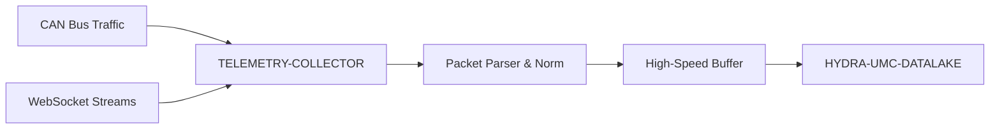

<!-- =============================================================================
HYDRA-UMC-TELEMETRY-COLLECTOR - Ingestion node for CAN, WebSocket and MQTT telemetry
Copyright (C) JuanenRac (Electro Hobby 3D) <electrohobby3d@gmail.com>
GPL-3.0-or-later - see LICENSE
============================================================================= -->

<p align="center">
  
</p>

# 📡 HYDRA-UMC-TELEMETRY-COLLECTOR

<p align="center">🇺🇸 <b>English</b> | <a href="README_spa.md">🇪🇸 Español</a> | <a href="README_fra.md">🇫🇷 Français</a> | <a href="README_ita.md">🇮🇹 Italiano</a> | <a href="README_deu.md">🇩🇪 Deutsch</a> | <a href="README_zho.md">🇨🇳 简体中文</a> | <a href="README_jpn.md">🇯🇵 日本語</a> | <a href="README_por.md">🇵🇹 Português</a></p>

### 🚀 High-Throughput Ingestion Node for CAN and WebSocket Logs

<p align="center">
  
  
  
  
  
  
</p>

---

> **Safety and security status:** this ecosystem is not a certified safety system. There is no hardware E-STOP path, no firmware-enforced limits or interlocks and no verified motion command yet; firmware images are checked with CRC-32 and an Ed25519 signature, and a release build refuses the published development keys (the tool heads and expansion boards behind the relay still run URTC bootloaders, which take a shared-key HMAC-SHA256 instead of a signature); TLS and mutual TLS are optional and off by default; no custom board has been populated or tested yet. Read the [security baseline](https://github.com/JuanenRac/HYDRA-UMC-DOCS/blob/main/docs/SECURITY_BASELINE.md) and the [threat model](https://github.com/JuanenRac/HYDRA-UMC-DOCS/blob/main/docs/THREAT_MODEL.md) before relying on any statement here for the safety of a person.

---

## 📋 At a glance

| | |
|---|---|
| Version | `0.1.8` |
| Maturity | Functional |
| Tests | 138 (`go test ./...`) |
| Stack | Go / CAN/WebSocket parsers / bounded FIFO buffer / HTTP API |
| Target | The Raspberry Pi CM5 of a HYDRA-UMC cell |
| On real hardware | Not yet: no run on real hardware is recorded for this version |

**Jump to:** [Overview](#-overview) · [Architecture](#-architecture) · [Security & Safety](#-security--safety) · [Configuration](#-configuration) · [Quick start](#-quick-start) · [Testing](#-testing) · [Troubleshooting](#-troubleshooting) · [Repository Structure](#-repository-structure) · [Related Projects](#-related-projects)

## 🚦 Project status

Each line is one part of this repository and the light says how far it is today. It is written from what the repository can show (tests, builds, runs), not from what is planned.

🟢 Done and verified · 🟡 Works, with known limits · 🟠 Partly done or not verified yet · 🔴 Not done or not working

| Area | State | What it means here |
|---|---|---|
| Software | 🟡 | Works for its main purpose; the honesty check above lists what is still missing |
| Tests | 🟢 | 138 automated tests, run on every change |
| Real hardware | 🔴 | Not yet: no run on real hardware is recorded for this version |
| Documentation | 🟢 | README in eight languages, checked against the manifest on every change |

## 🎯 Overview

**HYDRA-UMC-TELEMETRY-COLLECTOR** is the ingestion gateway that receives telemetry pushed to it over HTTP and writes it into the Datalake. It parses the CAN frames and WebSocket JSON messages it is given into normalized samples; it does not listen to a CAN bus itself (planned).

It normalizes and de-duplicates heterogeneous inputs, so that readings such as a motor current spike on a CAN bus could later be correlated with other series (planned: correlation with AI inference results from a Vision Node; no such inference exists yet).

### Key Features:
* 🚀 **Multi-Protocol Ingestion:** Handles CAN and WebSocket telemetry today, over a plain HTTP ingest API. *(gRPC ingestion is planned)*
* ⚡ **Throughput:** built for the factory's telemetry, not for a bus capture: with the defaults the collector delivers up to 250 samples per second (a batch of 500 every 2 s, in one batch request towards HYDRA-UMC-DATALAKE, or one request per sample when that datalake has no batch route or with `-datalake-batch=false`); beyond that the buffer fills up and ingestion answers `503`.
* 🧬 **Data Normalization:** Translates raw binary packets into a standardized JSON format. *(Protobuf output is planned, not implemented)*
* 🛡️ **Buffered Delivery:** a sample the collector accepted is not discarded during an outage of the database or the network: the batch being delivered keeps its place, and a full buffer refuses new samples (`503`) instead of dropping old ones. The buffer lives in memory, so restarting the collector loses what it holds.
* 🔁 **Reconnect-Safe Deduplication:** An optional per-producer sequence number, tracked in a bounded reorder window, so a device that reconnects and resends its last few unacked messages never inflates ingest counts. *(implemented)*
* 🧭 **Plausible input:** a timestamp in seconds instead of milliseconds, or more than 5 minutes ahead of the clock (`-max-future-skew`), and a `sourceId` that is too long or has invisible characters are refused (`400`); a producer whose counter starts over after a restart is recognised (`producerResets` in `GET /stats`) instead of having its new samples rejected as duplicates. *(implemented)*
* 🩺 **Real Failure Diagnosis:** Every flush failure is classified as the sink genuinely rejecting the data vs. a transport problem - exposed in `GET /stats` for real operational visibility. *(implemented)*
* 🧮 **Finite Field Validation:** An empty field name or a `NaN`/`Infinity`/`-Infinity` numeric value is rejected (`400`) before it ever reaches the buffer or a sink - CAN decoding runs through the exact same `Sample.Validate()` check as JSON ingestion. *(implemented)*
* 📊 **Prometheus Metrics:** `GET /metrics` exposes the same live ingestion/drop-rate counters `GET /stats` tracks (ingested, dropped, quarantined, transport vs. invalid-data flush failures, buffer occupancy) in real Prometheus text exposition format. *(implemented)*
* 🧰 **Outages, priorities and protected metrics (all optional):** `-spool <file>` keeps the samples of a long datalake outage on disk (bounded by `-spool-max-bytes`) and replays them first when it answers again; `-priority kind=level,...` lets a full buffer drop the least important queued sample for a more important one (counted in `evicted`); `-datalake-permanent-statuses 401,403,404` discards instead of retrying for ever; `-metrics-token` makes `GET /stats` and `GET /metrics` require a bearer token. They report the latency of the last and the slowest flush and the age of the oldest buffered sample. All are off by default. *(implemented)*
* 📉 **Downsampling per kind (optional, off by default):** `-downsample kind=intervalMs[:function]` folds the samples of a high-frequency kind into one sample per time bucket and source (mean, min, max, last or sum of every field) before they are buffered. A closed bucket is never lost when the buffer is full, open buckets are delivered on shutdown, and `/stats` and `/metrics` count the folded samples.

## 🧩 Role in HYDRA-UMC

**HYDRA-UMC-TELEMETRY-COLLECTOR** takes in telemetry from CAN frames, WebSocket messages and the MQTT state of the bridges, drops the duplicates of a resend, keeps a bounded buffer and delivers batches to `HYDRA-UMC-DATALAKE`, with an optional on-disk spool for outages. Without a datalake it prints what it would have written.

## 🏛️ Architecture

<p align="center">
  
</p>

<details>
<summary>Text version of the diagram (Mermaid)</summary>



</details>

### ARCHITECTURE & DESIGN DECISIONS

* **Why `src/` is the Go module root, not the repo root.** Keeps the installable module's own files (`main.go`, `version.go`, `go.mod`) separate from repo-root tooling (`bump_version.py`, `docker-compose.yml`) - `go build ./...` runs from inside `src/`, not the repo root.
* **Why collection is separate from HYDRA-UMC-DATALAKE itself.** Collection (polling HYDRA-UMC-SERVER, buffering, batching writes) is an I/O-bound concern distinct from storage/query - keeping it a separate process means a collector restart or backpressure spike doesn't touch the datalake's own query path.
* **Why a failed sink write requeues the batch instead of dropping it - except the one sample that will never succeed.** `src/collector` is what actually earns the "Buffered Delivery: zero data loss" claim: `FlushOnce` only removes a drained batch from the buffer once `Sink.Write` confirms it, and puts it straight back at the front on a transport-level failure - a real outage retries the same samples, it doesn't lose them. The one exception is a sample the sink itself PERMANENTLY rejected as invalid (see `sink.InvalidDataError` below) - requeuing that one unconditionally used to put it right back at the front forever, blocking every valid sample behind it; it's now quarantined (dropped, counted in `GET /stats`'s `quarantined`) instead, while the rest of the batch is still requeued normally. The buffer (`src/buffer`) is still bounded, though - an outage that outlasts its capacity does drop the oldest excess, a real, honest limit rather than a promise of infinite memory.
* **Why CAN and WebSocket both parse into the same `Sample` shape.** `src/telemetry` normalizes both heterogeneous sources into one struct before anything touches the buffer or the sink - the actual mechanism behind "a motor current spike on CAN correctly correlated with a Vision Node result": neither downstream stage needs to know which protocol a sample arrived over.
* **Why the CAN wire format is this project's own v0 convention, not the ecosystem's real CAN IDs yet.** The real CAN ID tables live in HYDRA-UMC's and URTC's own firmware docs - integrating against them for real is future work, not something to guess at without that reference open.
* **Why `DatalakeSink` writes one sample per HTTP request.** HYDRA-UMC-DATALAKE's `POST /ingest` takes one sample, so a "batch write" is really N requests, in order, stopping at the first failure. `PartialWriteError` says how many were confirmed (`202`) and only the rest is retried; a sample the sink rejects as invalid (`400`, or `413`) is the only one discarded, and what comes after it is retried. A duplicate row can only appear if DATALAKE accepted a request and the answer was lost, and DATALAKE keeps one value per (source, kind, field, timestamp), so a resend overwrites instead of duplicating.
* **How this fits the rest of the ecosystem.** A sibling service under HYDRA-UMC-DATALAKE: it receives the telemetry that producers push to it over HTTP and writes it into the shared time-series store. It does not poll anything, and nothing in the ecosystem sends it data yet: a producer (a subscription to the Server's robot deltas, a SocketCAN reader on the CM5) is still to be written.
* **Why deduplication is a separate `dedup` package, keyed on an optional `Sequence`, not a hash of the sample's own content.** A real reconnect resends the identical bytes, so content-hashing would work for that case - but it would also silently swallow two genuinely different samples that happen to share every field (e.g. two `0.0` readings a second apart). A per-producer sequence number is what a real device already has to track its own unacked messages, so reusing it is the honest, real signal - not a guess derived from data that doesn't actually promise uniqueness. `Sequence == 0`/omitted opts a producer out entirely, so nothing about pre-existing behavior changed for a device that doesn't send one.
* **Why `sink.InvalidDataError` carries the rejected sample's own batch `Index`.** Found while auditing the code (P1): `DatalakeSink.Write` sends one sample per HTTP request and stops at the first failure, so when DATALAKE returns a real HTTP 400 for one specific sample, `Write` stamps that sample's position in the batch onto the error before returning it. `FlushOnce` uses this to quarantine (permanently drop, never requeue) exactly that one sample - retrying identical rejected bytes can never succeed - while still requeuing the rest of the batch normally, instead of the whole batch being retried (and re-blocked) forever behind one poisoned sample. `GET /stats`'s `quarantined` counts every sample discarded this way, separate from `invalidDataErrors` (flush attempts, not samples) and from `dropped` (a full-buffer capacity limit, not a permanent rejection) - so nothing about this is a silent discard, and `invalidDataErrors` vs. `transportErrors` still lets an operator tell "DATALAKE is rejecting our data" apart from "the network to DATALAKE is down" without guessing from logs.

## 🔒 Security & Safety

| Threat | Defence | Where |
|---|---|---|
| Anyone on the network feeding the ingest routes | With a non-loopback `-addr` and no token the collector refuses to start unless `-allow-anonymous` is given; the token comes from `HYDRA_UMC_TELEMETRY_COLLECTOR_TOKEN` | `src/guard.go` |
| Samples stamped in the far future, or a flood of sources | A sample more than 5 minutes ahead of the clock is refused (`-max-future-skew`), source ids stop at 128 characters, request bodies at 1 MiB, and the deduplication table at 10 000 sources | `src/telemetry/sample.go`, `src/api/api.go`, `src/dedup/dedup.go` |
| Credentials for the broker travelling in the clear | A user name and password for a broker on another machine need `tls://`, or the explicit `-mqtt-allow-plaintext`; the password comes from a file or `HYDRA_UMC_TELEMETRY_MQTT_PASSWORD`, never from a flag | `src/main.go`, `src/mqttin/client.go` |

## ⚙️ Configuration

Everything is a flag; the secrets can also come from the environment.

| Variable | Default | What it sets |
|---|---|---|
| `-addr` | `127.0.0.1:8092` | address of the HTTP API |
| `-buffer` | `10000` | samples held while waiting for delivery |
| `-flush-interval` | `2s` | how often the buffer is flushed |
| `-batch-size` | `500` | most samples per flush |
| `-datalake-url` | none | datalake to write to; empty prints to standard output |
| `-token` / `HYDRA_UMC_TELEMETRY_COLLECTOR_TOKEN` | none | bearer token the ingest routes require |
| `-metrics-token` / `HYDRA_UMC_TELEMETRY_COLLECTOR_METRICS_TOKEN` | none | token that `GET /stats` and `GET /metrics` require |
| `-datalake-token` / `HYDRA_UMC_DATALAKE_TOKEN` | none | token sent to the datalake with every sample |
| `-spool`, `-spool-max-bytes` | off; 256 MiB | file that holds the samples of a datalake outage, and its size cap |
| `-mqtt-url` | none | broker to read bridge state from; empty leaves MQTT input off |

## 🚀 Quick start

Requires Go 1.24 or newer.

```bash
./build.sh  # Linux, macOS (build.bat on Windows)
./run.sh -addr 127.0.0.1:8092
./run.sh -addr 127.0.0.1:8092 -datalake-url http://localhost:8095 -spool spool.jsonl
```

## 🧪 Testing

138 automated tests run with `cd src && go test ./...`. They need no hardware and nothing outside this machine.

The CI runs `HYDRA_UMC_CI=1 python tools/ci_validate.py`, which checks the manifest, the documents, the eight READMEs and the pictures.

## 🏗️ Build & Release

Requires Go >= 1.21. A real ingestion pipeline with an HTTP API, not just a
skeleton that compiles.

```bash
# Linux/macOS
./build.sh
./run.sh -addr 127.0.0.1:8092 -datalake-url http://localhost:8095

# Windows
build.bat
run.bat -addr 127.0.0.1:8092 -datalake-url http://localhost:8095
```

`build` never changes the version (only `python tools/hydra_project_tool.py bump` raises it) and compiles the Go module in
`src/` into `build/telemetry-collector(.exe)`. `run` executes the compiled
binary, forwarding any flags, and starts listening for real traffic.
`-datalake-url` points flushed batches at a real, running
HYDRA-UMC-DATALAKE instance's `POST /ingest` (`sink.DatalakeSink`) -
omit it to print flushed samples to stdout instead
(`sink.ConsoleSink`), useful for running this collector standalone.

By default the collector listens on loopback only and its ingest routes are open to local callers. To listen on a network address, give it a bearer token (`-token`, or `HYDRA_UMC_TELEMETRY_COLLECTOR_TOKEN`; at least 16 characters): `POST /ingest/can` and `POST /ingest/ws` then require `Authorization: Bearer <token>` (`/stats` and `/metrics` stay open so a local scraper needs no secret). A non-loopback `-addr` with no token is refused at startup unless `-allow-anonymous` is passed. A request body is capped at 1 MiB (`413` beyond it) and the HTTP server applies read, write and idle timeouts.

**Reading the bridges from MQTT.** With `-mqtt-url tcp://127.0.0.1:1883` (or `tls://broker:8883`, with `-mqtt-ca-file` for a private authority) the collector also subscribes to `hydra/bridges/+/state` and `hydra/bridges/+/availability` (`-mqtt-topics`) and turns each message into a sample: `bridge_state` with every number and flag of the state (one level of nesting) and a `machine_state.<value>` flag, stamped with the `observed_at` of the bridge, and `bridge_availability` with `online` 1 or 0. A retained state older than `-mqtt-max-age` (default 2 minutes) is the memory of the broker, not a reading, and is skipped. The user name comes from `-mqtt-username` or `HYDRA_UMC_TELEMETRY_MQTT_USER` and the password from `-mqtt-password-file` or `HYDRA_UMC_TELEMETRY_MQTT_PASSWORD`; credentials over a plain connection to another machine are refused unless `-mqtt-allow-plaintext` is passed. The input is off by default and `GET /stats` reports its connection and counts under `mqtt`. Not yet tried against the real broker of the ecosystem.

```bash
# Ingest a WebSocket-style telemetry sample
curl -X POST localhost:8092/ingest/ws \
  -d '{"sourceId":"robot-1","kind":"motor_temp","timestamp":1700000000000,"fields":{"value":42.5}}'

# Ingest a CAN frame (8 bytes, base64 - see src/telemetry/can.go for the wire format)
curl -X POST localhost:8092/ingest/can \
  -d '{"arbitrationId":7,"data":"AQAAUEEAAAA="}'

# Check what the collector has ingested/flushed/dropped
curl localhost:8092/stats
```

```bash
cd src && go test ./...   # telemetry (CAN round-trip, WS validation),
                           # buffer (bounded FIFO, backpressure, requeue),
                           # collector (the actual "don't lose data on a
                           # sink outage" behavior), and api (real HTTP
                           # round-trips via httptest)
```

## 🩺 Troubleshooting

| You see | Because | Do |
|---|---|---|
| HTTP 503 | The buffer is full and no priority lets a queued sample be dropped | Check the datalake, add `-spool`, raise `-buffer` or set `-priority` |
| HTTP 401 | A token is set and the request has none or a wrong one | Send `Authorization: Bearer <token>` |

## 📂 Repository Structure

<p align="center">
  
</p>

<details>
<summary>Text version of the tree</summary>

```text
HYDRA-UMC-TELEMETRY-COLLECTOR/
├── src/                       Go module
│   ├── go.mod                 Module definition
│   ├── version.go             const Version = "X.Y.Z"
│   ├── main.go                Entry point: wires everything, starts the HTTP API
│   ├── guard.go               Startup guard: loopback-only unless a bearer token is set
│   ├── guard_test.go          Tests of the loopback-only start-up guard
│   ├── mqttin/                Turns what the bridges say on MQTT (state, availability) into telemetry samples
│   ├── telemetry/             Sample type + CAN/WebSocket parsers (normalization)
│   ├── buffer/                Bounded, backpressure-reporting FIFO (Ring)
│   ├── dedup/                 Real per-producer sequence deduplication (reorder window)
│   ├── collector/             Orchestrates ingest+flush, retries on sink failure, dedup
│   ├── sink/                  Where flushed batches go (the data lake over HTTP, or the console), transport/invalid-data classification
│   ├── spool/                 Optional on-disk queue that holds the samples of a long sink outage
│   └── api/                   Plain JSON/HTTP handlers wrapping the collector
├── docs/                      documents of the project
├── images/                    Media and diagrams
├── systemd/                   service unit
├── tools/                     project tools and CI checks
├── .github/                   CI workflow and issue templates
├── bump_version.py            explicit version bump
├── bump_manifest_version.py   Syncs hydra-umc.project.json's version to the native one (--sync)
├── build.sh / build.bat       Validate and build (building never changes the version)
├── run.sh / run.bat           Real run: executes the compiled binary
├── CHANGELOG.md               what changed in each version
├── build-test.sh              non-mutating build check
├── hydra-umc.project.json     manifest: version, maturity, family
└── test.sh                    runs the tests
```

</details>

## 🗺️ Roadmap & Known limits

**Known limits today**

* **Phase 1:** Datalake high-throughput ingestion and indexing for historical analysis.
* **Phase 2:** Telemetry collector edge-compression and secure transmission protocols.
* **Phase 3:** Anomaly detection using unsupervised learning and motor vibration analysis.
* **Phase 4:** Compression-on-the-fly for massive log ingestion and multi-protocol optimization.

## 🌍 Languages

This README and the documents of the repository exist in eight languages: English, Spanish, German, French, Italian, Japanese, Chinese and Portuguese (Portugal). They are written together and checked in the CI so that the eight files have the same sections and the same links. This repository has no screen or message catalogue of its own, so there are no interface strings to translate.

## 🔗 Related Projects

This project is part of the HYDRA-UMC robotics ecosystem by the same author (JuanenRac / Electro Hobby 3D). Worth knowing about, since a request might actually be about one of these rather than this repository.

**Parent Project**
- **[HYDRA-UMC-DATALAKE](https://github.com/JuanenRac/HYDRA-UMC-DATALAKE)** — real sqlite3-backed time-series store with a real ingest/query HTTP API; the parent this repo is one specific analytics service of, within its own data-and-analytics layer.

**Sibling Projects** — the other analytics services of HYDRA-UMC-DATALAKE's own data-and-analytics layer
- **[HYDRA-UMC-ANOMALY-DETECTOR](https://github.com/JuanenRac/HYDRA-UMC-ANOMALY-DETECTOR)** — real FFT + statistical baseline anomaly detector with drift monitoring.
- **[HYDRA-UMC-PRODUCTION-REPORTS](https://github.com/JuanenRac/HYDRA-UMC-PRODUCTION-REPORTS)** — real OEE/availability calculation over DATALAKE history, with reproducible CSV export.

**Directly Related**
- **[HYDRA-UMC-SERVER](https://github.com/JuanenRac/HYDRA-UMC-SERVER)** — the real headless backend (REST/WebSocket) every control client actually talks to — the source of the logs this project ingests.
- **[HYDRA-UMC](https://github.com/JuanenRac/HYDRA-UMC)** — the robot-arm motherboard design: CM5 host + dual-core STM32H745, meant to orchestrate up to 8 tool arms over CAN-OTA/SPI-OTA (firmware at an early stage; no populated board yet); today it uses its own v0 convention, honestly tracked as future work rather than claimed as done.
- **[URTC](https://github.com/JuanenRac/URTC)** — firmware for the physical Universal Robot Tool Controller PCB, 25+ tool profiles over CAN bus — the real CAN ID table this project's own CAN wire format is meant to eventually integrate against; today it uses its own v0 convention, honestly tracked as future work rather than claimed as done.

**Also Part of the Ecosystem**

*Core Hardware & Platform*
- **[HYDRA-UMC-OS](https://github.com/JuanenRac/HYDRA-UMC-OS)** — reproducible Raspberry Pi OS product layer for the CM5: read-only agent, validated config/profiles, WiFi first-contact provisioning.
- **[HYDRA-UMC-SDK](https://github.com/JuanenRac/HYDRA-UMC-SDK)** — the shared JSON-Schema contract and software job-gate boundary every bridge validates its commands against (not a certified safety function).
- **[HYDRA-UMC-CONNECTOR-HUB](https://github.com/JuanenRac/HYDRA-UMC-CONNECTOR-HUB)** — declarative adapter-manifest registry and validator for external-machine connectors; extends the SDK's own contract idea to external machines without replacing the industrial-gateway projects.

*Core Backend & Clients*
- **[HYDRA-UMC-STUDIO](https://github.com/JuanenRac/HYDRA-UMC-STUDIO)** — web control dashboard with real-time multi-robot 3D visualization.
- **[HYDRA-UMC-SUITE](https://github.com/JuanenRac/HYDRA-UMC-SUITE)** — desktop (PySide6) swarm command center for multiple servers at once, packaged as a standalone executable.
- **[HYDRA-UMC-ANDROID-CONTROL](https://github.com/JuanenRac/HYDRA-UMC-ANDROID-CONTROL)** — native Android control app with biometric login and a paired Wear OS companion.
- **[HYDRA-UMC-IOS-CONTROL](https://github.com/JuanenRac/HYDRA-UMC-IOS-CONTROL)** — iOS/iPadOS control app (Flutter) with real-time WebSocket sync.
- **[HYDRA-UMC-DSI](https://github.com/JuanenRac/HYDRA-UMC-DSI)** — native touch UI for the onboard 7" DSI touchscreen, embedded on the CM5 itself.
- **[HYDRA-UMC-EDITOR-URDF](https://github.com/JuanenRac/HYDRA-UMC-EDITOR-URDF)** — desktop graphical URDF creator/editor that pushes finished models into STUDIO's own catalog.
- **[HYDRA-UMC-EDITOR-STL](https://github.com/JuanenRac/HYDRA-UMC-EDITOR-STL)** — desktop STL model editor, transforming/replacing/removing/adding real parts in the same model catalog HYDRA-UMC-EDITOR-URDF also edits.
- **[HYDRA-UMC-BRIDGE-AMR](https://github.com/JuanenRac/HYDRA-UMC-BRIDGE-AMR)** — coordination boundary for AGV/AMR fleets via a VDA 5050 MQTT publisher (tested against an emulated fleet only).
- **[HYDRA-UMC-BRIDGE-CNC](https://github.com/JuanenRac/HYDRA-UMC-BRIDGE-CNC)** — high-level CNC-cell coordinator with GRBL status/control-byte access (tested against an emulator only).
- **[HYDRA-UMC-BRIDGE-DROIDS](https://github.com/JuanenRac/HYDRA-UMC-BRIDGE-DROIDS)** — coordination boundary for legged/humanoid droids, with a Boston Dynamics Spot command sender (tested against an emulator only).
- **[HYDRA-UMC-BRIDGE-LASER](https://github.com/JuanenRac/HYDRA-UMC-BRIDGE-LASER)** — laser-cell coordinator reading 3 key/enclosure/interlock GPIO signals (tested against a fake chip only; it cannot arm or fire a laser).
- **[HYDRA-UMC-BRIDGE-OPENPNP](https://github.com/JuanenRac/HYDRA-UMC-BRIDGE-OPENPNP)** — safe high-level board-flow coordinator for OpenPnP pick-and-place.
- **[HYDRA-UMC-BRIDGE-PRINTER3D](https://github.com/JuanenRac/HYDRA-UMC-BRIDGE-PRINTER3D)** — safe coordination boundary for Moonraker/Klipper 3D printers, with real gated job commands.
- **[HYDRA-UMC-BRIDGE-ROS2](https://github.com/JuanenRac/HYDRA-UMC-BRIDGE-ROS2)** — coordinator with a lazily imported rclpy ROS 2 transport (not yet run against a ROS 2 installation).
- **[HYDRA-UMC-BRIDGE-UAV](https://github.com/JuanenRac/HYDRA-UMC-BRIDGE-UAV)** — coordination boundary for camera-equipped UAVs, with a MAVLink command sender (tested against an emulator only).

*URTC Tool Platform*
- **[URTC-FLASHER](https://github.com/JuanenRac/URTC-FLASHER)** — desktop GUI flashing tool for URTC boards, CAN-OTA plus full-chip SWD/JTAG.
- **[URTC-TESTER](https://github.com/JuanenRac/URTC-TESTER)** — desktop live CAN-bus diagnostic tool for URTC boards, one panel per tool profile.
- **[URTC-WEB-STUDIO](https://github.com/JuanenRac/URTC-WEB-STUDIO)** — browser-based alternative to URTC-TESTER via the Web Serial API, no local install needed.
- **[URTC-GATEWAY](https://github.com/JuanenRac/URTC-GATEWAY)** — gateway in front of the URTC CAN bus: an allowed list of identifiers, a rate limit and a session key; software tested on a computer, not yet on a real bus.

*Vision AI Node (Hailo-8)*
- **[HYDRA-UMC-VISION-NODE](https://github.com/JuanenRac/HYDRA-UMC-VISION-NODE)** — integration hub for the Hailo-8 vision pipeline, with a real per-stage hardware-readiness check.
- **[HYDRA-UMC-DETECTION-HEF](https://github.com/JuanenRac/HYDRA-UMC-DETECTION-HEF)** — real compiled-model registry with Hailo-architecture/checksum safe-load verification.
- **[HYDRA-UMC-VISION-STREAMER](https://github.com/JuanenRac/HYDRA-UMC-VISION-STREAMER)** — real GStreamer pipeline + MediaMTX config generator with a real HailoRT integration boundary.
- **[HYDRA-UMC-VISUAL-SERVOING-API](https://github.com/JuanenRac/HYDRA-UMC-VISUAL-SERVOING-API)** — Position-Based Visual Servoing correction law with authorisation gated on the zone state; no camera pose estimation yet.
- **[HYDRA-UMC-SAFETY-ZONES](https://github.com/JuanenRac/HYDRA-UMC-SAFETY-ZONES)** — v0 zone-breach, calibration-freshness and E-STOP-request logic that takes object positions from a file; no detector feeds it and no physical E-STOP is wired to it yet.

*Cognitive AI Node (Hailo-10)*
- **[HYDRA-UMC-COGNITIVE-NODE](https://github.com/JuanenRac/HYDRA-UMC-COGNITIVE-NODE)** — integration hub for the Hailo-10 cognitive pipeline (LLM/VLA/voice orchestration).
- **[HYDRA-UMC-VLA-ENGINE](https://github.com/JuanenRac/HYDRA-UMC-VLA-ENGINE)** — real action-token encoding/decoding and trajectory generation for a Vision-Language-Action model.
- **[HYDRA-UMC-VOICE-UI](https://github.com/JuanenRac/HYDRA-UMC-VOICE-UI)** — real voice front-end (VAD + intent parser) with a bounded, confirmation-gated Watch relay.
- **[HYDRA-UMC-SEMANTIC-PLANNER](https://github.com/JuanenRac/HYDRA-UMC-SEMANTIC-PLANNER)** — real rule-based task decomposition and semantic error recovery over MCU error codes.
- **[HYDRA-UMC-DOCS-QA](https://github.com/JuanenRac/HYDRA-UMC-DOCS-QA)** — real stdlib-only TF-IDF document search over this ecosystem's own Markdown docs.
- **[HYDRA-UMC-LOCAL-TECHNICIAN](https://github.com/JuanenRac/HYDRA-UMC-LOCAL-TECHNICIAN)** — local, policy-gated AI maintenance technician for the ecosystem itself - observes, diagnoses and proposes fixes; the two highest risk levels are deliberately not implemented yet.

*Orchestration & Swarm*
- **[HYDRA-UMC-ORCHESTRATOR](https://github.com/JuanenRac/HYDRA-UMC-ORCHESTRATOR)** — integration hub with a real gRPC/Protobuf health-report contract and mission state machine.
- **[HYDRA-UMC-JOB-DISPATCHER](https://github.com/JuanenRac/HYDRA-UMC-JOB-DISPATCHER)** — real priority-based job queue with deduplication, over a real HTTP API.
- **[HYDRA-UMC-NODE-HEALING](https://github.com/JuanenRac/HYDRA-UMC-NODE-HEALING)** — real gRPC-based fleet health watchdog with retry/backoff and identity-mismatch detection.
- **[HYDRA-UMC-PATH-PLANNER-3D](https://github.com/JuanenRac/HYDRA-UMC-PATH-PLANNER-3D)** — real RRT-based 3D path planner with real obstacle/workspace collision validation.
- **[HYDRA-UMC-SWARM-SYNC](https://github.com/JuanenRac/HYDRA-UMC-SWARM-SYNC)** — real CRDT LWW-Element-Map state sync, property-tested for multi-cell convergence.

*Digital Twin & Simulation*
- **[HYDRA-UMC-TWIN](https://github.com/JuanenRac/HYDRA-UMC-TWIN)** — integration hub for the digital-twin engine, with a real version-compatibility sync contract.
- **[HYDRA-UMC-HIL-BRIDGE](https://github.com/JuanenRac/HYDRA-UMC-HIL-BRIDGE)** — hardware-in-the-loop router with a software collision interlock between simulation and real hardware (tested without real hardware).
- **[HYDRA-UMC-PHYSICS-REPLICA](https://github.com/JuanenRac/HYDRA-UMC-PHYSICS-REPLICA)** — real forward kinematics and joint-limit validation over a real URDF subset.
- **[HYDRA-UMC-SYNTHETIC-DATA-GEN](https://github.com/JuanenRac/HYDRA-UMC-SYNTHETIC-DATA-GEN)** — real procedural 2D scene generator with YOLO/COCO annotation export.

*Industrial Gateway*
- **[HYDRA-UMC-GATEWAY-INDUSTRIAL](https://github.com/JuanenRac/HYDRA-UMC-GATEWAY-INDUSTRIAL)** — integration hub relaying to industrial protocols, with a real command allowlist/backpressure layer.
- **[HYDRA-UMC-OPCUA-SERVER](https://github.com/JuanenRac/HYDRA-UMC-OPCUA-SERVER)** — real OPC-UA address space, verified with a real binary-protocol client session.
- **[HYDRA-UMC-MQTT-BROKER](https://github.com/JuanenRac/HYDRA-UMC-MQTT-BROKER)** — real MQTT broker with optional per-client authentication and topic ACLs.
- **[HYDRA-UMC-MTCONNECT-ADAPTER](https://github.com/JuanenRac/HYDRA-UMC-MTCONNECT-ADAPTER)** — real MTConnect `/probe` and `/current` XML endpoints with degraded-mode output.

*Complementary Tools & Ecosystem Operations*
- **[HYDRA-UMC-DASHBOARD-AI](https://github.com/JuanenRac/HYDRA-UMC-DASHBOARD-AI)** — Smart Summaries and Anomaly Highlighting panels over DATALAKE/ANOMALY-DETECTOR, with an honest statistical fallback.
- **[HYDRA-UMC-TOOL-CLI](https://github.com/JuanenRac/HYDRA-UMC-TOOL-CLI)** — fleet CLI with a real, stable exit-code contract, a genuine live client of HYDRA-UMC-SERVER's own API.
- **[HYDRA-UMC-WATCH](https://github.com/JuanenRac/HYDRA-UMC-WATCH)** — WearOS companion app with haptic alert patterns and a paired-phone voice relay (not yet run on a physical watch).
- **[URTC-SMART-RACK](https://github.com/JuanenRac/URTC-SMART-RACK)** — firmware for a board-mounting rack with real tool-ID decoding and Smart Idle pre-heating logic.
- **[URTC-VISION-TOOL](https://github.com/JuanenRac/URTC-VISION-TOOL)** — firmware plus a real Python vision companion for a thermal/RGB inspection tool head.
- **[HYDRA-UMC-UPDATER](https://github.com/JuanenRac/HYDRA-UMC-UPDATER)** — administrative desktop tool that discovers, clones and updates every repo in this ecosystem.
- **[HYDRA-UMC-OS-REBUILDER](https://github.com/JuanenRac/HYDRA-UMC-OS-REBUILDER)** — Windows/Linux desktop tool that builds a ready-to-flash CM5 image pre-loaded with the ecosystem's most current versions, with Raspberry-Pi-Imager-style first-boot Wi-Fi/user/SSH configuration.
- **[HYDRA-UMC-OPS-AGENT](https://github.com/JuanenRac/HYDRA-UMC-OPS-AGENT)** — maintenance-incident coordinator: a low-privilege edge role collects a sanitized inventory/health snapshot, a control-plane role renders it read-only and asks an AI provider to suggest a diagnosis - never applies a patch or deploys anything.
- **[HYDRA-UMC-DEV-SERVER](https://github.com/JuanenRac/HYDRA-UMC-DEV-SERVER)** — reproducible development host (Raspberry Pi 5 / CM5) that stores the ecosystem's source and runs bounded build/test tasks under a durable queue; a dedicated dev role, explicitly not an operational CM5.

## 📚 Documentation

Where to read more:

* [Security baseline of the ecosystem](https://github.com/JuanenRac/HYDRA-UMC-DOCS/blob/main/docs/SECURITY_BASELINE.md)
* [Threat model of the ecosystem](https://github.com/JuanenRac/HYDRA-UMC-DOCS/blob/main/docs/THREAT_MODEL.md)
* [Changelog of this repository](CHANGELOG.md)
* [License of this repository](LICENSE.md)

## 🤝 Contributing & Community

* Before a pull request run `HYDRA_UMC_CI=1 py -3 tools/ci_validate.py` (or `HYDRA_UMC_CI=1 python3 tools/ci_validate.py`): it must print `CI_VALIDATION=PASS`. Do not run `build.sh` or `build.bat` for this check; building is not a check.
* The eight READMEs are written from one source in HYDRA-UMC-DOCS; do not edit them by hand. Change the source and write them again with `tools/make_readmes.py`.
* Do not state in a README what has not run: say "simulated" or "not tried on hardware" where that is the truth.
* See [CONTRIBUTING.md](CONTRIBUTING.md), the [code of conduct](CODE_OF_CONDUCT.md), [SECURITY.md](SECURITY.md) and [SUPPORT.md](SUPPORT.md).

## 👤 AUTHOR

**JuanenRac (Electro Hobby 3D)** · electrohobby3d@gmail.com

## 📜 LICENSE

GPL-3.0-or-later - [LICENSE](LICENSE).
