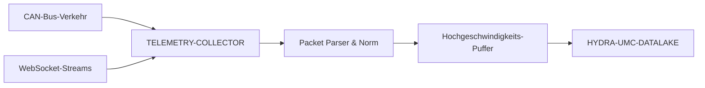

<!-- =============================================================================
HYDRA-UMC-TELEMETRY-COLLECTOR - Ingestion node for CAN, WebSocket and MQTT telemetry
Copyright (C) JuanenRac (Electro Hobby 3D) <electrohobby3d@gmail.com>
GPL-3.0-or-later - see LICENSE
============================================================================= -->

<p align="center">
  
</p>

# 📡 HYDRA-UMC-TELEMETRY-COLLECTOR

<p align="center"><a href="README.md">🇺🇸 English</a> | <a href="README_spa.md">🇪🇸 Español</a> | <a href="README_fra.md">🇫🇷 Français</a> | <a href="README_ita.md">🇮🇹 Italiano</a> | 🇩🇪 <b>Deutsch</b> | <a href="README_zho.md">🇨🇳 简体中文</a> | <a href="README_jpn.md">🇯🇵 日本語</a> | <a href="README_por.md">🇵🇹 Português</a></p>

### 🚀 High-Throughput-Ingestion-Knoten für CAN- und WebSocket-Logs

<p align="center">
  
  
  
  
  
  
</p>

---

> **Stand von Sicherheit (Safety) und Security:** Dieses Ökosystem ist kein zertifiziertes Sicherheitssystem. Es gibt noch keinen Hardware-E-STOP-Pfad, keine von der Firmware durchgesetzten Grenzen oder Verriegelungen und keinen verifizierten Bewegungsbefehl; Firmware-Images werden mit CRC-32 und einer Ed25519-Signatur geprüft, und ein Release-Build verweigert die veröffentlichten Entwicklungsschlüssel (die Werkzeugköpfe und Erweiterungsplatinen hinter dem Relais laufen noch mit URTC-Bootloadern, die statt einer Signatur ein HMAC-SHA256 mit gemeinsamem Schlüssel verwenden); TLS und gegenseitiges TLS sind optional und standardmäßig aus; noch keine eigene Platine wurde bestückt oder getestet. Lesen Sie die [Sicherheitsbasis](https://github.com/JuanenRac/HYDRA-UMC-DOCS/blob/main/docs/SECURITY_BASELINE.md) und das [Bedrohungsmodell](https://github.com/JuanenRac/HYDRA-UMC-DOCS/blob/main/docs/THREAT_MODEL.md), bevor Sie sich für die Sicherheit einer Person auf eine Aussage hier verlassen.

---

## 📋 Auf einen Blick

| | |
|---|---|
| Version | `0.1.8` |
| Reifegrad | Funktionsfähig |
| Tests | 138 (`go test ./...`) |
| Technik | Go / CAN/WebSocket parsers / bounded FIFO buffer / HTTP API |
| Ziel | Der Raspberry Pi CM5 einer HYDRA-UMC-Zelle |
| Auf echter Hardware | Noch nicht: für diese Version ist kein Lauf auf echter Hardware vermerkt |

**Springe zu:** [Überblick](#-überblick) · [Architektur](#-architektur) · [Sicherheit und Schutz](#-sicherheit-und-schutz) · [Konfiguration](#-konfiguration) · [Schnellstart](#-schnellstart) · [Tests](#-tests) · [Fehlerbehebung](#-fehlerbehebung) · [Struktur des Repositorys](#-struktur-des-repositorys) · [Verwandte Projekte](#-verwandte-projekte)

## 🚦 Projektstatus

Jede Zeile ist ein Teil dieses Repositorys, und die Ampel sagt, wie weit er heute ist. Sie beruht auf dem, was das Repository zeigen kann (Tests, Builds, Läufe), nicht auf dem, was geplant ist.

🟢 Fertig und überprüft · 🟡 Funktioniert, mit bekannten Grenzen · 🟠 Teilweise fertig oder noch nicht überprüft · 🔴 Nicht gemacht oder funktioniert nicht

| Bereich | Stand | Was das hier bedeutet |
|---|---|---|
| Software | 🟡 | Funktioniert für seinen Hauptzweck; die Ehrlichkeitsprüfung oben nennt, was noch fehlt |
| Tests | 🟢 | 138 automatische Tests, bei jeder Änderung ausgeführt |
| Echte Hardware | 🔴 | Noch nicht: für diese Version ist kein Lauf auf echter Hardware vermerkt |
| Dokumentation | 🟢 | README in acht Sprachen, bei jeder Änderung gegen das Manifest geprüft |

## 🎯 Überblick

**HYDRA-UMC-TELEMETRY-COLLECTOR** ist das Ingest-Gateway, das per HTTP an es gesendete Telemetrie entgegennimmt und in den Datalake schreibt. Es wandelt CAN-Frames und WebSocket-JSON-Nachrichten, die es erhält, in normalisierte Messwerte um; einen CAN-Bus hört es selbst noch nicht ab (geplant).

Es normalisiert und dedupliziert heterogene Eingaben, sodass Messwerte wie eine Motorstromspitze auf einem CAN-Bus später mit anderen Reihen korreliert werden könnten (geplant: Korrelation mit KI-Inferenzergebnissen eines Vision-Knotens; eine solche Inferenz gibt es noch nicht).

### Hauptmerkmale:
* 🚀 **Multi-Protokoll-Ingestion:** Verarbeitet heute CAN- und WebSocket-Telemetrie über eine einfache HTTP-Ingest-API. *(gRPC-Ingestion ist geplant)*
* ⚡ **Durchsatz:** ausgelegt für die Telemetrie der Fabrik, nicht für einen Bus-Mitschnitt: mit den Standardwerten liefert der Collector bis zu 250 Samples pro Sekunde (ein Stapel von 500 alle 2 s, in einer Stapelanfrage an HYDRA-UMC-DATALAKE, oder eine Anfrage pro Sample, wenn dieses Datalake keine Stapel-Route hat oder mit `-datalake-batch=false`); darüber füllt sich der Puffer und die Aufnahme antwortet mit `503`.
* 🧬 **Daten-Normalisierung:** Übersetzt rohe Binärpakete in ein standardisiertes JSON-Format. *(Protobuf-Ausgabe ist geplant, nicht implementiert)*
* 🛡️ **Gepufferte Auslieferung:** ein vom Collector angenommenes Sample wird bei einem Ausfall der Datenbank oder des Netzes nicht verworfen: der Stapel, der gerade ausgeliefert wird, behält seinen Platz, und ein voller Puffer weist neue Samples ab (`503`), statt alte zu verwerfen. Der Puffer liegt im Speicher; ein Neustart des Collectors verliert also seinen Inhalt.
* 🔁 **Reconnect-sichere Deduplizierung:** Eine optionale Sequenznummer pro Produzent, verfolgt in einem begrenzten Reorder-Fenster, sodass ein Gerät, das sich neu verbindet und seine letzten unbestätigten Nachrichten erneut sendet, die Ingest-Zählungen niemals aufbläht. *(implementiert)*
* 🧭 **Plausible Eingaben:** ein Zeitstempel in Sekunden statt Millisekunden oder mehr als 5 Minuten der Uhr voraus (`-max-future-skew`) sowie eine zu lange `sourceId` oder eine mit unsichtbaren Zeichen werden abgewiesen (`400`); ein Produzent, dessen Zähler nach einem Neustart von vorn beginnt, wird erkannt (`producerResets` in `GET /stats`), statt dass seine neuen Samples als Duplikate abgewiesen werden. *(implementiert)*
* 🩺 **Echte Fehlerdiagnose:** Jeder Flush-Fehler wird klassifiziert als echte Ablehnung der Daten durch den Sink gegenüber einem Transportproblem - offengelegt in `GET /stats` für echte operative Sichtbarkeit. *(implementiert)*
* 🧮 **Validierung endlicher Felder:** Ein leerer Feldname oder ein `NaN`/`Infinity`/`-Infinity`-Zahlenwert wird abgelehnt (`400`), bevor er den Puffer oder einen Sink erreicht - die CAN-Dekodierung durchläuft dieselbe `Sample.Validate()`-Prüfung wie die JSON-Aufnahme. *(implementiert)*
* 📊 **Prometheus-Metriken:** `GET /metrics` stellt dieselben Live-Zähler für Aufnahme und Verluste bereit wie `GET /stats` (aufgenommen, verworfen, in Quarantäne, Sendefehler durch Transport bzw. ungültige Daten, Pufferbelegung) im echten Prometheus-Textformat. *(implementiert)*
* 🧰 **Ausfälle, Prioritäten und geschützte Metriken (alles optional):** `-spool <Datei>` hält die Samples eines langen Datalake-Ausfalls auf der Platte (begrenzt durch `-spool-max-bytes`) und sendet sie zuerst erneut, wenn es wieder antwortet; mit `-priority art=stufe,...` darf ein voller Puffer das unwichtigste Sample für ein wichtigeres verwerfen (gezählt in `evicted`); `-datalake-permanent-statuses 401,403,404` verwirft, statt ewig zu wiederholen; `-metrics-token` verlangt für `GET /stats` und `GET /metrics` ein Bearer-Token. Gemeldet werden die Latenz des letzten und des langsamsten Sendens und das Alter des ältesten gepufferten Samples. Alles ist standardmäßig aus. *(implementiert)*

## 🧩 Rolle in HYDRA-UMC

**HYDRA-UMC-TELEMETRY-COLLECTOR** nimmt Telemetrie aus CAN-Frames, WebSocket-Nachrichten und dem MQTT-Zustand der Bridges entgegen, verwirft die Duplikate eines erneuten Sendens, hält einen begrenzten Puffer und liefert Stapel an `HYDRA-UMC-DATALAKE`, mit einem optionalen Spool auf der Platte für Ausfälle. Ohne Datalake gibt er aus, was er geschrieben hätte.

## 🏛️ Architektur

<p align="center">
  
</p>

<details>
<summary>Textversion des Diagramms (Mermaid)</summary>



</details>

### ARCHITEKTUR & DESIGNENTSCHEIDUNGEN

* **Warum `src/` die Go-Modulwurzel ist, nicht das Repo-Root.** Hält die eigenen Dateien des installierbaren Moduls (`main.go`, `version.go`, `go.mod`) getrennt von den Repo-Root-Tools (`bump_version.py`, `docker-compose.yml`) - `go build ./...` läuft von innerhalb `src/`, nicht vom Repo-Root.
* **Warum die Sammlung von HYDRA-UMC-DATALAKE selbst getrennt ist.** Sammlung (HYDRA-UMC-SERVER abfragen, puffern, Schreibvorgänge bündeln) ist ein E/A-gebundenes Anliegen, das sich von Speicherung/Abfrage unterscheidet - es als separaten Prozess zu halten bedeutet, dass ein Neustart des Collectors oder ein Gegendruck-Spitzenwert nicht den eigenen Abfragepfad des Data Lake berührt.
* **Warum ein fehlgeschlagenes Sink-Schreiben den Batch erneut einreiht, statt ihn zu verwerfen - außer dem einen Sample, das niemals erfolgreich sein wird.** `src/collector` ist das, was das Versprechen "Gepufferte Zustellung: kein Datenverlust" tatsächlich einlöst: `FlushOnce` entfernt einen abgezapften Batch erst dann aus dem Puffer, wenn `Sink.Write` ihn bestätigt, und legt ihn bei einem Transportfehler direkt wieder vorne ein - ein echter Ausfall wiederholt dieselben Samples, statt sie zu verlieren. Die einzige Ausnahme ist ein Sample, das der Sink selbst DAUERHAFT als ungültig abgelehnt hat (siehe `sink.InvalidDataError` unten) - es bedingungslos erneut einzureihen, stellte es früher für immer wieder ganz nach vorne und blockierte jedes gültige Sample dahinter; jetzt wird es stattdessen unter Quarantäne gestellt (verworfen, gezählt in `GET /stats`s `quarantined`), während der Rest des Batches wie gewohnt erneut eingereiht wird. Der Puffer (`src/buffer`) bleibt trotzdem begrenzt - ein Ausfall, der seine Kapazität übersteigt, verwirft tatsächlich die ältesten überzähligen Einträge, eine echte, ehrliche Grenze statt eines Versprechens von unendlichem Speicher.
* **Warum CAN und WebSocket beide in dieselbe `Sample`-Form geparst werden.** `src/telemetry` normalisiert beide heterogenen Quellen zu einer einzigen Struktur, bevor irgendetwas den Puffer oder den Sink berührt - der eigentliche Mechanismus hinter "ein Motorstromspitzenwert auf CAN korrekt korreliert mit einem Ergebnis eines Vision Node": keine nachgelagerte Stufe muss wissen, über welches Protokoll ein Sample eintraf.
* **Warum das CAN-Drahtformat die eigene v0-Konvention dieses Projekts ist, noch nicht die echten CAN-IDs des Ökosystems.** Die echten CAN-ID-Tabellen leben in der eigenen Firmware-Dokumentation von HYDRA-UMC und URTC - die echte Integration dagegen ist künftige Arbeit, nichts, das man ohne diese Referenz vor sich erraten sollte.
* **Warum `DatalakeSink` ein Sample pro HTTP-Anfrage schreibt.** Das `POST /ingest` von HYDRA-UMC-DATALAKE nimmt ein Sample entgegen, ein "Stapelschreiben" sind also in Wirklichkeit N Anfragen, der Reihe nach, die beim ersten Fehler anhalten. `PartialWriteError` sagt, wie viele bestätigt wurden (`202`), und nur der Rest wird wiederholt; ein Sample, das der Sink als ungültig ablehnt (`400` oder `413`), ist das einzige, das verworfen wird, und was danach kommt, wird wiederholt. Eine doppelte Zeile kann nur entstehen, wenn DATALAKE eine Anfrage angenommen hat und die Antwort verloren ging; DATALAKE hält einen Wert pro (Quelle, Art, Feld, Zeitstempel), ein erneutes Senden überschreibt also, statt zu verdoppeln.
* **Wie sich das in das restliche Ökosystem einfügt.** Ein Geschwisterdienst unter HYDRA-UMC-DATALAKE: er empfängt die Telemetrie, die Produzenten per HTTP an ihn schicken, und schreibt sie in den gemeinsamen Zeitreihenspeicher. Er fragt nichts ab, und noch sendet ihm nichts im Ökosystem Daten: ein Produzent (ein Abonnement der Roboter-Deltas des Servers, ein SocketCAN-Leser auf dem CM5) muss noch geschrieben werden.
* **Warum Deduplizierung ein separates `dedup`-Paket ist, das auf einer optionalen `Sequence` basiert, nicht auf einem Hash des Sample-Inhalts selbst.** Eine echte Reconnect sendet exakt dieselben Bytes erneut, daher würde Content-Hashing für diesen Fall funktionieren - aber es würde auch still zwei echt unterschiedliche Samples verschlucken, die zufällig alle Felder teilen (z. B. zwei `0.0`-Messwerte im Abstand einer Sekunde). Eine Sequenznummer pro Produzent ist das, was ein echtes Gerät ohnehin schon verfolgen muss, um seine eigenen unbestätigten Nachrichten im Blick zu behalten - sie wiederzuverwenden ist also das ehrliche, echte Signal, keine Vermutung, die aus Daten abgeleitet wird, die tatsächlich keine Eindeutigkeit versprechen. `Sequence == 0`/weggelassen nimmt einen Produzenten vollständig aus, sodass sich am bestehenden Verhalten für ein Gerät, das keine sendet, nichts ändert.
* **Warum `sink.InvalidDataError` den `Index` des abgelehnten Samples innerhalb des Batches trägt.** Beim Auditieren des Codes gefunden (P1): `DatalakeSink.Write` sendet ein Sample pro HTTP-Anfrage und stoppt beim ersten Fehler - wenn DATALAKE also einen echten HTTP 400 für ein bestimmtes Sample zurückgibt, markiert `Write` dessen Position im Batch auf dem Fehler selbst, bevor es ihn zurückgibt. `FlushOnce` nutzt das, um genau dieses eine Sample unter Quarantäne zu stellen (dauerhaft zu verwerfen, nie erneut einzureihen) - ein Wiederholen der identischen abgelehnten Bytes kann niemals erfolgreich sein - während der Rest des Batches weiterhin normal erneut eingereiht wird, statt dass der gesamte Batch für immer hinter einem vergifteten Sample erneut versucht (und erneut blockiert) wird. `quarantined` in `GET /stats` zählt jedes so verworfene Sample, getrennt von `invalidDataErrors` (Flush-Versuche, keine Samples) und von `dropped` (eine Kapazitätsgrenze des vollen Puffers, keine dauerhafte Ablehnung) - nichts davon ist also ein stilles Verwerfen, und `invalidDataErrors` gegenüber `transportErrors` lässt einen Operator weiterhin "DATALAKE lehnt unsere Daten ab" von "das Netzwerk zu DATALAKE ist ausgefallen" unterscheiden, ohne aus Logs raten zu müssen.

## 🔒 Sicherheit und Schutz

| Bedrohung | Abwehr | Wo |
|---|---|---|
| Jeder im Netz, der die Ingest-Routen füttert | Mit einem Nicht-Loopback-`-addr` und ohne Token startet der Collector nicht, außer `-allow-anonymous` ist gesetzt; das Token kommt aus `HYDRA_UMC_TELEMETRY_COLLECTOR_TOKEN` | `src/guard.go` |
| Messwerte mit Zeitstempel in ferner Zukunft oder eine Flut von Quellen | Ein Messwert mehr als 5 Minuten vor der Uhr wird abgelehnt (`-max-future-skew`), Quellkennungen enden bei 128 Zeichen, Bodys bei 1 MiB und die Deduplizierungstabelle bei 10 000 Quellen | `src/telemetry/sample.go`, `src/api/api.go`, `src/dedup/dedup.go` |
| Zugangsdaten des Brokers im Klartext | Benutzername und Passwort für einen Broker auf einem anderen Rechner verlangen `tls://` oder das ausdrückliche `-mqtt-allow-plaintext`; das Passwort kommt aus einer Datei oder `HYDRA_UMC_TELEMETRY_MQTT_PASSWORD`, nie aus einer Option | `src/main.go`, `src/mqttin/client.go` |

## ⚙️ Konfiguration

Alles sind Optionen; die Geheimnisse können auch aus der Umgebung kommen.

| Variable | Standard | Was sie festlegt |
|---|---|---|
| `-addr` | `127.0.0.1:8092` | Adresse der HTTP-API |
| `-buffer` | `10000` | Messwerte, die auf die Zustellung warten |
| `-flush-interval` | `2s` | wie oft der Puffer geleert wird |
| `-batch-size` | `500` | höchstens so viele Messwerte je Leerung |
| `-datalake-url` | keiner | Datalake, in das geschrieben wird; leer gibt auf die Standardausgabe aus |
| `-token` / `HYDRA_UMC_TELEMETRY_COLLECTOR_TOKEN` | keiner | Bearer-Token, das die Ingest-Routen verlangen |
| `-metrics-token` / `HYDRA_UMC_TELEMETRY_COLLECTOR_METRICS_TOKEN` | keiner | Token, das `GET /stats` und `GET /metrics` verlangen |
| `-datalake-token` / `HYDRA_UMC_DATALAKE_TOKEN` | keiner | Token, das mit jedem Messwert an den Datalake geht |
| `-spool`, `-spool-max-bytes` | aus; 256 MiB | Datei, die die Messwerte eines Datalake-Ausfalls hält, und ihre Größenobergrenze |
| `-mqtt-url` | keiner | Broker, aus dem der Bridge-Zustand gelesen wird; leer lässt den MQTT-Eingang aus |

## 🚀 Schnellstart

Benötigt Go 1.24 oder neuer.

```bash
./build.sh  # Linux, macOS (build.bat on Windows)
./run.sh -addr 127.0.0.1:8092
./run.sh -addr 127.0.0.1:8092 -datalake-url http://localhost:8095 -spool spool.jsonl
```

## 🧪 Tests

138 automatische Tests laufen mit `cd src && go test ./...`. Sie brauchen weder Hardware noch etwas außerhalb dieses Rechners.

Die CI führt `HYDRA_UMC_CI=1 python tools/ci_validate.py` aus; das prüft das Manifest, die Dokumente, die acht READMEs und die Bilder.

## 🏗️ Build und Veröffentlichung

Erfordert Go >= 1.21. Eine echte Ingestion-Pipeline mit HTTP-API, nicht nur
ein kompilierbares Skelett.

```bash
# Linux/macOS
./build.sh
./run.sh -addr 127.0.0.1:8092 -datalake-url http://localhost:8095

# Windows
build.bat
run.bat -addr 127.0.0.1:8092 -datalake-url http://localhost:8095
```

`build` ändert die Version nie (nur `python tools/hydra_project_tool.py bump` erhöht sie) und kompiliert das Go-Modul
in `src/` zu `build/telemetry-collector(.exe)`. `run` führt die
kompilierte Binärdatei aus, reicht dabei jedes Flag weiter, und beginnt,
echten Verkehr entgegenzunehmen. `-datalake-url` lenkt geleerte Batches
an eine echte, laufende HYDRA-UMC-DATALAKE-Instanz (`POST /ingest`,
`sink.DatalakeSink`) - wird es weggelassen, werden geleerte Samples
stattdessen auf stdout ausgegeben (`sink.ConsoleSink`), nützlich um
diesen Collector eigenständig auszuführen:

Standardmäßig lauscht der Collector nur auf Loopback, und seine Ingest-Routen sind für lokale Aufrufer offen. Um auf einer Netzwerkadresse zu lauschen, braucht er ein Bearer-Token (`-token` oder `HYDRA_UMC_TELEMETRY_COLLECTOR_TOKEN`; mindestens 16 Zeichen): `POST /ingest/can` und `POST /ingest/ws` verlangen dann `Authorization: Bearer <token>` (`/stats` und `/metrics` bleiben offen, damit ein lokaler Scraper kein Geheimnis braucht). Ein `-addr` außerhalb von Loopback ohne Token wird beim Start abgelehnt, außer `-allow-anonymous` wird übergeben. Ein Anfragekörper ist auf 1 MiB begrenzt (darüber `413`), und der HTTP-Server setzt Timeouts für Lesen, Schreiben und Leerlauf.

**Die Brücken über MQTT lesen.** Mit `-mqtt-url tcp://127.0.0.1:1883` (oder `tls://broker:8883`, mit `-mqtt-ca-file` für eine private Zertifizierungsstelle) abonniert der Collector zusätzlich `hydra/bridges/+/state` und `hydra/bridges/+/availability` (`-mqtt-topics`) und macht aus jeder Nachricht eine Probe: `bridge_state` mit jeder Zahl und jedem Flag des Zustands (eine Verschachtelungsebene) und einem Flag `machine_state.<Wert>`, mit dem `observed_at` der Brücke als Zeitstempel, und `bridge_availability` mit `online` 1 oder 0. Ein gehaltener Zustand, der älter als `-mqtt-max-age` (Standard 2 Minuten) ist, ist das Gedächtnis des Brokers und keine Messung und wird übersprungen. Den Benutzernamen liefert `-mqtt-username` oder `HYDRA_UMC_TELEMETRY_MQTT_USER`, das Passwort `-mqtt-password-file` oder `HYDRA_UMC_TELEMETRY_MQTT_PASSWORD`; Zugangsdaten über eine unverschlüsselte Verbindung zu einem anderen Rechner werden abgelehnt, außer mit `-mqtt-allow-plaintext`. Der Eingang ist standardmäßig aus, und `GET /stats` meldet Verbindung und Zähler unter `mqtt`. Noch nicht mit dem echten Broker des Ökosystems erprobt.

```bash
# Ein WebSocket-artiges Telemetrie-Sample einspeisen
curl -X POST localhost:8092/ingest/ws \
  -d '{"sourceId":"robot-1","kind":"motor_temp","timestamp":1700000000000,"fields":{"value":42.5}}'

# Einen CAN-Frame einspeisen (8 Bytes, base64 - siehe src/telemetry/can.go für das Format)
curl -X POST localhost:8092/ingest/can \
  -d '{"arbitrationId":7,"data":"AQAAUEEAAAA="}'

# Nachsehen, was der Collector eingelesen/geflusht/verworfen hat
curl localhost:8092/stats
```

```bash
cd src && go test ./...   # telemetry (CAN-Roundtrip, WS-Validierung),
                           # buffer (begrenzte FIFO, Gegendruck, Requeue),
                           # collector (das tatsächliche "kein Datenverlust
                           # bei einem Sink-Ausfall"-Verhalten), und api
                           # (echte HTTP-Roundtrips via httptest)
```

## 🩺 Fehlerbehebung

| Du siehst | Weil | Tu |
|---|---|---|
| HTTP 503 | Der Puffer ist voll und keine Priorität erlaubt, einen eingereihten Messwert zu verwerfen | Datalake prüfen, `-spool` setzen, `-buffer` erhöhen oder `-priority` festlegen |
| HTTP 401 | Ein Token ist gesetzt und die Anfrage hat keins oder ein falsches | `Authorization: Bearer <token>` senden |

## 📂 Struktur des Repositorys

<p align="center">
  
</p>

<details>
<summary>Textversion des Baums</summary>

```text
HYDRA-UMC-TELEMETRY-COLLECTOR/
├── src/                       Go-Modul
│   ├── go.mod                 Modul-Definition
│   ├── version.go             const Version = "X.Y.Z"
│   ├── main.go                Einstiegspunkt: verbindet alles, startet die HTTP-API
│   ├── guard.go               Startwächter: nur Loopback, außer ein Bearer-Token ist gesetzt
│   ├── guard_test.go          Tests der Start-Sperre nur für Loopback
│   ├── mqttin/                Wandelt um, was die Bridges über MQTT melden (Zustand, Verfügbarkeit), in Telemetrieproben
│   ├── telemetry/             Sample-Typ + CAN/WebSocket-Parser (Normalisierung)
│   ├── buffer/                Begrenzte FIFO mit Gegendruck-Meldung (Ring)
│   ├── dedup/                 Echte Deduplizierung per Sequenz pro Produzent (Reorder-Fenster)
│   ├── collector/             Orchestriert Ingest+Flush, wiederholt bei Sink-Fehler, Dedup
│   ├── sink/                  Wohin die abgeschickten Batches gehen (der Data Lake über HTTP oder die Konsole), Klassifizierung von Transport- und Datenfehlern
│   ├── spool/                 Optionale Warteschlange auf der Platte für die Samples eines langen Ausfalls des Ziels
│   └── api/                   Einfache JSON/HTTP-Handler, die den Collector umschließen
├── docs/                      Dokumente des Projekts
├── images/                    Medien und Diagramme
├── systemd/                   Dienst-Unit
├── tools/                     Projektwerkzeuge und CI-Prüfungen
├── .github/                   CI-Workflow und Issue-Vorlagen
├── bump_version.py            ausdrückliche Versionserhöhung
├── bump_manifest_version.py   Synchronisiert die Version von hydra-umc.project.json mit der nativen (--sync)
├── build.sh / build.bat       Validiert und baut (Bauen ändert nie die Version)
├── run.sh / run.bat           Echte Ausführung: startet die kompilierte Binärdatei
├── CHANGELOG.md               was sich in jeder Version geändert hat
├── build-test.sh              Build-Prüfung ohne Änderungen
├── hydra-umc.project.json     Manifest: Version, Reifegrad, Familie
└── test.sh                    führt die Tests aus
```

</details>

## 🗺️ Roadmap und bekannte Grenzen

**Bekannte Grenzen heute**

* **Phase 1:** Hochdurchsatz-Ingestion und Indexierung des Datalakes für historische Analysen.
* **Phase 2:** Edge-Kompression des Telemetrie-Collectors und sichere Übertragungsprotokolle.
* **Phase 3:** Anomalieerkennung mittels unüberwachtem Lernen und Motorvibrationsanalyse.
* **Phase 4:** Compression-on-the-fly für massive Log-Aufnahme und Multi-Protokoll-Optimierung.

## 🌍 Sprachen

Diese README und die Dokumente des Repositorys gibt es in acht Sprachen: Englisch, Spanisch, Deutsch, Französisch, Italienisch, Japanisch, Chinesisch und Portugiesisch (Portugal). Sie entstehen gemeinsam, und die CI prüft, dass die acht Dateien dieselben Abschnitte und dieselben Links haben. Dieses Repository hat weder eine eigene Oberfläche noch einen eigenen Meldungskatalog, es gibt also keine Oberflächentexte zu übersetzen.

## 🔗 Verwandte Projekte

Dieses Projekt ist Teil des HYDRA-UMC-Robotik-Ökosystems desselben Autors (JuanenRac / Electro Hobby 3D). Gut zu wissen, da eine Anfrage eigentlich eines dieser Projekte betreffen könnte statt dieses Repositorys.

**Übergeordnetes Projekt**
- **[HYDRA-UMC-DATALAKE](https://github.com/JuanenRac/HYDRA-UMC-DATALAKE)** — echter sqlite3-gestützter Zeitreihenspeicher mit einer echten Ingest-/Abfrage-HTTP-API; das übergeordnete Projekt, dessen spezifischer Analysedienst dieses Repository innerhalb seiner eigenen Daten- und Analytik-Schicht ist.

**Geschwisterprojekte** — die übrigen Analysedienste der eigenen Daten- und Analytik-Schicht von HYDRA-UMC-DATALAKE
- **[HYDRA-UMC-ANOMALY-DETECTOR](https://github.com/JuanenRac/HYDRA-UMC-ANOMALY-DETECTOR)** — echter FFT- + statistischer Basislinien-Anomaliedetektor mit Drift-Überwachung.
- **[HYDRA-UMC-PRODUCTION-REPORTS](https://github.com/JuanenRac/HYDRA-UMC-PRODUCTION-REPORTS)** — echte OEE-/Verfügbarkeitsberechnung über den DATALAKE-Verlauf, mit reproduzierbarem CSV-Export.

**Direkt verwandt**
- **[HYDRA-UMC-SERVER](https://github.com/JuanenRac/HYDRA-UMC-SERVER)** — das reale Headless-Backend (REST/WebSocket), mit dem jeder Steuerungsclient tatsächlich spricht — die Quelle der Protokolle, die dieses Projekt aufnimmt.
- **[HYDRA-UMC](https://github.com/JuanenRac/HYDRA-UMC)** — der Entwurf des Motherboards des Roboterarms: CM5-Host + Dual-Core-STM32H745, gedacht zur Koordination von bis zu 8 Werkzeugarmen über CAN-OTA/SPI-OTA (Firmware in einer frühen Phase; noch keine bestückte Platine); heute verwendet es seine eigene v0-Konvention, ehrlich als zukünftige Arbeit nachverfolgt statt als erledigt behauptet.
- **[URTC](https://github.com/JuanenRac/URTC)** — Firmware für die physische Universal-Robot-Tool-Controller-Platine, 25+ Werkzeugprofile über CAN-Bus — die echte CAN-ID-Tabelle, gegen die das eigene CAN-Drahtformat dieses Projekts letztlich integriert werden soll; heute verwendet es seine eigene v0-Konvention, ehrlich als zukünftige Arbeit nachverfolgt statt als erledigt behauptet.

**Ebenfalls Teil des Ökosystems**

*Kern-Hardware & Plattform*
- **[HYDRA-UMC-OS](https://github.com/JuanenRac/HYDRA-UMC-OS)** — reproduzierbare Raspberry-Pi-OS-Produktschicht für den CM5: schreibgeschützter Agent, validierte Konfiguration/Profile, WiFi-Ersteinrichtung.
- **[HYDRA-UMC-SDK](https://github.com/JuanenRac/HYDRA-UMC-SDK)** — der gemeinsame JSON-Schema-Vertrag und die Software-Auftragsschranke, gegen die jede Bridge ihre Befehle validiert (keine zertifizierte Sicherheitsfunktion).
- **[HYDRA-UMC-CONNECTOR-HUB](https://github.com/JuanenRac/HYDRA-UMC-CONNECTOR-HUB)** — deklaratives Adapter-Manifest-Register und Validator für Konnektoren externer Maschinen; erweitert die eigene Vertragsidee des SDK auf externe Maschinen, ohne die Industrie-Gateway-Projekte zu ersetzen.

*Kern-Backend & Clients*
- **[HYDRA-UMC-STUDIO](https://github.com/JuanenRac/HYDRA-UMC-STUDIO)** — Web-Steuerungs-Dashboard mit Echtzeit-3D-Visualisierung mehrerer Roboter.
- **[HYDRA-UMC-SUITE](https://github.com/JuanenRac/HYDRA-UMC-SUITE)** — Desktop-Schwarmleitstand (PySide6) für mehrere Server gleichzeitig, verpackt als eigenständige ausführbare Datei.
- **[HYDRA-UMC-ANDROID-CONTROL](https://github.com/JuanenRac/HYDRA-UMC-ANDROID-CONTROL)** — native Android-Steuerungs-App mit biometrischem Login und einer gekoppelten Wear-OS-Begleit-App.
- **[HYDRA-UMC-IOS-CONTROL](https://github.com/JuanenRac/HYDRA-UMC-IOS-CONTROL)** — iOS/iPadOS-Steuerungs-App (Flutter) mit Echtzeit-WebSocket-Synchronisierung.
- **[HYDRA-UMC-DSI](https://github.com/JuanenRac/HYDRA-UMC-DSI)** — native Touch-UI für das eingebaute 7"-DSI-Touchscreen, direkt auf dem CM5 eingebettet.
- **[HYDRA-UMC-EDITOR-URDF](https://github.com/JuanenRac/HYDRA-UMC-EDITOR-URDF)** — grafischer Desktop-URDF-Ersteller/-Editor, der fertige Modelle in STUDIOs eigenen Katalog überträgt.
- **[HYDRA-UMC-EDITOR-STL](https://github.com/JuanenRac/HYDRA-UMC-EDITOR-STL)** — Desktop-STL-Modelleditor, der echte Teile im selben Modellkatalog transformiert/ersetzt/entfernt/hinzufügt, den auch HYDRA-UMC-EDITOR-URDF bearbeitet.
- **[HYDRA-UMC-BRIDGE-AMR](https://github.com/JuanenRac/HYDRA-UMC-BRIDGE-AMR)** — Koordinationsschranke für AGV-/AMR-Flotten über einen VDA-5050-MQTT-Publisher (nur gegen eine emulierte Flotte getestet).
- **[HYDRA-UMC-BRIDGE-CNC](https://github.com/JuanenRac/HYDRA-UMC-BRIDGE-CNC)** — High-Level-Koordinator für CNC-Zellen mit GRBL-Status-/Steuerbyte-Zugriff (nur gegen einen Emulator getestet).
- **[HYDRA-UMC-BRIDGE-DROIDS](https://github.com/JuanenRac/HYDRA-UMC-BRIDGE-DROIDS)** — Koordinationsschranke für laufende/humanoide Droiden, mit einem Boston-Dynamics-Spot-Befehlssender (nur gegen einen Emulator getestet).
- **[HYDRA-UMC-BRIDGE-LASER](https://github.com/JuanenRac/HYDRA-UMC-BRIDGE-LASER)** — Koordinator für Laserzellen, liest 3 Schlüssel-/Gehäuse-/Verriegelungs-GPIO-Signale (nur gegen einen simulierten Chip getestet; kann keinen Laser scharfschalten oder auslösen).
- **[HYDRA-UMC-BRIDGE-OPENPNP](https://github.com/JuanenRac/HYDRA-UMC-BRIDGE-OPENPNP)** — sicherer High-Level-Koordinator für den Leiterplattenfluss von OpenPnP Pick-and-Place.
- **[HYDRA-UMC-BRIDGE-PRINTER3D](https://github.com/JuanenRac/HYDRA-UMC-BRIDGE-PRINTER3D)** — sichere Koordinationsschranke für Moonraker/Klipper-3D-Drucker, mit echten gesicherten Job-Befehlen.
- **[HYDRA-UMC-BRIDGE-ROS2](https://github.com/JuanenRac/HYDRA-UMC-BRIDGE-ROS2)** — Koordinator mit einem träge importierten rclpy-ROS-2-Transport (noch nicht gegen eine ROS-2-Installation ausgeführt).
- **[HYDRA-UMC-BRIDGE-UAV](https://github.com/JuanenRac/HYDRA-UMC-BRIDGE-UAV)** — Koordinationsschranke für kameraausgestattete UAVs, mit einem MAVLink-Befehlssender (nur gegen einen Emulator getestet).

*URTC-Werkzeugplattform*
- **[URTC-FLASHER](https://github.com/JuanenRac/URTC-FLASHER)** — Desktop-GUI-Flash-Tool für URTC-Platinen, CAN-OTA plus Full-Chip-SWD/JTAG.
- **[URTC-TESTER](https://github.com/JuanenRac/URTC-TESTER)** — Desktop-Live-CAN-Bus-Diagnosetool für URTC-Platinen, ein Panel pro Werkzeugprofil.
- **[URTC-WEB-STUDIO](https://github.com/JuanenRac/URTC-WEB-STUDIO)** — browserbasierte Alternative zu URTC-TESTER über die Web-Serial-API, ohne lokale Installation.
- **[URTC-GATEWAY](https://github.com/JuanenRac/URTC-GATEWAY)** — Gateway vor dem CAN-Bus von URTC: Liste erlaubter Kennungen, Ratenbegrenzung und Sitzungsschlüssel; Software auf dem Computer getestet, noch nicht an einem echten Bus.

*Vision-KI-Knoten (Hailo-8)*
- **[HYDRA-UMC-VISION-NODE](https://github.com/JuanenRac/HYDRA-UMC-VISION-NODE)** — Integrationsknoten für die Hailo-8-Vision-Pipeline, mit einer echten stufenweisen Hardware-Bereitschaftsprüfung.
- **[HYDRA-UMC-DETECTION-HEF](https://github.com/JuanenRac/HYDRA-UMC-DETECTION-HEF)** — echte Registry für kompilierte Modelle mit Hailo-Architektur-/Prüfsummen-Safe-Load-Verifizierung.
- **[HYDRA-UMC-VISION-STREAMER](https://github.com/JuanenRac/HYDRA-UMC-VISION-STREAMER)** — echter GStreamer-Pipeline- + MediaMTX-Konfigurationsgenerator mit einer echten HailoRT-Integrationsschranke.
- **[HYDRA-UMC-VISUAL-SERVOING-API](https://github.com/JuanenRac/HYDRA-UMC-VISUAL-SERVOING-API)** — Position-Based-Visual-Servoing-Korrekturgesetz mit Freigabe abhängig vom Zonenstatus; noch keine Posenschätzung per Kamera.
- **[HYDRA-UMC-SAFETY-ZONES](https://github.com/JuanenRac/HYDRA-UMC-SAFETY-ZONES)** — v0-Logik für Zonenverletzung, Kalibrierungsaktualität und E-STOP-Anforderung, die Objektpositionen aus einer Datei nimmt; kein Detektor speist sie, und noch kein physischer E-STOP ist angeschlossen.

*Kognitiver KI-Knoten (Hailo-10)*
- **[HYDRA-UMC-COGNITIVE-NODE](https://github.com/JuanenRac/HYDRA-UMC-COGNITIVE-NODE)** — Integrationsknoten für die Hailo-10-Cognitive-Pipeline (LLM-/VLA-/Sprach-Orchestrierung).
- **[HYDRA-UMC-VLA-ENGINE](https://github.com/JuanenRac/HYDRA-UMC-VLA-ENGINE)** — echte Aktions-Token-Kodierung/-Dekodierung und Trajektoriengenerierung für ein Vision-Language-Action-Modell.
- **[HYDRA-UMC-VOICE-UI](https://github.com/JuanenRac/HYDRA-UMC-VOICE-UI)** — echtes Sprach-Frontend (VAD + Intent-Parser) mit einem begrenzten, bestätigungsgesicherten Watch-Relay.
- **[HYDRA-UMC-SEMANTIC-PLANNER](https://github.com/JuanenRac/HYDRA-UMC-SEMANTIC-PLANNER)** — echte regelbasierte Aufgabenzerlegung und semantische Fehlerbehebung über MCU-Fehlercodes.
- **[HYDRA-UMC-DOCS-QA](https://github.com/JuanenRac/HYDRA-UMC-DOCS-QA)** — echte, nur auf der Standardbibliothek basierende TF-IDF-Dokumentensuche über die eigenen Markdown-Dokumente dieses Ökosystems.
- **[HYDRA-UMC-LOCAL-TECHNICIAN](https://github.com/JuanenRac/HYDRA-UMC-LOCAL-TECHNICIAN)** — lokaler, richtlinien-gesteuerter KI-Wartungstechniker für das Ökosystem selbst - beobachtet, diagnostiziert und schlägt Korrekturen vor; die zwei höchsten Risikostufen sind absichtlich noch nicht implementiert.

*Orchestrierung & Schwarm*
- **[HYDRA-UMC-ORCHESTRATOR](https://github.com/JuanenRac/HYDRA-UMC-ORCHESTRATOR)** — Integrationsknoten mit einem echten gRPC/Protobuf-Health-Report-Vertrag und einer Missions-Zustandsmaschine.
- **[HYDRA-UMC-JOB-DISPATCHER](https://github.com/JuanenRac/HYDRA-UMC-JOB-DISPATCHER)** — echte prioritätsbasierte Job-Queue mit Deduplizierung, über eine echte HTTP-API.
- **[HYDRA-UMC-NODE-HEALING](https://github.com/JuanenRac/HYDRA-UMC-NODE-HEALING)** — echter gRPC-basierter Flotten-Health-Watchdog mit Retry/Backoff und Identitäts-Mismatch-Erkennung.
- **[HYDRA-UMC-PATH-PLANNER-3D](https://github.com/JuanenRac/HYDRA-UMC-PATH-PLANNER-3D)** — echter RRT-basierter 3D-Pfadplaner mit echter Hindernis-/Arbeitsraum-Kollisionsvalidierung.
- **[HYDRA-UMC-SWARM-SYNC](https://github.com/JuanenRac/HYDRA-UMC-SWARM-SYNC)** — echte CRDT-LWW-Element-Map-Zustandssynchronisation, eigenschaftsgetestet auf Multi-Zellen-Konvergenz.

*Digitaler Zwilling & Simulation*
- **[HYDRA-UMC-TWIN](https://github.com/JuanenRac/HYDRA-UMC-TWIN)** — Integrationsknoten für die Digital-Twin-Engine, mit einem echten Versionskompatibilitäts-Sync-Vertrag.
- **[HYDRA-UMC-HIL-BRIDGE](https://github.com/JuanenRac/HYDRA-UMC-HIL-BRIDGE)** — Hardware-in-the-Loop-Router mit einer Software-Kollisionsverriegelung zwischen Simulation und echter Hardware (ohne echte Hardware getestet).
- **[HYDRA-UMC-PHYSICS-REPLICA](https://github.com/JuanenRac/HYDRA-UMC-PHYSICS-REPLICA)** — echte Vorwärtskinematik und Gelenkgrenzenvalidierung über eine echte URDF-Teilmenge.
- **[HYDRA-UMC-SYNTHETIC-DATA-GEN](https://github.com/JuanenRac/HYDRA-UMC-SYNTHETIC-DATA-GEN)** — echter prozeduraler 2D-Szenengenerator mit YOLO/COCO-Annotationsexport.

*Industrie-Gateway*
- **[HYDRA-UMC-GATEWAY-INDUSTRIAL](https://github.com/JuanenRac/HYDRA-UMC-GATEWAY-INDUSTRIAL)** — Integrationsknoten, der zu Industrieprotokollen weiterleitet, mit einer echten Befehls-Allowlist-/Backpressure-Schicht.
- **[HYDRA-UMC-OPCUA-SERVER](https://github.com/JuanenRac/HYDRA-UMC-OPCUA-SERVER)** — echter OPC-UA-Adressraum, verifiziert mit einer echten Binärprotokoll-Client-Session.
- **[HYDRA-UMC-MQTT-BROKER](https://github.com/JuanenRac/HYDRA-UMC-MQTT-BROKER)** — echter MQTT-Broker mit optionaler Pro-Client-Authentifizierung und Topic-ACLs.
- **[HYDRA-UMC-MTCONNECT-ADAPTER](https://github.com/JuanenRac/HYDRA-UMC-MTCONNECT-ADAPTER)** — echte MTConnect-`/probe`- und `/current`-XML-Endpunkte mit Degraded-Mode-Ausgabe.

*Ergänzende Tools & Ökosystembetrieb*
- **[HYDRA-UMC-DASHBOARD-AI](https://github.com/JuanenRac/HYDRA-UMC-DASHBOARD-AI)** — Smart-Summaries- und Anomaly-Highlighting-Panels über DATALAKE/ANOMALY-DETECTOR, mit einem ehrlichen statistischen Fallback.
- **[HYDRA-UMC-TOOL-CLI](https://github.com/JuanenRac/HYDRA-UMC-TOOL-CLI)** — Flotten-CLI mit einem echten, stabilen Exit-Code-Vertrag, ein echter Live-Client der eigenen API von HYDRA-UMC-SERVER.
- **[HYDRA-UMC-WATCH](https://github.com/JuanenRac/HYDRA-UMC-WATCH)** — WearOS-Begleit-App mit haptischen Alarmmustern und einem Sprach-Relay zum gekoppelten Telefon (noch nicht auf einer physischen Uhr ausgeführt).
- **[URTC-SMART-RACK](https://github.com/JuanenRac/URTC-SMART-RACK)** — Firmware für ein Platinenmontagegestell mit echter Werkzeug-ID-Dekodierung und Smart-Idle-Vorheizlogik.
- **[URTC-VISION-TOOL](https://github.com/JuanenRac/URTC-VISION-TOOL)** — Firmware plus ein echter Python-Vision-Begleiter für einen Thermal-/RGB-Inspektionswerkzeugkopf.
- **[HYDRA-UMC-UPDATER](https://github.com/JuanenRac/HYDRA-UMC-UPDATER)** — administratives Desktop-Tool, das jedes Repository in diesem Ökosystem entdeckt, klont und aktualisiert.
- **[HYDRA-UMC-OS-REBUILDER](https://github.com/JuanenRac/HYDRA-UMC-OS-REBUILDER)** — Windows/Linux-Desktop-Tool, das ein flashbereites CM5-Image baut, vorgeladen mit den aktuellsten Versionen des Ökosystems, mit Ersteinrichtungs-Konfiguration für WLAN/Benutzer/SSH im Stil von Raspberry Pi Imager.
- **[HYDRA-UMC-OPS-AGENT](https://github.com/JuanenRac/HYDRA-UMC-OPS-AGENT)** — Wartungsvorfall-Koordinator: eine Edge-Rolle mit niedrigem Privileg sammelt einen bereinigten Inventar-/Gesundheits-Snapshot, eine Control-Plane-Rolle rendert ihn schreibgeschützt und bittet einen KI-Anbieter um einen Diagnosevorschlag - wendet nie einen Patch an und stellt nie etwas bereit.
- **[HYDRA-UMC-DEV-SERVER](https://github.com/JuanenRac/HYDRA-UMC-DEV-SERVER)** — reproduzierbarer Entwicklungshost (Raspberry Pi 5 / CM5), der den Quellcode des Ökosystems vorhält und begrenzte Build-/Test-Aufgaben über eine dauerhafte Warteschlange ausführt; eine dedizierte Entwicklerrolle, ausdrücklich kein operativer CM5.

## 📚 Dokumentation

Hier steht mehr:

* [Sicherheitsgrundlage des Ökosystems](https://github.com/JuanenRac/HYDRA-UMC-DOCS/blob/main/docs/SECURITY_BASELINE.md)
* [Bedrohungsmodell des Ökosystems](https://github.com/JuanenRac/HYDRA-UMC-DOCS/blob/main/docs/THREAT_MODEL.md)
* [Änderungsprotokoll dieses Repositorys](CHANGELOG.md)
* [Lizenz dieses Repositorys](LICENSE.md)

## 🤝 Mitwirken und Community

* Führe vor einem Pull Request `HYDRA_UMC_CI=1 py -3 tools/ci_validate.py` (oder `HYDRA_UMC_CI=1 python3 tools/ci_validate.py`) aus: Es muss `CI_VALIDATION=PASS` ausgeben. Führe dafür nicht `build.sh` oder `build.bat` aus; Bauen ist keine Prüfung.
* Die acht READMEs entstehen aus einer einzigen Quelle in HYDRA-UMC-DOCS; bearbeite sie nicht von Hand. Ändere die Quelle und schreibe sie mit `tools/make_readmes.py` neu.
* Behaupte in einer README nichts, was nicht gelaufen ist: Schreibe „simuliert“ oder „nicht auf Hardware erprobt“, wo das stimmt.
* Siehe [CONTRIBUTING.md](CONTRIBUTING.md), den [Verhaltenskodex](CODE_OF_CONDUCT.md), [SECURITY.md](SECURITY.md) und [SUPPORT.md](SUPPORT.md).

## 👤 AUTOR

**JuanenRac (Electro Hobby 3D)** · electrohobby3d@gmail.com

## 📜 LIZENZ

GPL-3.0-or-later - [LICENSE](LICENSE).
