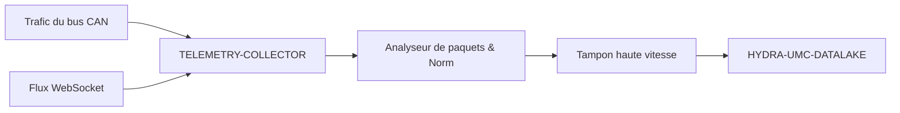

<p align="center">
  
</p>

# 📡 HYDRA-UMC-TELEMETRY-COLLECTOR

<p align="center"><a href="README.md">🇺🇸 English</a> | <a href="README_spa.md">🇪🇸 Español</a> | 🇫🇷 <b>Français</b> | <a href="README_ita.md">🇮🇹 Italiano</a> | <a href="README_deu.md">🇩🇪 Deutsch</a> | <a href="README_zho.md">🇨🇳 简体中文</a> | <a href="README_jpn.md">🇯🇵 日本語</a> | <a href="README_por.md">🇵🇹 Português</a></p>

### 🚀 Nœud d'ingestion à haut débit pour les journaux CAN et WebSocket

<p align="center">
  
  
  
</p>

**Vérification d'honnêteté - ce qui fonctionne réellement aujourd'hui :** le vrai pipeline d'ingestion - `telemetry` analysant les trames CAN et le JSON WebSocket en un `Sample` normalisé, l'anneau borné avec signalement de contre-pression de `buffer`, l'orchestration ingestion+vidage de `collector` (une écriture échouée vers le sink remet tout le lot en file au lieu de le perdre), le suivi de séquence par producteur résistant à la reconnexion de `dedup`, et le vrai `DatalakeSink` de `sink` (testé contre un vrai `net/http/httptest.Server` implémentant le propre `POST /ingest` de DATALAKE) ou son repli `ConsoleSink` - sont tous réels et testés (51 tests, `go test ./...`). Deux vraies lacunes à connaître avant toute intégration : ce collecteur n'ouvre pas lui-même une connexion réelle à un bus FDCAN physique ni n'accepte de connexions WebSocket en direct d'un robot - l'ingestion se fait via sa propre API HTTP simple (`POST /ingest/can`, `POST /ingest/ws`), donc quelque chose d'autre doit encore lire le vrai bus/socket et relayer les trames ici. Et le format de trame CAN propre à `telemetry/can.go` (octet de code de signal + valeur float32) est une convention v0 propre et auto-déclarée de ce projet, pas encore les véritables tables d'ID CAN documentées par l'écosystème dans le firmware de HYDRA-UMC/URTC - délibérément non devinées. La sortie est uniquement du JSON réel ; le « JSON/Protobuf » du README lui-même et l'ingestion gRPC restent planifiés, non implémentés nulle part dans ce code. Voir `CHANGELOG.md` pour ce qui a été livré exactement jusqu'à présent.

---

> **État de la sûreté et de la cybersécurité :** cet écosystème n'est pas un système de sécurité certifié. Il n'existe pas encore de chaîne d'E-STOP matérielle, ni de limites ou de verrouillages imposés par le firmware, ni de commande de mouvement vérifiée ; les images de firmware sont contrôlées par CRC32 et un HMAC-SHA256 à clé partagée, pas par une signature asymétrique ; TLS et TLS mutuel sont optionnels et désactivés par défaut ; aucune carte propre n'a encore été assemblée ni testée. Lisez la [base de sécurité](https://github.com/JuanenRac/HYDRA-UMC-DOCS/blob/main/docs/SECURITY_BASELINE.md) et le [modèle de menaces](https://github.com/JuanenRac/HYDRA-UMC-DOCS/blob/main/docs/THREAT_MODEL.md) avant de vous fier à une affirmation d'ici pour la sécurité d'une personne.

## 📋 En un coup d'œil

| | |
|---|---|
| Version | `0.1.8` |
| Maturité | Fonctionnel |
| Technologie | Go / CAN/WebSocket parsers / bounded FIFO buffer / HTTP API |
| Cible | Le Raspberry Pi CM5 d'une cellule HYDRA-UMC |
| Sur matériel réel | Pas encore : aucune exécution sur du matériel réel n'est consignée pour cette version |

## 1. 🛠️ APERÇU TECHNIQUE

**HYDRA-UMC-TELEMETRY-COLLECTOR** est la passerelle d'ingestion qui reçoit la télémétrie qui lui est envoyée en HTTP et l'écrit dans le Datalake. Elle convertit en échantillons normalisés les trames CAN et les messages JSON WebSocket qu'elle reçoit ; elle n'écoute pas elle-même de bus CAN (prévu).

Elle normalise et dédoublonne des entrées hétérogènes, afin que des mesures comme un pic de courant moteur sur un bus CAN puissent être corrélées plus tard avec d'autres séries (prévu : corrélation avec des résultats d'inférence IA d'un Vision Node ; une telle inférence n'existe pas encore).

### Caractéristiques principales :
* 🚀 **Ingestion multiprotocole :** Gère la télémétrie CAN et WebSocket aujourd'hui, via une API d'ingestion HTTP simple. *(l'ingestion gRPC est prévue)*
* ⚡ **Débit :** conçu pour la télémétrie de l'usine, pas pour une capture de bus : avec les valeurs par défaut, le collector livre jusqu'à 250 échantillons par seconde (un lot de 500 toutes les 2 s, en une seule requête par lot vers HYDRA-UMC-DATALAKE, ou une requête par échantillon si ce datalake n'a pas la route de lots ou avec `-datalake-batch=false`) ; au-delà, le tampon se remplit et l'ingestion répond `503`.
* 🧬 **Normalisation des données :** Traduit les paquets binaires bruts en un format JSON standardisé. *(la sortie Protobuf est planifiée, non implémentée)*
* 🛡️ **Livraison tamponnée :** un échantillon que le collector a accepté n'est pas jeté pendant une panne de la base de données ou du réseau : le lot en cours de livraison garde sa place, et un tampon plein refuse les nouveaux échantillons (`503`) au lieu d'abandonner les anciens. Le tampon est en mémoire : redémarrer le collector perd son contenu.
* 🔁 **Déduplication sûre en cas de reconnexion :** Un numéro de séquence optionnel par producteur, suivi dans une fenêtre de réordonnancement bornée, pour qu'un appareil qui se reconnecte et renvoie ses derniers messages non acquittés ne gonfle jamais les comptes d'ingestion. *(implémenté)*
* 🧭 **Entrées plausibles :** un horodatage en secondes au lieu de millisecondes, ou de plus de 5 minutes en avance sur l'horloge (`-max-future-skew`), et un `sourceId` trop long ou avec des caractères invisibles sont refusés (`400`) ; un producteur dont le compteur repart de zéro après un redémarrage est reconnu (`producerResets` dans `GET /stats`) au lieu de voir ses nouveaux échantillons rejetés comme doublons. *(implémenté)*
* 🩺 **Diagnostic réel des échecs :** Chaque échec de vidage est classé comme un rejet réel des données par le sink par rapport à un problème de transport - exposé dans `GET /stats` pour une visibilité opérationnelle réelle. *(implémenté)*
* 🧮 **Validation de champs finis :** Un nom de champ vide ou une valeur numérique `NaN`/`Infinity`/`-Infinity` est rejeté (`400`) avant d'atteindre le buffer ou un sink - le décodage CAN passe par le même `Sample.Validate()` que l'ingestion JSON. *(implémenté)*
* 📊 **Métriques Prometheus :** `GET /metrics` expose les mêmes compteurs en direct d'ingestion et de perte que `GET /stats` (ingérés, abandonnés, en quarantaine, échecs d'envoi de transport ou de données invalides, occupation du tampon) au vrai format texte de Prometheus. *(implémenté)*
* 🧰 **Pannes, priorités et métriques protégées (tout est optionnel) :** `-spool <fichier>` garde sur disque les échantillons d'une longue panne du datalake (limitée par `-spool-max-bytes`) et les renvoie d'abord quand il répond de nouveau ; `-priority type=niveau,...` permet à un tampon plein d'abandonner l'échantillon le moins important pour un plus important (compté dans `evicted`) ; `-datalake-permanent-statuses 401,403,404` abandonne au lieu de réessayer indéfiniment ; `-metrics-token` fait exiger un jeton par `GET /stats` et `GET /metrics`. Ils indiquent la latence du dernier et du plus lent envoi et l'âge du plus ancien échantillon du tampon. Tout est désactivé par défaut. *(implémenté)*

---

## 2. 🔄 FLUX DE TRAVAIL D'INGESTION



---

## 3. 🧱 ARCHITECTURE & DÉCISIONS DE CONCEPTION

* **Pourquoi `src/` est la racine du module Go, pas la racine du dépôt.** Garde les propres fichiers du module installable (`main.go`, `version.go`, `go.mod`) séparés de l'outillage à la racine du dépôt (`bump_version.py`, `docker-compose.yml`) - `go build ./...` s'exécute depuis l'intérieur de `src/`, pas depuis la racine du dépôt.
* **Pourquoi la collecte est séparée de HYDRA-UMC-DATALAKE lui-même.** La collecte (interroger HYDRA-UMC-SERVER, mettre en tampon, grouper les écritures) est une préoccupation liée aux E/S distincte du stockage/de la requête - la garder comme processus séparé signifie qu'un redémarrage du collecteur ou un pic de contre-pression ne touche pas le propre chemin de requête du lac de données.
* **Pourquoi un échec d'écriture du sink remet le lot en file plutôt que de l'abandonner - sauf le seul échantillon qui ne réussira jamais.** `src/collector` est ce qui justifie réellement la promesse « Livraison bufferisée : zéro perte de données » : `FlushOnce` ne retire un lot du tampon qu'une fois que `Sink.Write` le confirme, et le remet directement en tête en cas d'échec de transport - une vraie panne fait réessayer les mêmes échantillons, elle ne les perd pas. La seule exception est un échantillon que le sink lui-même a rejeté DÉFINITIVEMENT comme invalide (voir `sink.InvalidDataError` ci-dessous) - le remettre en file sans condition le replaçait auparavant en tête pour toujours, bloquant tout échantillon valide derrière lui ; il est désormais mis en quarantaine (abandonné, comptabilisé dans le `quarantined` de `GET /stats`) à la place, tandis que le reste du lot est toujours remis en file normalement. Le tampon (`src/buffer`) reste borné cependant - une panne qui dépasse sa capacité fait bien perdre les plus anciens en excès, une vraie limite honnête plutôt qu'une promesse de mémoire infinie.
* **Pourquoi CAN et WebSocket se parsent tous deux vers la même forme `Sample`.** `src/telemetry` normalise les deux sources hétérogènes en une seule structure avant que quoi que ce soit ne touche le tampon ou le sink - le vrai mécanisme derrière « un pic de courant moteur sur CAN correctement corrélé à un résultat d'un Vision Node » : aucune étape en aval n'a besoin de savoir via quel protocole un échantillon est arrivé.
* **Pourquoi le format de trame CAN est une convention propre v0 de ce projet, pas encore les vrais ID CAN de l'écosystème.** Les vraies tables d'ID CAN vivent dans la propre documentation firmware de HYDRA-UMC et d'URTC - s'y intégrer réellement est un travail futur, pas quelque chose à deviner sans cette référence sous les yeux.
* **Pourquoi `DatalakeSink` écrit un échantillon par requête HTTP.** Le `POST /ingest` de HYDRA-UMC-DATALAKE prend un échantillon, donc une "écriture par lot" correspond en réalité à N requêtes, dans l'ordre, qui s'arrêtent au premier échec. `PartialWriteError` indique combien ont été confirmées (`202`) et seul le reste est réessayé ; un échantillon que le sink rejette comme invalide (`400` ou `413`) est le seul à être écarté, et ce qui le suit est réessayé. Une ligne en double ne peut apparaître que si DATALAKE a accepté une requête et que la réponse s'est perdue, et DATALAKE conserve une valeur par (source, type, champ, horodatage) : un renvoi écrase au lieu de dupliquer.
* **Comment cela s'intègre au reste de l'écosystème.** Un service frère sous HYDRA-UMC-DATALAKE : il reçoit la télémétrie que les producteurs lui envoient en HTTP et l'écrit dans le magasin de séries temporelles partagé. Il n'interroge rien, et rien dans l'écosystème ne lui envoie encore de données : il reste à écrire un producteur (un abonnement aux deltas de robots du Server, un lecteur SocketCAN sur le CM5).
* **Pourquoi la déduplication est un package `dedup` séparé, indexé sur un `Sequence` optionnel, et non un hachage du contenu de l'échantillon lui-même.** Une vraie reconnexion renvoie les mêmes octets identiques, donc le hachage de contenu fonctionnerait pour ce cas - mais il avalerait aussi silencieusement deux échantillons réellement différents qui partagent par hasard tous les champs (par ex. deux lectures de `0.0` à une seconde d'intervalle). Un numéro de séquence par producteur est ce qu'un vrai appareil doit déjà suivre pour ses propres messages non acquittés, donc le réutiliser est le signal honnête et réel - pas une supposition tirée de données qui ne promettent pas réellement l'unicité. `Sequence == 0`/omis exclut entièrement un producteur, donc rien du comportement préexistant ne change pour un appareil qui n'en envoie pas.
* **Pourquoi `sink.InvalidDataError` porte l'`Index` de l'échantillon rejeté dans le lot.** Trouvé en auditant le code (P1) : `DatalakeSink.Write` envoie un échantillon par requête HTTP et s'arrête au premier échec, donc lorsque DATALAKE renvoie un vrai HTTP 400 pour un échantillon précis, `Write` marque la position de cet échantillon dans le lot sur l'erreur elle-même avant de la renvoyer. `FlushOnce` s'en sert pour mettre en quarantaine (abandonner définitivement, ne jamais remettre en file) exactement cet échantillon - réessayer les mêmes octets rejetés ne peut jamais réussir - tout en continuant à remettre en file le reste du lot normalement, plutôt que de réessayer (et de rebloquer) le lot entier pour toujours derrière un échantillon empoisonné. `quarantined` dans `GET /stats` comptabilise chaque échantillon ainsi abandonné, séparément de `invalidDataErrors` (des tentatives de flush, pas des échantillons) et de `dropped` (une limite de capacité du tampon plein, pas un rejet définitif) - rien de tout cela n'est donc un abandon silencieux, et `invalidDataErrors` face à `transportErrors` permet toujours à un opérateur de distinguer « DATALAKE rejette nos données » de « le réseau vers DATALAKE est en panne » sans avoir à deviner à partir des logs.

---

## 📂 STRUCTURE DES RÉPERTOIRES

Service purement logiciel (nœud d'ingestion) - sans matériel, micrologiciel ou système d'exploitation propres ; ces dossiers sont omis conformément à la politique de structure du dépôt.

```text
HYDRA-UMC-TELEMETRY-COLLECTOR/
├── src/                  # Module Go
│   ├── go.mod            # Définition du module
│   ├── version.go        # const Version = "X.Y.Z"
│   ├── main.go           # Point d'entrée : relie tout, démarre l'API HTTP
│   ├── guard.go        # Garde de démarrage : loopback uniquement sauf jeton Bearer
│   ├── telemetry/        # Type Sample + analyseurs CAN/WebSocket (normalisation)
│   ├── buffer/           # File FIFO bornée signalant la contre-pression (Ring)
│   ├── dedup/            # Déduplication réelle par séquence par producteur (fenêtre de réordonnancement)
│   ├── collector/        # Orchestre ingestion+vidage, réessaie si le sink échoue, dédup
│   ├── sink/              # Où vont les lots vidés (ConsoleSink aujourd'hui), classification transport/données invalides
│   ├── spool/          # File optionnelle sur disque qui garde les échantillons d'une longue panne de la destination
│   └── api/                # Handlers JSON/HTTP simples encapsulant le collecteur
├── docs/
│   └── API.md              # Référence réelle des endpoints HTTP (requêtes, réponses, codes de statut)
├── images/               # Médias et diagrammes
├── systemd/
│   └── hydra-umc-telemetry-collector.service # Unité systemd de l'API locale d'ingestion de télémétrie sur la CM5
├── tools/
│   ├── build_test.py     # Vérification de build sans versionnage
│   └── ci_validate.py    # Validation manifeste/CHANGELOG/docs utilisée par CI
├── build/                # Binaires compilés (ignoré par git)
├── bump_version.py        # Incrément de version type compteur kilométrique (exécuté seulement par la commande `bump` explicite)
├── bump_manifest_version.py # Synchronise la version de hydra-umc.project.json avec la version native (--sync)
├── build.sh / build.bat   # Valide et compile (compiler ne change jamais la version)
├── run.sh / run.bat       # Exécution réelle : lance le binaire compilé
└── README.md
```

Élagué du modèle original : `hardware/`, `firmware/` et `os/` — il s'agit
d'un service purement logiciel (binaire Go) sans matériel ni firmware
propres et sans image de système d'exploitation à maintenir. Voir
[`docs/API.md`](docs/API.md) pour la référence complète des endpoints HTTP.

---

## 4. ⚙️ BUILD ET EXÉCUTION

Nécessite Go >= 1.21. Un véritable pipeline d'ingestion avec une API HTTP,
pas seulement un squelette qui compile.

```bash
# Linux/macOS
./build.sh
./run.sh -addr 127.0.0.1:8092 -datalake-url http://localhost:8095

# Windows
build.bat
run.bat -addr 127.0.0.1:8092 -datalake-url http://localhost:8095
```

`build` ne change jamais la version (seule `python tools/hydra_project_tool.py bump` la fait monter) et compile le module Go
de `src/` vers `build/telemetry-collector(.exe)`. `run` exécute le binaire
compilé, en transmettant tout indicateur, et commence à écouter du vrai
trafic. `-datalake-url` fait pointer les lots vidangés vers une instance
réelle et en cours d'exécution de HYDRA-UMC-DATALAKE (`POST /ingest`,
`sink.DatalakeSink`) - à omettre pour afficher les échantillons vidangés
sur stdout à la place (`sink.ConsoleSink`), utile pour exécuter ce
collecteur de manière autonome :

Par défaut le collector n'écoute que sur loopback et ses routes d'ingestion sont ouvertes aux appelants locaux. Pour écouter sur une adresse réseau, il faut lui donner un jeton Bearer (`-token`, ou `HYDRA_UMC_TELEMETRY_COLLECTOR_TOKEN` ; au moins 16 caractères) : `POST /ingest/can` et `POST /ingest/ws` exigent alors `Authorization: Bearer <token>` (`/stats` et `/metrics` restent ouvertes pour qu'un collecteur local n'ait besoin d'aucun secret). Un `-addr` hors loopback sans jeton est refusé au démarrage, sauf si `-allow-anonymous` est passé. Le corps d'une requête est limité à 1 Mio (`413` au-delà) et le serveur HTTP applique des délais de lecture, d'écriture et d'inactivité.

**Lire les ponts par MQTT.** Avec `-mqtt-url tcp://127.0.0.1:1883` (ou `tls://broker:8883`, avec `-mqtt-ca-file` pour une autorité privée), le collecteur s'abonne aussi à `hydra/bridges/+/state` et `hydra/bridges/+/availability` (`-mqtt-topics`) et fait de chaque message un échantillon : `bridge_state` avec chaque nombre et chaque drapeau de l'état (un niveau d'imbrication) et un drapeau `machine_state.<valeur>`, horodaté avec l'`observed_at` du pont, et `bridge_availability` avec `online` à 1 ou 0. Un état retenu plus vieux que `-mqtt-max-age` (2 minutes par défaut) est la mémoire du broker et non une mesure, et il est ignoré. Le nom d'utilisateur vient de `-mqtt-username` ou `HYDRA_UMC_TELEMETRY_MQTT_USER` et le mot de passe de `-mqtt-password-file` ou `HYDRA_UMC_TELEMETRY_MQTT_PASSWORD` ; des identifiants sur une connexion en clair vers une autre machine sont refusés sauf avec `-mqtt-allow-plaintext`. L'entrée est désactivée par défaut et `GET /stats` rapporte sa connexion et ses compteurs sous `mqtt`. Pas encore essayé avec le vrai broker de l'écosystème.

```bash
# Ingérer un échantillon de télémétrie de type WebSocket
curl -X POST localhost:8092/ingest/ws \
  -d '{"sourceId":"robot-1","kind":"motor_temp","timestamp":1700000000000,"fields":{"value":42.5}}'

# Ingérer une trame CAN (8 octets, base64 - voir src/telemetry/can.go pour le format)
curl -X POST localhost:8092/ingest/can \
  -d '{"arbitrationId":7,"data":"AQAAUEEAAAA="}'

# Voir ce que le collecteur a ingéré/vidé/abandonné
curl localhost:8092/stats
```

```bash
cd src && go test ./...   # telemetry (aller-retour CAN, validation WS),
                           # buffer (FIFO borne, contre-pression, requeue),
                           # collector (le vrai comportement "ne pas
                           # perdre de donnees lors d'une panne du sink"),
                           # et api (allers-retours HTTP reels via httptest)
```

---

## 🚀 FEUILLE DE ROUTE
* **Phase 1 :** Ingestion à haut débit du Datalake et indexation pour l'analyse historique.
* **Phase 2 :** Compression à la périphérie du collecteur de télémétrie et protocoles de transmission sécurisés.
* **Phase 3 :** Détection d'anomalies à l'aide de l'apprentissage non supervisé et analyse des vibrations du moteur.
* **Phase 4 :** Compression à la volée pour l'ingestion massive de journaux et optimisation multi-protocole.

---

## 🔗 Projets Liés

Ce projet fait partie de l'écosystème robotique HYDRA-UMC du même auteur (JuanenRac / Electro Hobby 3D). Bon à savoir, car une demande pourrait en réalité concerner l'un de ceux-ci plutôt que ce dépôt.

**Projet Parent**
- **[HYDRA-UMC-DATALAKE](https://github.com/JuanenRac/HYDRA-UMC-DATALAKE)** — vrai magasin de séries temporelles basé sur sqlite3, avec une vraie API HTTP d'ingestion/requête ; le parent dont ce dépôt est un service d'analytique spécifique, au sein de sa propre couche de données et analytique.

**Projets Frères** — les autres services d'analytique de la propre couche de données et analytique de HYDRA-UMC-DATALAKE
- **[HYDRA-UMC-ANOMALY-DETECTOR](https://github.com/JuanenRac/HYDRA-UMC-ANOMALY-DETECTOR)** — vrai détecteur d'anomalies FFT + ligne de base statistique, avec surveillance de dérive.
- **[HYDRA-UMC-PRODUCTION-REPORTS](https://github.com/JuanenRac/HYDRA-UMC-PRODUCTION-REPORTS)** — vrai calcul OEE/disponibilité sur l'historique de DATALAKE, avec export CSV reproductible.

**Directement Liés**
- **[HYDRA-UMC-SERVER](https://github.com/JuanenRac/HYDRA-UMC-SERVER)** — le vrai backend headless (REST/WebSocket) auquel parle réellement chaque client de contrôle — la source des journaux que ce projet ingère.
- **[HYDRA-UMC](https://github.com/JuanenRac/HYDRA-UMC)** — la conception de la carte mère du bras robotique : hôte CM5 + coprocesseur STM32H745 double cœur, destinée à coordonner jusqu'à 8 bras-outils via CAN-OTA/SPI-OTA (firmware à un stade précoce ; aucune carte assemblée pour l'instant) ; aujourd'hui il utilise sa propre convention v0, suivie honnêtement comme travail futur plutôt que revendiquée comme terminée.
- **[URTC](https://github.com/JuanenRac/URTC)** — firmware pour la carte physique Universal Robot Tool Controller, plus de 25 profils d'outil sur bus CAN — la vraie table d'ID CAN contre laquelle le propre format CAN de ce projet est destiné à s'intégrer un jour ; aujourd'hui il utilise sa propre convention v0, suivie honnêtement comme travail futur plutôt que revendiquée comme terminée.

**Fait Également Partie de l'Écosystème**

*Matériel & Plateforme de Base*
- **[HYDRA-UMC-OS](https://github.com/JuanenRac/HYDRA-UMC-OS)** — couche produit reproductible sur Raspberry Pi OS pour le CM5 : agent en lecture seule, config/profils validés, provisionnement WiFi de premier contact.
- **[HYDRA-UMC-SDK](https://github.com/JuanenRac/HYDRA-UMC-SDK)** — le contrat JSON-Schema partagé et la barrière logicielle de contrôle des jobs contre laquelle chaque bridge valide ses commandes (pas une fonction de sécurité certifiée).
- **[HYDRA-UMC-CONNECTOR-HUB](https://github.com/JuanenRac/HYDRA-UMC-CONNECTOR-HUB)** — registre déclaratif et validateur de manifestes d'adaptateur pour les connecteurs de machines externes ; étend la propre idée de contrat du SDK aux machines externes sans remplacer les projets de passerelle industrielle.

*Backend Central & Clients*
- **[HYDRA-UMC-STUDIO](https://github.com/JuanenRac/HYDRA-UMC-STUDIO)** — tableau de bord de contrôle web avec visualisation 3D multi-robot en temps réel.
- **[HYDRA-UMC-SUITE](https://github.com/JuanenRac/HYDRA-UMC-SUITE)** — centre de commande d'essaim de bureau (PySide6) pour plusieurs serveurs à la fois, empaqueté en exécutable autonome.
- **[HYDRA-UMC-ANDROID-CONTROL](https://github.com/JuanenRac/HYDRA-UMC-ANDROID-CONTROL)** — application de contrôle Android native avec connexion biométrique et un compagnon Wear OS jumelé.
- **[HYDRA-UMC-IOS-CONTROL](https://github.com/JuanenRac/HYDRA-UMC-IOS-CONTROL)** — application de contrôle iOS/iPadOS (Flutter) avec synchronisation WebSocket en temps réel.
- **[HYDRA-UMC-DSI](https://github.com/JuanenRac/HYDRA-UMC-DSI)** — interface tactile native pour l'écran tactile DSI 7" embarqué, intégrée directement sur le CM5.
- **[HYDRA-UMC-EDITOR-URDF](https://github.com/JuanenRac/HYDRA-UMC-EDITOR-URDF)** — créateur/éditeur graphique de bureau pour URDF qui envoie les modèles terminés vers le propre catalogue de STUDIO.
- **[HYDRA-UMC-EDITOR-STL](https://github.com/JuanenRac/HYDRA-UMC-EDITOR-STL)** — éditeur de bureau de modèles STL, transformant/remplaçant/retirant/ajoutant de vraies pièces dans le même catalogue de modèles qu'édite aussi HYDRA-UMC-EDITOR-URDF.
- **[HYDRA-UMC-BRIDGE-AMR](https://github.com/JuanenRac/HYDRA-UMC-BRIDGE-AMR)** — frontière de coordination pour les flottes AGV/AMR via un éditeur MQTT VDA 5050 (testé uniquement contre une flotte émulée).
- **[HYDRA-UMC-BRIDGE-CNC](https://github.com/JuanenRac/HYDRA-UMC-BRIDGE-CNC)** — coordinateur haut niveau pour cellules CNC avec accès au statut/octets de contrôle GRBL (testé uniquement contre un émulateur).
- **[HYDRA-UMC-BRIDGE-DROIDS](https://github.com/JuanenRac/HYDRA-UMC-BRIDGE-DROIDS)** — frontière de coordination pour droïdes à pattes/humanoïdes, avec un émetteur de commandes Boston Dynamics Spot (testé uniquement contre un émulateur).
- **[HYDRA-UMC-BRIDGE-LASER](https://github.com/JuanenRac/HYDRA-UMC-BRIDGE-LASER)** — coordinateur de cellules laser lisant 3 signaux GPIO de clé/enceinte/verrouillage (testé uniquement contre une puce simulée ; il ne peut ni armer ni tirer un laser).
- **[HYDRA-UMC-BRIDGE-OPENPNP](https://github.com/JuanenRac/HYDRA-UMC-BRIDGE-OPENPNP)** — coordinateur haut niveau sûr pour le flux de cartes du pick-and-place OpenPnP.
- **[HYDRA-UMC-BRIDGE-PRINTER3D](https://github.com/JuanenRac/HYDRA-UMC-BRIDGE-PRINTER3D)** — frontière de coordination sûre pour imprimantes 3D Moonraker/Klipper, avec de vraies commandes de tâche contrôlées.
- **[HYDRA-UMC-BRIDGE-ROS2](https://github.com/JuanenRac/HYDRA-UMC-BRIDGE-ROS2)** — coordinateur avec un transport ROS 2 rclpy à importation paresseuse (pas encore exécuté contre une installation ROS 2).
- **[HYDRA-UMC-BRIDGE-UAV](https://github.com/JuanenRac/HYDRA-UMC-BRIDGE-UAV)** — frontière de coordination pour UAV équipés de caméra, avec un émetteur de commandes MAVLink (testé uniquement contre un émulateur).

*Plateforme d'Outils URTC*
- **[URTC-FLASHER](https://github.com/JuanenRac/URTC-FLASHER)** — outil de bureau à interface graphique pour flasher les cartes URTC, CAN-OTA plus SWD/JTAG puce complète.
- **[URTC-TESTER](https://github.com/JuanenRac/URTC-TESTER)** — outil de bureau de diagnostic CAN-bus en direct pour cartes URTC, un panneau par profil d'outil.
- **[URTC-WEB-STUDIO](https://github.com/JuanenRac/URTC-WEB-STUDIO)** — alternative basée navigateur à URTC-TESTER via la Web Serial API, sans installation locale.
- **[URTC-GATEWAY](https://github.com/JuanenRac/URTC-GATEWAY)** — passerelle devant le bus CAN d'URTC : liste d'identifiants autorisés, limite de débit et clé de session ; logiciel testé sur ordinateur, pas encore sur un bus réel.

*Nœud IA de Vision (Hailo-8)*
- **[HYDRA-UMC-VISION-NODE](https://github.com/JuanenRac/HYDRA-UMC-VISION-NODE)** — hub d'intégration pour le pipeline de vision Hailo-8, avec une vraie vérification de disponibilité matérielle par étape.
- **[HYDRA-UMC-DETECTION-HEF](https://github.com/JuanenRac/HYDRA-UMC-DETECTION-HEF)** — registre réel de modèles compilés avec vérification de chargement sécurisé par architecture Hailo/checksum.
- **[HYDRA-UMC-VISION-STREAMER](https://github.com/JuanenRac/HYDRA-UMC-VISION-STREAMER)** — générateur réel de pipeline GStreamer + config MediaMTX, avec une vraie frontière d'intégration HailoRT.
- **[HYDRA-UMC-VISUAL-SERVOING-API](https://github.com/JuanenRac/HYDRA-UMC-VISUAL-SERVOING-API)** — loi de correction Position-Based Visual Servoing avec autorisation conditionnée à l'état de zone ; pas encore d'estimation de pose par caméra.
- **[HYDRA-UMC-SAFETY-ZONES](https://github.com/JuanenRac/HYDRA-UMC-SAFETY-ZONES)** — logique v0 de violation de zone, de fraîcheur de calibration et de demande d'E-STOP qui lit les positions d'objets dans un fichier ; aucun détecteur ne l'alimente et aucun E-STOP physique n'y est encore relié.

*Nœud IA Cognitif (Hailo-10)*
- **[HYDRA-UMC-COGNITIVE-NODE](https://github.com/JuanenRac/HYDRA-UMC-COGNITIVE-NODE)** — hub d'intégration pour le pipeline cognitif Hailo-10 (orchestration LLM/VLA/voix).
- **[HYDRA-UMC-VLA-ENGINE](https://github.com/JuanenRac/HYDRA-UMC-VLA-ENGINE)** — vrai encodage/décodage de jetons d'action et génération de trajectoire pour un modèle Vision-Language-Action.
- **[HYDRA-UMC-VOICE-UI](https://github.com/JuanenRac/HYDRA-UMC-VOICE-UI)** — vrai front-end vocal (VAD + analyseur d'intention) avec un relais Watch borné et soumis à confirmation.
- **[HYDRA-UMC-SEMANTIC-PLANNER](https://github.com/JuanenRac/HYDRA-UMC-SEMANTIC-PLANNER)** — vraie décomposition de tâches basée sur des règles et récupération sémantique d'erreurs sur les codes d'erreur MCU.
- **[HYDRA-UMC-DOCS-QA](https://github.com/JuanenRac/HYDRA-UMC-DOCS-QA)** — vraie recherche documentaire TF-IDF (bibliothèque standard uniquement) sur les propres documents Markdown de cet écosystème.
- **[HYDRA-UMC-LOCAL-TECHNICIAN](https://github.com/JuanenRac/HYDRA-UMC-LOCAL-TECHNICIAN)** — technicien de maintenance IA local et à portes de politique pour l'écosystème lui-même - observe, diagnostique et propose des corrections ; les deux niveaux de risque les plus élevés ne sont délibérément pas encore implémentés.

*Orchestration & Essaim*
- **[HYDRA-UMC-ORCHESTRATOR](https://github.com/JuanenRac/HYDRA-UMC-ORCHESTRATOR)** — hub d'intégration avec un vrai contrat de rapport de santé gRPC/Protobuf et une machine à états de mission.
- **[HYDRA-UMC-JOB-DISPATCHER](https://github.com/JuanenRac/HYDRA-UMC-JOB-DISPATCHER)** — vraie file de tâches basée sur la priorité avec déduplication, via une vraie API HTTP.
- **[HYDRA-UMC-NODE-HEALING](https://github.com/JuanenRac/HYDRA-UMC-NODE-HEALING)** — vrai chien de garde de santé de flotte basé sur gRPC, avec retry/backoff et détection d'incohérence d'identité.
- **[HYDRA-UMC-PATH-PLANNER-3D](https://github.com/JuanenRac/HYDRA-UMC-PATH-PLANNER-3D)** — vrai planificateur de trajectoire 3D basé sur RRT, avec vraie validation des collisions obstacle/espace de travail.
- **[HYDRA-UMC-SWARM-SYNC](https://github.com/JuanenRac/HYDRA-UMC-SWARM-SYNC)** — vraie synchronisation d'état CRDT LWW-Element-Map, testée par propriétés pour la convergence multi-cellule.

*Jumeau Numérique & Simulation*
- **[HYDRA-UMC-TWIN](https://github.com/JuanenRac/HYDRA-UMC-TWIN)** — hub d'intégration pour le moteur de jumeau numérique, avec un vrai contrat de synchronisation par compatibilité de version.
- **[HYDRA-UMC-HIL-BRIDGE](https://github.com/JuanenRac/HYDRA-UMC-HIL-BRIDGE)** — routeur hardware-in-the-loop avec un verrouillage logiciel de collision entre simulation et matériel réel (testé sans matériel réel).
- **[HYDRA-UMC-PHYSICS-REPLICA](https://github.com/JuanenRac/HYDRA-UMC-PHYSICS-REPLICA)** — vraie cinématique directe et validation des limites articulaires sur un vrai sous-ensemble URDF.
- **[HYDRA-UMC-SYNTHETIC-DATA-GEN](https://github.com/JuanenRac/HYDRA-UMC-SYNTHETIC-DATA-GEN)** — vrai générateur procédural de scènes 2D avec export d'annotations YOLO/COCO.

*Passerelle Industrielle*
- **[HYDRA-UMC-GATEWAY-INDUSTRIAL](https://github.com/JuanenRac/HYDRA-UMC-GATEWAY-INDUSTRIAL)** — hub d'intégration relayant vers les protocoles industriels, avec une vraie couche de liste blanche de commandes/contre-pression.
- **[HYDRA-UMC-OPCUA-SERVER](https://github.com/JuanenRac/HYDRA-UMC-OPCUA-SERVER)** — vrai espace d'adressage OPC-UA, vérifié avec une vraie session client du protocole binaire.
- **[HYDRA-UMC-MQTT-BROKER](https://github.com/JuanenRac/HYDRA-UMC-MQTT-BROKER)** — vrai broker MQTT avec authentification par client optionnelle et ACL de sujets.
- **[HYDRA-UMC-MTCONNECT-ADAPTER](https://github.com/JuanenRac/HYDRA-UMC-MTCONNECT-ADAPTER)** — vrais points de terminaison XML MTConnect `/probe` et `/current`, avec sortie en mode dégradé.

*Outils Complémentaires & Opérations de l'Écosystème*
- **[HYDRA-UMC-DASHBOARD-AI](https://github.com/JuanenRac/HYDRA-UMC-DASHBOARD-AI)** — panneaux Smart Summaries et Anomaly Highlighting sur DATALAKE/ANOMALY-DETECTOR, avec un repli statistique honnête.
- **[HYDRA-UMC-TOOL-CLI](https://github.com/JuanenRac/HYDRA-UMC-TOOL-CLI)** — CLI de flotte avec un vrai contrat de codes de sortie stable, un vrai client en direct de la propre API de HYDRA-UMC-SERVER.
- **[HYDRA-UMC-WATCH](https://github.com/JuanenRac/HYDRA-UMC-WATCH)** — application compagnon WearOS avec des motifs d'alerte haptique et un relais vocal vers le téléphone jumelé (pas encore exécutée sur une montre physique).
- **[URTC-SMART-RACK](https://github.com/JuanenRac/URTC-SMART-RACK)** — firmware pour un rack de montage de cartes avec décodage réel d'ID d'outil et logique de préchauffage Smart Idle.
- **[URTC-VISION-TOOL](https://github.com/JuanenRac/URTC-VISION-TOOL)** — firmware plus un vrai compagnon de vision Python pour une tête d'outil d'inspection thermique/RGB.
- **[HYDRA-UMC-UPDATER](https://github.com/JuanenRac/HYDRA-UMC-UPDATER)** — outil administratif de bureau qui découvre, clone et met à jour chaque dépôt de cet écosystème.
- **[HYDRA-UMC-OS-REBUILDER](https://github.com/JuanenRac/HYDRA-UMC-OS-REBUILDER)** — outil de bureau Windows/Linux qui construit une image de la CM5 prête à graver, préchargée avec les versions les plus actuelles de l'écosystème, avec une configuration de premier démarrage Wi-Fi/utilisateur/SSH façon Raspberry Pi Imager.
- **[HYDRA-UMC-OPS-AGENT](https://github.com/JuanenRac/HYDRA-UMC-OPS-AGENT)** — coordinateur d'incidents de maintenance : un rôle edge à faible privilège collecte un instantané d'inventaire/santé assaini, un rôle control-plane le rend en lecture seule et demande à un fournisseur d'IA de suggérer un diagnostic - n'applique jamais de correctif ni ne déploie rien.
- **[HYDRA-UMC-DEV-SERVER](https://github.com/JuanenRac/HYDRA-UMC-DEV-SERVER)** — hôte de développement reproductible (Raspberry Pi 5 / CM5) qui héberge le code source de l'écosystème et exécute des tâches de compilation/test délimitées via une file d'attente durable ; un rôle de développement dédié, explicitement distinct d'un CM5 opérationnel.


---

## 📚 Documentation & Communauté

- **[CONTRIBUTING.md](CONTRIBUTING.md)** — pile technologique et lignes directrices de codage pour une pull request.
- **[CODE_OF_CONDUCT.md](CODE_OF_CONDUCT.md)** — les normes de comportement attendues dans cette communauté.
- **[SECURITY.md](SECURITY.md)** — comment signaler une vulnérabilité, et les véritables axes de sécurité de ce projet.
- **[SUPPORT.md](SUPPORT.md)** — où poser des questions et signaler des bugs.
- **[LICENSE.md](LICENSE.md)** — la licence propre de ce projet.

## 👤 AUTEUR
**JuanenRac** (Electro Hobby 3D)
📧 electrohobby3d@gmail.com
📺 [youtube.com/@electrohobby3d](https://youtube.com/@electrohobby3d)

## 📜 LICENCE
GPL-3.0 - Voir le fichier LICENSE pour plus de détails.
