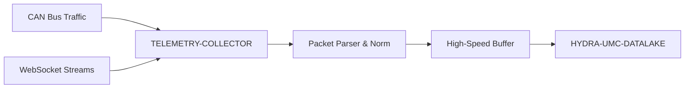

<p align="center">
  
</p>

# 📡 HYDRA-UMC-TELEMETRY-COLLECTOR

<p align="center"><a href="README.md">🇺🇸 English</a> | <a href="README_spa.md">🇪🇸 Español</a> | <a href="README_fra.md">🇫🇷 Français</a> | <a href="README_ita.md">🇮🇹 Italiano</a> | <a href="README_deu.md">🇩🇪 Deutsch</a> | <a href="README_zho.md">🇨🇳 简体中文</a> | 🇯🇵 <b>日本語</b> | <a href="README_por.md">🇵🇹 Português</a></p>

### 🚀 CAN および WebSocket ログ向けの高スループット取り込みノード

<p align="center">
  
  
  
</p>

**正直な現状確認 - 今日実際に動くもの:** 本物の取り込みパイプライン - CANフレームとWebSocket JSONを正規化された`Sample`にパースする`telemetry`、バックプレッシャーを報告する境界付きリングバッファの`buffer`、取り込み+フラッシュのオーケストレーションを行う`collector`(シンクへの書き込みが失敗した場合、バッチ全体を破棄せずに再キューイングする)、再接続に強いプロデューサーごとのシーケンス追跡を行う`dedup`、そして本物の`DatalakeSink`を持つ`sink`(DATALAKE自身の本物の`POST /ingest`を実装した本物の`net/http/httptest.Server`に対してテスト済み)、またはそのフォールバックである`ConsoleSink` - はすべて本物でテスト済みである(51件のテスト、`go test ./...`)。統合前に知っておくべき2つの本物のギャップ: このコレクター自体は物理的なFDCANバスへの実際の接続を開いたり、ロボットからのライブWebSocket接続を受け付けたりはしない - 取り込みは独自のシンプルなHTTP API(`POST /ingest/can`、`POST /ingest/ws`)経由で行われるため、実際のバス/ソケットを読み取ってここにフレームを転送する何か別のものがまだ必要である。そして`telemetry/can.go`自身のCANフレーム形式(信号コードバイト + float32値)はこのプロジェクト自身が宣言したv0のプレースホルダー規約であり、HYDRA-UMC/URTC自身のファームウェアでエコシステムが実際に文書化しているCAN IDテーブルではまだない - 意図的に推測していない。出力は本物のJSONのみである。README自身の「JSON/Protobuf」とgRPC取り込みは依然として計画中であり、このコードベースのどこにも実装されていない。これまでに何が実際に出荷されたかは`CHANGELOG.md`を参照してください。

---

> **安全性とセキュリティの現状:** このエコシステムは認証された安全システムではありません。ハードウェアの E-STOP 経路、ファームウェアが強制する制限やインターロック、検証済みの動作コマンドはまだありません。ファームウェアイメージは CRC32 と共有鍵の HMAC-SHA256 で検査しており、非対称署名ではありません。TLS と相互 TLS は任意で、既定では無効です。独自基板はまだ実装も試験もされていません。ここに書かれた内容を人の安全のために頼る前に、[セキュリティベースライン](https://github.com/JuanenRac/HYDRA-UMC-DOCS/blob/main/docs/SECURITY_BASELINE.md)と[脅威モデル](https://github.com/JuanenRac/HYDRA-UMC-DOCS/blob/main/docs/THREAT_MODEL.md)をお読みください。

## 📋 ひと目で

| | |
|---|---|
| バージョン | `0.1.7` |
| 成熟度 | 機能する |
| 技術 | Go / CAN/WebSocket parsers / bounded FIFO buffer / HTTP API |
| 対象 | HYDRA-UMC セルの Raspberry Pi CM5 |
| 実機での確認 | まだです：このバージョンについて実機での動作記録はありません |

## 1. 🛠️ 技術概要

**HYDRA-UMC-TELEMETRY-COLLECTOR** は、HTTP で送られてくるテレメトリを受け取って Datalake に書き込む取り込みゲートウェイです。受け取った CAN フレームと WebSocket の JSON メッセージを正規化したサンプルに変換しますが、CAN バスそのものを自分で監視することはまだありません(計画中)。

異種の入力を正規化し重複を除去するため、CAN バス上のモーター電流のスパイクのような値を、後で他の系列と相関づけられるようになります(計画中:Vision Node の AI 推論結果との相関。そのような推論はまだありません)。

### 主な機能：
* 🚀 **マルチプロトコル取り込み：** 現時点では CAN と WebSocket のテレメトリを、シンプルな HTTP 取り込み API 経由で処理します。*(gRPC 取り込みは計画中)*
* ⚡ **スループット：** バスのキャプチャ用ではなく、工場のテレメトリ向けです。既定値では毎秒最大 250 サンプルを配信します（2 秒ごとに 500 件のバッチ、サンプルごとに HYDRA-UMC-DATALAKE へ 1 リクエスト）。それを超えるとバッファが満杯になり、取り込みは `503` を返します。
* 🧬 **データ正規化：** 生のバイナリパケットを標準化された JSON 形式に変換します。*(Protobuf 出力は計画中で、未実装です)*
* 🛡️ **バッファ付き配信：** コレクターが受け付けたサンプルは、データベースやネットワークの障害中も破棄されません。配信中のバッチは場所を保持し、バッファが満杯になると古いサンプルを捨てずに新しいサンプルを拒否します（`503`）。バッファはメモリ上にあるため、コレクターを再起動すると中身は失われます。
* 🔁 **再接続に強い重複排除：** プロデューサーごとのオプションのシーケンス番号を、有界の並べ替えウィンドウ内で追跡することで、再接続して未確認の直近メッセージを再送するデバイスが取り込み件数を水増しすることは決してありません。*(実装済み)*
* 🧭 **妥当な入力：** ミリ秒ではなく秒のタイムスタンプ、時計より 5 分以上先のタイムスタンプ（`-max-future-skew`）、長すぎる、または不可視文字を含む `sourceId` は拒否されます（`400`）。再起動でカウンターが最初からやり直しになったプロデューサーは、新しいサンプルが重複として拒否されるのではなく、再起動として認識されます（`GET /stats` の `producerResets`）。*(実装済み)*
* 🩺 **実際の障害診断：** すべてのフラッシュ失敗は、シンクが実際にデータを拒否したのか、それとも輸送(トランスポート)上の問題なのかに分類され——`GET /stats` で公開され、実際の運用上の可視性をもたらします。*(実装済み)*
* 🧮 **有限フィールド検証:** 空のフィールド名や `NaN`/`Infinity`/`-Infinity` の数値は、バッファやシンクに到達する前に拒否されます(`400`)——CAN のデコードも JSON 取り込みと同じ `Sample.Validate()` を経由します。*(実装済み)*

---

## 2. 🔄 取り込みワークフロー



---

## 3. 🧱 アーキテクチャと設計上の決定

* **`src/` がリポジトリルートではなく Go モジュールのルートである理由。** インストール可能なモジュール自身のファイル（`main.go`、`version.go`、`go.mod`）を、リポジトリルートのツール（`bump_version.py`、`docker-compose.yml`）から分離するためです——`go build ./...` はリポジトリルートではなく `src/` 内部から実行されます。
* **データ収集が HYDRA-UMC-DATALAKE 自体から分離されている理由。** データ収集（HYDRA-UMC-SERVER のポーリング、バッファリング、バッチ書き込み）は、ストレージ/クエリとは異なる I/O バウンドな関心事です——独立したプロセスとして保つことで、コレクターの再起動やバックプレッシャーのスパイクが、データレイク自身のクエリパスに影響を与えることはありません。
* **シンク書き込みの失敗がバッチを破棄せず再キューに入れる理由——ただし、絶対に成功しない1件のサンプルは例外。** `src/collector` こそが「バッファ配信：データ損失ゼロ」という約束を実際に果たしている部分です——`FlushOnce` は `Sink.Write` が確認して初めて、取り出したバッチをバッファから削除します。トランスポート障害の場合は先頭にそのまま戻します——実際の障害は同じサンプルを再試行するのであって、失うわけではありません。唯一の例外は、シンク自体が永久に無効だと判定したサンプルです（下記の `sink.InvalidDataError` を参照）——これを無条件に再キューすると、以前は永久に先頭に戻り続け、その後ろにある有効なサンプルを全てブロックしていました。今では代わりに隔離（破棄し、`GET /stats` の `quarantined` でカウント）され、バッチの残りは通常どおり再キューされます。とはいえバッファ(`src/buffer`)は依然として有限です——その容量を超える障害は、実際に最も古い超過分を失います。これは無限のメモリを約束するのではなく、現実的で正直な限界です。
* **CAN と WebSocket の両方が同じ `Sample` 形式にパースされる理由。** `src/telemetry` は、何かがバッファやシンクに触れる前に、両方の異種ソースを一つの構造体に正規化します——これが「CAN 上のモーター電流スパイクが Vision Node の推論結果と正しく相関する」ことの実際のメカニズムです：下流のどの段階も、サンプルがどのプロトコル経由で届いたかを知る必要がありません。
* **CAN のワイヤーフォーマットが、まだエコシステムの本物の CAN ID ではなく、このプロジェクト独自の v0 規約である理由。** 本物の CAN ID テーブルは HYDRA-UMC と URTC それぞれの実際のファームウェアドキュメントにあります——それらと本当に統合するのは将来の作業です。その参照資料を手元に置かずに推測すべきものではありません。
* **`DatalakeSink` がサンプルごとに 1 回の HTTP リクエストを書き込む理由。** HYDRA-UMC-DATALAKE の `POST /ingest` は 1 サンプルを受け取るため、「バッチ書き込み」は実際には N 個のリクエストを順番に送り、最初の失敗で止まります。`PartialWriteError` が何件確認されたか（`202`）を伝え、残りだけが再試行されます。シンクが無効として拒否したサンプル（`400` または `413`）だけが破棄され、その後ろは再試行されます。重複行は、DATALAKE がリクエストを受け付けたのに応答が失われた場合にしか生じず、DATALAKE は（ソース、種類、フィールド、タイムスタンプ）ごとに 1 つの値を保持するため、再送は重複ではなく上書きになります。
* **エコシステムの他の部分との関係。** HYDRA-UMC-DATALAKE の下にある兄弟サービスで、プロデューサーが HTTP で送ってくるテレメトリを受け取り、共有の時系列ストアに書き込みます。自分から何かを取得することはなく、現時点でエコシステム内にデータを送るものはありません。プロデューサー（Server のロボット差分への購読、CM5 上の SocketCAN リーダー）はこれから書く必要があります。
* **重複排除が独立した `dedup` パッケージであり、サンプル自体のコンテンツのハッシュではなく、オプションの `Sequence` をキーにしている理由。** 実際の再接続は同一のバイト列をそのまま再送するため、コンテンツハッシュはその場合には機能します——しかし、たまたますべてのフィールドが一致する、実際には異なる2つのサンプル(例:1秒間隔の2つの `0.0` の読み取り値)を静かに取りこぼしてしまいます。プロデューサーごとのシーケンス番号は、実際のデバイスが自分自身の未確認メッセージを追跡するためにもともと持っているべきものなので、それを再利用することが誠実で本物のシグナルです——一意性を実際には保証しないデータから導き出した推測ではありません。`Sequence == 0`/省略は、あるプロデューサーを完全にオプトアウトさせるため、シーケンスを送らないデバイスの既存の動作は何一つ変わりません。
* **`sink.InvalidDataError` が拒否されたサンプルのバッチ内 `Index` を保持している理由。** エコシステム全体のソフトウェア改善監査(P1)で発見:`DatalakeSink.Write` は1リクエストにつき1サンプルを送信し、最初の失敗で停止します。そのため DATALAKE が特定のサンプルに対して本物の HTTP 400 を返すと、`Write` はエラーを返す前にそのサンプルのバッチ内の位置をエラー自体に記録します。`FlushOnce` はこれを使って、まさにそのサンプルだけを隔離します(永久に破棄し、二度と再キューしません)——拒否された同一のバイト列を再試行しても絶対に成功しないからです——一方でバッチの残りは通常どおり再キューされ続けます。1件の毒サンプルの後ろでバッチ全体が永遠に再試行され(再びブロックされ)続けることはもうありません。`GET /stats` の `quarantined` は、このように破棄されたサンプルの数をカウントします。これは `invalidDataErrors`(サンプル数ではなく flush 試行回数)や `dropped`(永久的な拒否ではなく、満杯のバッファ容量の限界)とは別のものです——つまりこれらはどれも黙って破棄されるわけではなく、`invalidDataErrors` と `transportErrors` を見比べることで、運用者はログから推測することなく、「DATALAKE が私たちのデータを拒否している」のか「DATALAKE へのネットワークがダウンしている」のかを引き続き区別できます。

---

## 📂 リポジトリ構成

純粋なソフトウェアサービス（取り込みノード）であり、独自のハードウェア、
ファームウェア、OS はありません。これらのディレクトリはリポジトリ構造
ポリシーに従って省略されています。

```text
HYDRA-UMC-TELEMETRY-COLLECTOR/
├── src/                  # Go モジュール
│   ├── go.mod            # モジュール定義
│   ├── version.go        # const Version = "X.Y.Z"
│   ├── main.go           # エントリポイント：すべてを接続し、HTTP API を起動
│   ├── guard.go        # 起動ガード：Bearer トークンがない限りループバックのみ
│   ├── telemetry/        # Sample 型 + CAN/WebSocket パーサー(正規化)
│   ├── buffer/           # 背圧を報告する有界 FIFO(Ring)
│   ├── dedup/            # 実際のプロデューサーごとのシーケンス重複排除(並べ替えウィンドウ)
│   ├── collector/        # 取り込み+フラッシュを調整、シンク失敗時に再試行、重複排除
│   ├── sink/              # フラッシュされたバッチの行き先(現在は ConsoleSink)、トランスポート/無効データの分類
│   └── api/                # collector を包む単純な JSON/HTTP ハンドラー
├── docs/
│   └── API.md              # 本物の HTTP エンドポイントリファレンス（リクエスト、レスポンス、ステータスコード）
├── images/               # メディアと図表
├── systemd/
│   └── hydra-umc-telemetry-collector.service # ローカルCM5テレメトリ取り込みAPIのsystemdユニット
├── tools/
│   ├── build_test.py     # バージョンを増やさないビルドチェック
│   └── ci_validate.py    # CI が使用するマニフェスト/CHANGELOG/ドキュメント検証
├── build/                # コンパイル済みバイナリ（gitignore 対象）
├── bump_version.py        # ネイティブバージョンのオドメーター式インクリメント（ビルドが実行）
├── bump_manifest_version.py # hydra-umc.project.json のバージョンをネイティブ版と同期(--sync)
├── build.sh / build.bat   # 実際のビルド：バージョンインクリメント + go build
├── run.sh / run.bat       # 実際の実行：コンパイル済みバイナリを実行
└── README.md
```

元のテンプレートから省略：`hardware/`、`firmware/`、`os/` —— これは純粋な
ソフトウェアサービス(Go バイナリ)であり、専用のハードウェアや
ファームウェア、維持すべきオペレーティングシステムイメージもありません。
完全な HTTP エンドポイントリファレンスは [`docs/API.md`](docs/API.md) を参照。

---

## 4. ⚙️ ビルドと実行

Go >= 1.21 が必要です。コンパイルできるだけの骨組みではなく、HTTP API
を備えた本物の取り込みパイプラインです。

```bash
# Linux/macOS
./build.sh
./run.sh -addr 127.0.0.1:8092 -datalake-url http://localhost:8095

# Windows
build.bat
run.bat -addr 127.0.0.1:8092 -datalake-url http://localhost:8095
```

`build` はバージョンを増加させ（`src/version.go`）、`src/` 内の Go
モジュールを `build/telemetry-collector(.exe)` としてコンパイルします。
`run` はコンパイル済みバイナリを実行し、フラグをそのまま渡して、
実際のトラフィックのリッスンを開始します。`-datalake-url` は
フラッシュされたバッチを、実際に稼働している HYDRA-UMC-DATALAKE
インスタンス（`POST /ingest`、`sink.DatalakeSink`）に向けます——
省略した場合は、フラッシュされたサンプルを代わりに標準出力へ表示します
（`sink.ConsoleSink`）。このコレクターを単独で実行する際に便利です：

デフォルトでは、コレクターはループバックのみで待ち受け、取り込みルートはローカルの呼び出し元に開かれています。ネットワークアドレスで待ち受けるには、Bearer トークン（`-token`、または `HYDRA_UMC_TELEMETRY_COLLECTOR_TOKEN`。16文字以上）を指定します。すると `POST /ingest/can` と `POST /ingest/ws` は `Authorization: Bearer <token>` を要求します（`/stats` と `/metrics` は、ローカルのスクレイパーが秘密情報を必要としないよう開いたままです）。ループバック以外の `-addr` でトークンがない場合は、`-allow-anonymous` を渡さない限り起動時に拒否されます。リクエスト本文は 1 MiB に制限され（超えると `413`）、HTTP サーバーは読み取り・書き込み・アイドルのタイムアウトを適用します。

```bash
# WebSocket 形式のテレメトリサンプルを取り込む
curl -X POST localhost:8092/ingest/ws \
  -d '{"sourceId":"robot-1","kind":"motor_temp","timestamp":1700000000000,"fields":{"value":42.5}}'

# CAN フレームを取り込む(8 バイト、base64 - フォーマットは src/telemetry/can.go を参照)
curl -X POST localhost:8092/ingest/can \
  -d '{"arbitrationId":7,"data":"AQAAUEEAAAA="}'

# collector が取り込み/フラッシュ/破棄した内容を確認する
curl localhost:8092/stats
```

```bash
cd src && go test ./...   # telemetry(CAN 往復、WS 検証)、buffer(有界
                           # FIFO、背圧、requeue)、collector(「シンク
                           # 障害時にデータを失わない」という実際の
                           # 挙動)、そして api(httptest による本物の
                           # HTTP 往復テスト)
```

---

## 🚀 ロードマップ
* **フェーズ 1：** 履歴分析のためのデータレイクの高スループット取り込みとインデックス作成。
* **フェーズ 2：** テレメトリコレクターのエッジ圧縮と安全な送信プロトコル。
* **フェーズ 3：** 教師なし学習とモーター振動分析を用いた異常検知。
* **フェーズ 4：** 大量のログ取り込みのためのオンザフライ圧縮とマルチプロトコル最適化。

---

## 🔗 関連プロジェクト

本プロジェクトは、同じ作者(JuanenRac / Electro Hobby 3D)による HYDRA-UMC ロボティクスエコシステムの一部です。リクエストが実はこの中のどれかについてのものである可能性があるため、知っておく価値があります。

**親プロジェクト**
- **[HYDRA-UMC-DATALAKE](https://github.com/JuanenRac/HYDRA-UMC-DATALAKE)** — 実際の取り込み/クエリ HTTP API を備えた、実際の sqlite3 ベースの時系列ストア。本リポジトリは、その自身のデータ&分析レイヤー内における特定の分析サービスとして、この親の一部を成す。

**兄弟プロジェクト** —— HYDRA-UMC-DATALAKE 自身のデータ&分析レイヤーにおける他の分析サービス
- **[HYDRA-UMC-ANOMALY-DETECTOR](https://github.com/JuanenRac/HYDRA-UMC-ANOMALY-DETECTOR)** — ドリフト監視を備えた、実際の FFT + 統計ベースラインによる異常検知器。
- **[HYDRA-UMC-PRODUCTION-REPORTS](https://github.com/JuanenRac/HYDRA-UMC-PRODUCTION-REPORTS)** — DATALAKE の履歴に対する実際の OEE/稼働率計算、再現可能な CSV エクスポート付き。

**直接関連**
- **[HYDRA-UMC-SERVER](https://github.com/JuanenRac/HYDRA-UMC-SERVER)** — すべての制御クライアントが実際に通信する、本物のヘッドレスバックエンド(REST/WebSocket) ——本プロジェクトが取り込むログの情報源。
- **[HYDRA-UMC](https://github.com/JuanenRac/HYDRA-UMC)** — ロボットアームのマザーボードの設計——CM5 ホスト + デュアルコア STM32H745、CAN-OTA/SPI-OTA 経由で最大 8 本のツールアームを統括することを目指す(ファームウェアは初期段階で、実装済みの基板はまだない)。現在は独自の v0 規約を使用しており、完了済みと主張せず、将来の作業として正直に追跡されている。
- **[URTC](https://github.com/JuanenRac/URTC)** — 物理的な Universal Robot Tool Controller 基板向けファームウェア、CAN バス経由の 25 以上のツールプロファイル ——本プロジェクト自身の CAN ワイヤーフォーマットが将来的に統合されることを意図した実際の CAN ID テーブル。現在は独自の v0 規約を使用しており、完了済みと主張せず、将来の作業として正直に追跡されている。

**エコシステムの他のプロジェクト**

*コアハードウェア&プラットフォーム*
- **[HYDRA-UMC-OS](https://github.com/JuanenRac/HYDRA-UMC-OS)** — CM5 向けの再現可能な Raspberry Pi OS プロダクト層——読み取り専用エージェント、検証済み設定/プロファイル、WiFi 初回接続プロビジョニング。
- **[HYDRA-UMC-SDK](https://github.com/JuanenRac/HYDRA-UMC-SDK)** — すべてのブリッジが自身のコマンドを検証する共有 JSON-Schema 契約とソフトウェアのジョブゲート境界(認証済みの安全機能ではない)。
- **[HYDRA-UMC-CONNECTOR-HUB](https://github.com/JuanenRac/HYDRA-UMC-CONNECTOR-HUB)** — 外部マシン用コネクタのための宣言的アダプターマニフェストのレジストリとバリデーター。SDK 自身の契約という発想を外部マシンにまで拡張し、産業用ゲートウェイ系のプロジェクトを置き換えることはありません。

*コアバックエンド&クライアント*
- **[HYDRA-UMC-STUDIO](https://github.com/JuanenRac/HYDRA-UMC-STUDIO)** — リアルタイムのマルチロボット 3D 可視化を備えたウェブ制御ダッシュボード。
- **[HYDRA-UMC-SUITE](https://github.com/JuanenRac/HYDRA-UMC-SUITE)** — 複数のサーバーを同時に扱えるデスクトップ(PySide6)スウォームコマンドセンター、スタンドアロン実行ファイルとしてパッケージ化。
- **[HYDRA-UMC-ANDROID-CONTROL](https://github.com/JuanenRac/HYDRA-UMC-ANDROID-CONTROL)** — 生体認証ログインとペアリングされた Wear OS コンパニオンを備えたネイティブ Android 制御アプリ。
- **[HYDRA-UMC-IOS-CONTROL](https://github.com/JuanenRac/HYDRA-UMC-IOS-CONTROL)** — リアルタイム WebSocket 同期を備えた iOS/iPadOS 制御アプリ(Flutter)。
- **[HYDRA-UMC-DSI](https://github.com/JuanenRac/HYDRA-UMC-DSI)** — 本体搭載の 7 インチ DSI タッチスクリーン向けネイティブタッチ UI、CM5 自体に組み込み。
- **[HYDRA-UMC-EDITOR-URDF](https://github.com/JuanenRac/HYDRA-UMC-EDITOR-URDF)** — 完成したモデルを STUDIO 自身のカタログへ送信するデスクトップ用グラフィカル URDF 作成/編集ツール。
- **[HYDRA-UMC-EDITOR-STL](https://github.com/JuanenRac/HYDRA-UMC-EDITOR-STL)** — HYDRA-UMC-EDITOR-URDF も編集する同じモデルカタログ内で、実在するパーツを変換/置換/削除/追加するデスクトップ STL モデルエディタ。
- **[HYDRA-UMC-BRIDGE-AMR](https://github.com/JuanenRac/HYDRA-UMC-BRIDGE-AMR)** — VDA 5050 MQTT パブリッシャーによる AGV/AMR フリートの調整境界(エミュレートしたフリートに対してのみテスト済み)。
- **[HYDRA-UMC-BRIDGE-CNC](https://github.com/JuanenRac/HYDRA-UMC-BRIDGE-CNC)** — GRBL ステータス/制御バイトへのアクセスを持つ、CNC セルの高レベルコーディネーター(エミュレーターに対してのみテスト済み)。
- **[HYDRA-UMC-BRIDGE-DROIDS](https://github.com/JuanenRac/HYDRA-UMC-BRIDGE-DROIDS)** — Boston Dynamics Spot コマンド送信機能を持つ、脚型/ヒューマノイドドロイドの調整境界(エミュレーターに対してのみテスト済み)。
- **[HYDRA-UMC-BRIDGE-LASER](https://github.com/JuanenRac/HYDRA-UMC-BRIDGE-LASER)** — キー/筐体/インターロックの GPIO 信号 3 系統を読み取るレーザーセルのコーディネーター(模擬チップに対してのみテスト済み。レーザーの武装や発射はできない)。
- **[HYDRA-UMC-BRIDGE-OPENPNP](https://github.com/JuanenRac/HYDRA-UMC-BRIDGE-OPENPNP)** — OpenPnP ピックアンドプレースの基板フローを安全に統括する高レベルコーディネーター。
- **[HYDRA-UMC-BRIDGE-PRINTER3D](https://github.com/JuanenRac/HYDRA-UMC-BRIDGE-PRINTER3D)** — 実際にゲート制御されたジョブコマンドを持つ、Moonraker/Klipper 3D プリンター向けの安全な調整境界。
- **[HYDRA-UMC-BRIDGE-ROS2](https://github.com/JuanenRac/HYDRA-UMC-BRIDGE-ROS2)** — 遅延インポートの rclpy ROS 2 トランスポートを持つコーディネーター(ROS 2 環境ではまだ実行していない)。
- **[HYDRA-UMC-BRIDGE-UAV](https://github.com/JuanenRac/HYDRA-UMC-BRIDGE-UAV)** — MAVLink コマンド送信機能を持つ、カメラ搭載 UAV の調整境界(エミュレーターに対してのみテスト済み)。

*URTC ツールプラットフォーム*
- **[URTC-FLASHER](https://github.com/JuanenRac/URTC-FLASHER)** — URTC 基板用のデスクトップ GUI 書き込みツール、CAN-OTA およびフルチップ SWD/JTAG。
- **[URTC-TESTER](https://github.com/JuanenRac/URTC-TESTER)** — URTC 基板向けのデスクトップ CAN バスライブ診断ツール、ツールプロファイルごとに 1 パネル。
- **[URTC-WEB-STUDIO](https://github.com/JuanenRac/URTC-WEB-STUDIO)** — Web Serial API を使ったブラウザベースの URTC-TESTER の代替、ローカルインストール不要。

*ビジョン AI ノード(Hailo-8)*
- **[HYDRA-UMC-VISION-NODE](https://github.com/JuanenRac/HYDRA-UMC-VISION-NODE)** — Hailo-8 ビジョンパイプラインの統合ハブ、段階ごとの実際のハードウェア準備状況チェック付き。
- **[HYDRA-UMC-DETECTION-HEF](https://github.com/JuanenRac/HYDRA-UMC-DETECTION-HEF)** — Hailo アーキテクチャ/チェックサムによる安全読み込み検証を備えた、実際のコンパイル済みモデルレジストリ。
- **[HYDRA-UMC-VISION-STREAMER](https://github.com/JuanenRac/HYDRA-UMC-VISION-STREAMER)** — 実際の HailoRT 統合境界を持つ、実際の GStreamer パイプライン + MediaMTX 設定生成器。
- **[HYDRA-UMC-VISUAL-SERVOING-API](https://github.com/JuanenRac/HYDRA-UMC-VISUAL-SERVOING-API)** — ゾーン状態を条件に承認する Position-Based Visual Servoing 補正則。カメラによる姿勢推定はまだない。
- **[HYDRA-UMC-SAFETY-ZONES](https://github.com/JuanenRac/HYDRA-UMC-SAFETY-ZONES)** — ファイルから物体位置を受け取る、ゾーン侵入・キャリブレーション鮮度・E-STOP 要求の v0 ロジック。検出器は接続されておらず、物理 E-STOP もまだ配線されていない。

*コグニティブ AI ノード(Hailo-10)*
- **[HYDRA-UMC-COGNITIVE-NODE](https://github.com/JuanenRac/HYDRA-UMC-COGNITIVE-NODE)** — Hailo-10 コグニティブパイプライン(LLM/VLA/音声オーケストレーション)の統合ハブ。
- **[HYDRA-UMC-VLA-ENGINE](https://github.com/JuanenRac/HYDRA-UMC-VLA-ENGINE)** — Vision-Language-Action モデル向けの、実際のアクショントークンのエンコード/デコードと軌道生成。
- **[HYDRA-UMC-VOICE-UI](https://github.com/JuanenRac/HYDRA-UMC-VOICE-UI)** — 確認ゲート付きの限定的な Watch リレーを備えた、実際の音声フロントエンド(VAD + 意図解析)。
- **[HYDRA-UMC-SEMANTIC-PLANNER](https://github.com/JuanenRac/HYDRA-UMC-SEMANTIC-PLANNER)** — MCU エラーコードに対する、実際のルールベースのタスク分解と意味的エラー復旧。
- **[HYDRA-UMC-DOCS-QA](https://github.com/JuanenRac/HYDRA-UMC-DOCS-QA)** — このエコシステム自身の Markdown ドキュメントに対する、標準ライブラリのみの実際の TF-IDF 文書検索。
- **[HYDRA-UMC-LOCAL-TECHNICIAN](https://github.com/JuanenRac/HYDRA-UMC-LOCAL-TECHNICIAN)** — エコシステム自身のための、ローカルでポリシーゲート付きのAIメンテナンス技術者 — 観察、診断し、修正を提案する;最上位の2つのリスクレベルは意図的にまだ実装されていない。

*オーケストレーション&スウォーム*
- **[HYDRA-UMC-ORCHESTRATOR](https://github.com/JuanenRac/HYDRA-UMC-ORCHESTRATOR)** — 実際の gRPC/Protobuf ヘルスレポート契約とミッションステートマシンを持つ統合ハブ。
- **[HYDRA-UMC-JOB-DISPATCHER](https://github.com/JuanenRac/HYDRA-UMC-JOB-DISPATCHER)** — 実際の HTTP API 上に構築された、優先度ベースの実際のジョブキュー(重複排除付き)。
- **[HYDRA-UMC-NODE-HEALING](https://github.com/JuanenRac/HYDRA-UMC-NODE-HEALING)** — リトライ/バックオフとアイデンティティ不一致検出を備えた、実際の gRPC ベースのフリートヘルスウォッチドッグ。
- **[HYDRA-UMC-PATH-PLANNER-3D](https://github.com/JuanenRac/HYDRA-UMC-PATH-PLANNER-3D)** — 実際の障害物/ワークスペース衝突検証を備えた、実際の RRT ベースの 3D 経路プランナー。
- **[HYDRA-UMC-SWARM-SYNC](https://github.com/JuanenRac/HYDRA-UMC-SWARM-SYNC)** — 複数セルの収束についてプロパティテストされた、実際の CRDT LWW-Element-Map 状態同期。

*デジタルツイン&シミュレーション*
- **[HYDRA-UMC-TWIN](https://github.com/JuanenRac/HYDRA-UMC-TWIN)** — 実際のバージョン互換性同期契約を持つ、デジタルツインエンジンの統合ハブ。
- **[HYDRA-UMC-HIL-BRIDGE](https://github.com/JuanenRac/HYDRA-UMC-HIL-BRIDGE)** — シミュレーションと実機の間にソフトウェアの衝突インターロックを備えたハードウェア・イン・ザ・ループのルーター(実機なしでテスト済み)。
- **[HYDRA-UMC-PHYSICS-REPLICA](https://github.com/JuanenRac/HYDRA-UMC-PHYSICS-REPLICA)** — 実際の URDF サブセットに対する、実際の順運動学と関節限界検証。
- **[HYDRA-UMC-SYNTHETIC-DATA-GEN](https://github.com/JuanenRac/HYDRA-UMC-SYNTHETIC-DATA-GEN)** — YOLO/COCO アノテーションのエクスポート機能を持つ、実際のプロシージャル 2D シーンジェネレーター。

*産業用ゲートウェイ*
- **[HYDRA-UMC-GATEWAY-INDUSTRIAL](https://github.com/JuanenRac/HYDRA-UMC-GATEWAY-INDUSTRIAL)** — 実際のコマンド許可リスト/バックプレッシャー層を持つ、産業用プロトコルへ中継する統合ハブ。
- **[HYDRA-UMC-OPCUA-SERVER](https://github.com/JuanenRac/HYDRA-UMC-OPCUA-SERVER)** — 実際のバイナリプロトコルクライアントセッションで検証された、実際の OPC-UA アドレス空間。
- **[HYDRA-UMC-MQTT-BROKER](https://github.com/JuanenRac/HYDRA-UMC-MQTT-BROKER)** — クライアント単位のオプション認証とトピック ACL を備えた、実際の MQTT ブローカー。
- **[HYDRA-UMC-MTCONNECT-ADAPTER](https://github.com/JuanenRac/HYDRA-UMC-MTCONNECT-ADAPTER)** — 縮退モード出力を備えた、実際の MTConnect `/probe` および `/current` XML エンドポイント。

*補完ツール&エコシステム運用*
- **[HYDRA-UMC-DASHBOARD-AI](https://github.com/JuanenRac/HYDRA-UMC-DASHBOARD-AI)** — 誠実な統計フォールバックを備えた、DATALAKE/ANOMALY-DETECTOR 上のスマートサマリーと異常ハイライトパネル。
- **[HYDRA-UMC-TOOL-CLI](https://github.com/JuanenRac/HYDRA-UMC-TOOL-CLI)** — 実際の安定した終了コード契約を持つフリート CLI、HYDRA-UMC-SERVER 自身の API の本物のライブクライアント。
- **[HYDRA-UMC-WATCH](https://github.com/JuanenRac/HYDRA-UMC-WATCH)** — 触覚アラートのパターンとペアリング済みスマートフォンへの音声リレーを備えた WearOS コンパニオンアプリ(物理的なウォッチではまだ実行していない)。
- **[URTC-SMART-RACK](https://github.com/JuanenRac/URTC-SMART-RACK)** — 実際の工具 ID デコードと Smart Idle 予熱ロジックを備えた、基板搭載ラック用ファームウェア。
- **[URTC-VISION-TOOL](https://github.com/JuanenRac/URTC-VISION-TOOL)** — サーマル/RGB 検査ツールヘッド向けの、ファームウェアと実際の Python ビジョンコンパニオン。
- **[HYDRA-UMC-UPDATER](https://github.com/JuanenRac/HYDRA-UMC-UPDATER)** — このエコシステム内のすべてのリポジトリを検出・クローン・更新する、管理用デスクトップツール。
- **[HYDRA-UMC-OS-REBUILDER](https://github.com/JuanenRac/HYDRA-UMC-OS-REBUILDER)** — エコシステムの最新バージョンをプリロードした、書き込み可能なCM5イメージを構築するWindows/Linuxデスクトップツール。Raspberry Pi Imager方式の初回起動Wi-Fi/ユーザー/SSH設定を備える。
- **[HYDRA-UMC-OPS-AGENT](https://github.com/JuanenRac/HYDRA-UMC-OPS-AGENT)** — 保守インシデントコーディネーター: 低権限のエッジ役割がサニタイズされたインベントリ/ヘルスのスナップショットを収集し、コントロールプレーン役割がそれを読み取り専用でレンダリングして AI プロバイダーに診断の提案を依頼します - パッチを適用することも、何かをデプロイすることも決してありません。
- **[HYDRA-UMC-DEV-SERVER](https://github.com/JuanenRac/HYDRA-UMC-DEV-SERVER)** — 再現可能な開発ホスト（Raspberry Pi 5 / CM5）。エコシステムのソースコードを保管し、永続キューのもとで境界の明確なビルド/テストタスクを実行する。運用中の CM5 とは明確に異なる、開発専用の役割。


---

## 📚 ドキュメント & コミュニティ

- **[CONTRIBUTING.md](CONTRIBUTING.md)** —— プルリクエストのための技術スタックとコーディング指針。
- **[CODE_OF_CONDUCT.md](CODE_OF_CONDUCT.md)** —— このコミュニティで期待される行動規範。
- **[SECURITY.md](SECURITY.md)** —— 脆弱性の報告方法と、このプロジェクトの実際のセキュリティ重点領域。
- **[SUPPORT.md](SUPPORT.md)** —— 質問の投稿先とバグの報告先。
- **[LICENSE.md](LICENSE.md)** —— このプロジェクト自身のライセンス。

## 👤 作者
**JuanenRac** (Electro Hobby 3D)
📧 electrohobby3d@gmail.com
📺 [youtube.com/@electrohobby3d](https://youtube.com/@electrohobby3d)

## 📜 ライセンス
GPL-3.0 —— 詳細は LICENSE を参照してください。
