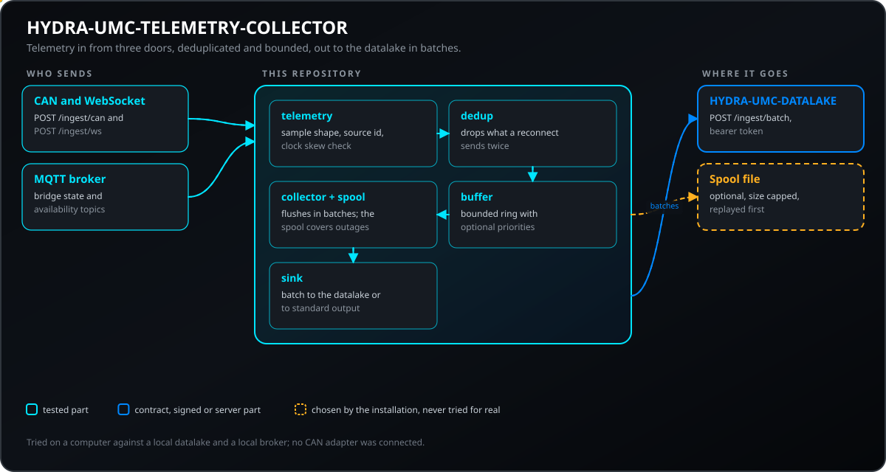
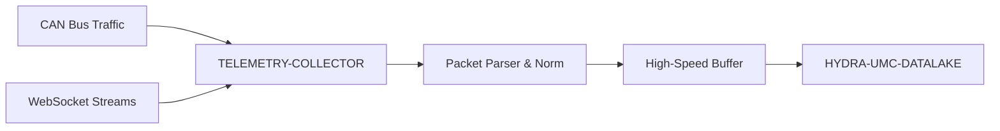
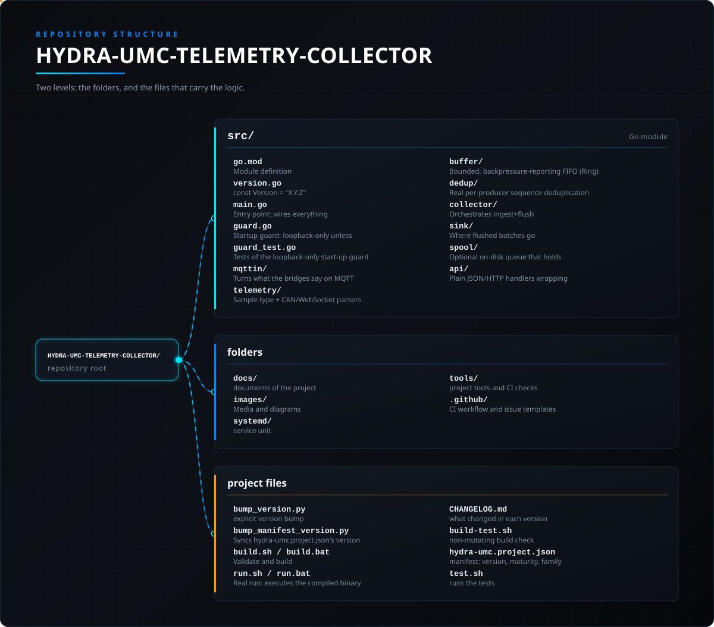

<!-- =============================================================================
HYDRA-UMC-TELEMETRY-COLLECTOR - Ingestion node for CAN, WebSocket and MQTT telemetry
Copyright (C) JuanenRac (Electro Hobby 3D) <electrohobby3d@gmail.com>
GPL-3.0-or-later - see LICENSE
============================================================================= -->

<p align="center">
  
</p>

# 📡 HYDRA-UMC-TELEMETRY-COLLECTOR

<p align="center"><a href="README.md">🇺🇸 English</a> | <a href="README_spa.md">🇪🇸 Español</a> | <a href="README_fra.md">🇫🇷 Français</a> | <a href="README_ita.md">🇮🇹 Italiano</a> | <a href="README_deu.md">🇩🇪 Deutsch</a> | <a href="README_zho.md">🇨🇳 简体中文</a> | <a href="README_jpn.md">🇯🇵 日本語</a> | 🇵🇹 <b>Português</b></p>

### 🚀 Nó de ingestão de alto débito para registos CAN e WebSocket

<p align="center">
  
  
  
  
  
  
</p>

---

> **Estado de segurança (safety e security):** este ecossistema não é um sistema de segurança certificado. Ainda não existe um caminho de E-STOP por hardware, nem limites ou interlocks impostos pelo firmware, nem um comando de movimento verificado; as imagens de firmware são verificadas com CRC-32 e uma assinatura Ed25519, e uma compilação de versão recusa as chaves de desenvolvimento publicadas (as cabeças de ferramenta e as placas de expansão atrás do relé ainda usam os bootloaders do URTC, que aceitam um HMAC-SHA256 de chave partilhada em vez de uma assinatura); TLS e TLS mútuo são opcionais e estão desativados por defeito; nenhuma placa própria foi ainda montada ou testada. Leia a [base de segurança](https://github.com/JuanenRac/HYDRA-UMC-DOCS/blob/main/docs/SECURITY_BASELINE.md) e o [modelo de ameaças](https://github.com/JuanenRac/HYDRA-UMC-DOCS/blob/main/docs/THREAT_MODEL.md) antes de confiar em qualquer afirmação aqui para a segurança de uma pessoa.

---

## 📋 Num relance

| | |
|---|---|
| Versão | `0.1.8` |
| Maturidade | Funcional |
| Testes | 138 (`go test ./...`) |
| Tecnologia | Go / CAN/WebSocket parsers / bounded FIFO buffer / HTTP API |
| Destino | O Raspberry Pi CM5 de uma célula HYDRA-UMC |
| Em hardware real | Ainda não: não há registo de execução em hardware real para esta versão |

**Ir para:** [Visão geral](#-visão-geral) · [Arquitetura](#-arquitetura) · [Segurança e proteção](#-segurança-e-proteção) · [Configuração](#-configuração) · [Início rápido](#-início-rápido) · [Testes](#-testes) · [Resolução de problemas](#-resolução-de-problemas) · [Estrutura do repositório](#-estrutura-do-repositório) · [Projetos relacionados](#-projetos-relacionados)

## 🚦 Estado do projeto

Cada linha é uma parte deste repositório e a luz diz até onde chega hoje. É escrita com o que o repositório consegue demonstrar (testes, compilações, execuções), não com o que está previsto.

🟢 Feito e verificado · 🟡 Funciona, com limites conhecidos · 🟠 Feito a meio ou ainda por verificar · 🔴 Por fazer ou a não funcionar

| Área | Estado | O que significa aqui |
|---|---|---|
| Software | 🟡 | Funciona para o seu propósito principal; a verificação de honestidade acima lista o que ainda falta |
| Testes | 🟢 | 138 testes automáticos, executados a cada alteração |
| Hardware real | 🔴 | Ainda não: não há registo de execução em hardware real para esta versão |
| Documentação | 🟢 | README em oito idiomas, verificado contra o manifesto a cada alteração |

## 🎯 Visão geral

O **HYDRA-UMC-TELEMETRY-COLLECTOR** é o gateway de ingestão que recebe a telemetria enviada por HTTP e a escreve no Datalake. Converte em amostras normalizadas as tramas CAN e as mensagens JSON de WebSocket que recebe; não escuta ele próprio nenhum barramento CAN (previsto).

Normaliza e deduplica entradas heterogéneas, para que leituras como um pico de corrente de um motor num barramento CAN possam mais tarde ser correlacionadas com outras séries (previsto: correlação com resultados de inferência de IA de um Vision Node; essa inferência ainda não existe).

### Funcionalidades principais:
* 🚀 **Ingestão multiprotocolo:** trata hoje telemetria CAN e WebSocket, através de uma API de ingestão HTTP simples. *(a ingestão gRPC está planeada)*
* ⚡ **Débito:** pensado para a telemetria da fábrica, não para capturar um barramento: com os valores por defeito o collector entrega até 250 amostras por segundo (um lote de 500 a cada 2 s, num único pedido por lote para o HYDRA-UMC-DATALAKE, ou um pedido por amostra se esse datalake não tiver a rota de lotes ou com `-datalake-batch=false`); acima disso o buffer enche-se e a ingestão responde `503`.
* 🧬 **Normalização de dados:** traduz pacotes binários em bruto para um formato JSON padronizado. *(a saída em Protobuf está planeada, não implementada)*
* 🛡️ **Entrega com buffer:** uma amostra que o collector aceitou não é descartada durante uma falha da base de dados ou da rede: o lote que está a ser entregue mantém o seu lugar, e um buffer cheio recusa amostras novas (`503`) em vez de largar as antigas. O buffer está em memória, pelo que reiniciar o collector perde o que ele contém.
* 🔁 **Deduplicação segura contra religações:** um número de sequência opcional por produtor, acompanhado numa janela de reordenação limitada, para que um dispositivo que volta a ligar-se e reenvia as suas últimas mensagens sem confirmação nunca infle as contagens de ingestão. *(implementado)*
* 🧭 **Entrada plausível:** um carimbo temporal em segundos em vez de milissegundos, ou mais de 5 minutos à frente do relógio (`-max-future-skew`), e um `sourceId` demasiado longo ou com caracteres invisíveis são recusados (`400`); um produtor cujo contador recomeça depois de um reinício é reconhecido (`producerResets` em `GET /stats`) em vez de ver as suas amostras novas rejeitadas como duplicadas. *(implementado)*
* 🩺 **Diagnóstico real de falhas:** cada falha de descarga é classificada como o destino ter rejeitado genuinamente os dados ou como um problema de transporte - exposto no `GET /stats` para visibilidade operacional real. *(implementado)*
* 🧮 **Validação de campos finitos:** um nome de campo vazio ou um valor numérico `NaN`/`Infinity`/`-Infinity` é rejeitado (`400`) antes de chegar à memória intermédia ou a um destino - a descodificação CAN passa exatamente pela mesma verificação `Sample.Validate()` que a ingestão JSON. *(implementado)*
* 📊 **Métricas Prometheus:** o `GET /metrics` expõe os mesmos contadores em direto de ingestão e de taxa de perda que o `GET /stats` acompanha (ingeridos, descartados, em quarentena, falhas de descarga de transporte vs. dados inválidos, ocupação da memória intermédia) no formato real de exposição de texto do Prometheus. *(implementado)*
* 🧰 **Falhas, prioridades e métricas protegidas (tudo opcional):** `-spool <ficheiro>` guarda em disco as amostras de uma falha longa do datalake (limitada por `-spool-max-bytes`) e reenvia-as primeiro quando ele voltar a responder; `-priority tipo=nível,...` deixa um buffer cheio descartar a amostra menos importante por outra mais importante (contado em `evicted`); `-datalake-permanent-statuses 401,403,404` descarta em vez de tentar para sempre; `-metrics-token` faz `GET /stats` e `GET /metrics` exigirem um token. Indicam a latência do último e do mais lento envio e a idade da amostra mais antiga no buffer. Tudo está desligado por defeito. *(implementado)*
* 📉 **Redução de amostras por tipo (opcional, desativada por predefinição):** `-downsample tipo=intervaloMs[:função]` agrupa as amostras de um tipo de alta frequência numa amostra por intervalo de tempo e origem (média, mínimo, máximo, última ou soma de cada campo) antes de as pôr no buffer. Um intervalo fechado nunca se perde quando o buffer está cheio, os intervalos abertos são entregues ao terminar, e `/stats` e `/metrics` contam as amostras agrupadas.

## 🧩 Papel no HYDRA-UMC

O **HYDRA-UMC-TELEMETRY-COLLECTOR** recebe telemetria de tramas CAN, mensagens WebSocket e do estado MQTT dos bridges, descarta os duplicados de um reenvio, mantém um buffer limitado e entrega lotes ao `HYDRA-UMC-DATALAKE`, com um spool opcional em disco para falhas. Sem datalake, imprime o que teria escrito.

## 🏛️ Arquitetura

<p align="center">
  
</p>

<details>
<summary>Versão em texto do diagrama (Mermaid)</summary>



</details>

### ARQUITETURA E DECISÕES DE DESENHO

* **Porque é que `src/` é a raiz do módulo Go e não a raiz do repositório.** Mantém os ficheiros do próprio módulo instalável (`main.go`, `version.go`, `go.mod`) separados das ferramentas da raiz do repositório (`bump_version.py`, `docker-compose.yml`) - o `go build ./...` corre de dentro de `src/`, não da raiz do repositório.
* **Porque a recolha é separada do próprio HYDRA-UMC-DATALAKE.** A recolha (consultar o HYDRA-UMC-SERVER, pôr em memória intermédia, agrupar escritas) é uma preocupação limitada por E/S, distinta do armazenamento/consulta - mantê-la como processo separado significa que um reinício do collector ou um pico de contrapressão não toca no caminho de consulta do próprio datalake.
* **Porque uma escrita falhada no destino volta a pôr o lote em fila em vez de o descartar - exceto a única amostra que nunca terá êxito.** O `src/collector` é o que realmente merece a afirmação "Entrega com memória intermédia: zero perda de dados": o `FlushOnce` só retira da memória intermédia um lote drenado depois de o `Sink.Write` o confirmar e, numa falha ao nível do transporte, volta a colocá-lo logo à frente - uma interrupção real repete as mesmas amostras, não as perde. A única exceção é uma amostra que o próprio destino rejeitou PERMANENTEMENTE como inválida (veja `sink.InvalidDataError` abaixo) - voltar a pô-la incondicionalmente em fila colocava-a de novo à frente para sempre, bloqueando todas as amostras válidas atrás dela; agora é posta em quarentena (descartada, contada no `quarantined` do `GET /stats`), enquanto o resto do lote volta a ser posto em fila normalmente. A memória intermédia (`src/buffer`) continua a ser limitada - uma interrupção que dure mais do que a sua capacidade descarta o excesso mais antigo, um limite real e honesto e não uma promessa de memória infinita.
* **Porque CAN e WebSocket são ambos analisados para a mesma forma de `Sample`.** O `src/telemetry` normaliza as duas fontes heterogéneas numa só estrutura antes de qualquer coisa tocar na memória intermédia ou no destino - o mecanismo real por detrás de "um pico de corrente de um motor em CAN corretamente correlacionado com um resultado de um Vision Node": nenhuma das etapas seguintes precisa de saber por que protocolo uma amostra chegou.
* **Porque o formato de transmissão CAN é a convenção v0 deste projeto e ainda não os IDs CAN reais do ecossistema.** As tabelas reais de IDs CAN vivem na documentação do firmware do HYDRA-UMC e do URTC - integrar-se com elas a sério é trabalho futuro, não algo a adivinhar sem essa referência aberta.
* **Porque o `DatalakeSink` escreve uma amostra por pedido HTTP.** O `POST /ingest` do HYDRA-UMC-DATALAKE recebe uma amostra, pelo que uma "escrita em lote" são na verdade N pedidos, por ordem, que param à primeira falha. O `PartialWriteError` diz quantos foram confirmados (`202`) e só o resto é repetido; uma amostra que o sink rejeita como inválida (`400` ou `413`) é a única descartada, e o que vem depois é repetido. Uma linha duplicada só pode aparecer se o DATALAKE aceitou um pedido e a resposta se perdeu, e o DATALAKE guarda um valor por (origem, tipo, campo, carimbo temporal), pelo que um reenvio sobrescreve em vez de duplicar.
* **Como se encaixa no resto do ecossistema.** Um serviço irmão sob o HYDRA-UMC-DATALAKE: recebe a telemetria que os produtores lhe enviam por HTTP e escreve-a no armazém partilhado de séries temporais. Não consulta nada, e nada no ecossistema lhe envia dados ainda: falta escrever um produtor (uma subscrição aos deltas de robôs do Server, um leitor SocketCAN no CM5).
* **Porque a deduplicação é um pacote `dedup` separado, assente numa `Sequence` opcional e não num hash do conteúdo da própria amostra.** Uma religação real reenvia exatamente os mesmos bytes, pelo que fazer o hash do conteúdo funcionaria nesse caso - mas também engoliria em silêncio duas amostras genuinamente diferentes que por acaso partilham todos os campos (por exemplo, duas leituras de `0.0` com um segundo de intervalo). Um número de sequência por produtor é o que um dispositivo real já tem de acompanhar para as suas próprias mensagens sem confirmação, pelo que reutilizá-lo é o sinal honesto e real - não um palpite derivado de dados que na verdade não prometem unicidade. `Sequence == 0`/omitida retira um produtor por completo, pelo que nada do comportamento anterior mudou para um dispositivo que não envia nenhuma.
* **Porque o `sink.InvalidDataError` transporta o `Index` do lote da própria amostra rejeitada.** Encontrado ao auditar o código (P1): o `DatalakeSink.Write` envia uma amostra por pedido HTTP e pára na primeira falha, pelo que, quando o DATALAKE devolve um HTTP 400 real para uma amostra concreta, o `Write` carimba a posição dessa amostra no lote no erro antes de o devolver. O `FlushOnce` usa isto para pôr em quarentena (descartar de forma permanente, nunca voltar a pôr em fila) exatamente essa amostra - repetir os mesmos bytes rejeitados nunca pode ter êxito - enquanto volta a pôr em fila o resto do lote normalmente, em vez de o lote inteiro ser repetido (e voltar a ser bloqueado) para sempre atrás de uma amostra envenenada. O `quarantined` do `GET /stats` conta todas as amostras descartadas desta forma, separado do `invalidDataErrors` (tentativas de descarga, não amostras) e do `dropped` (um limite de capacidade de memória intermédia cheia, não uma rejeição permanente) - pelo que nada disto é um descarte silencioso, e o `invalidDataErrors` vs. `transportErrors` continua a permitir a um operador distinguir "o DATALAKE está a rejeitar os nossos dados" de "a rede até ao DATALAKE está em baixo" sem adivinhar a partir dos registos.

## 🔒 Segurança e proteção

| Ameaça | Defesa | Onde |
|---|---|---|
| Qualquer pessoa na rede a alimentar as rotas de ingestão | Com um `-addr` que não é de loopback e sem token o coletor recusa arrancar, a menos que se dê `-allow-anonymous`; o token vem de `HYDRA_UMC_TELEMETRY_COLLECTOR_TOKEN` | `src/guard.go` |
| Amostras com data num futuro distante, ou uma enxurrada de fontes | Uma amostra mais de 5 minutos à frente do relógio é recusada (`-max-future-skew`), os identificadores de fonte ficam em 128 carateres, os corpos em 1 MiB e a tabela de deduplicação em 10 000 fontes | `src/telemetry/sample.go`, `src/api/api.go`, `src/dedup/dedup.go` |
| Credenciais do broker a viajar em claro | Um nome de utilizador e uma palavra-passe para um broker de outra máquina exigem `tls://` ou o explícito `-mqtt-allow-plaintext`; a palavra-passe vem de um ficheiro ou de `HYDRA_UMC_TELEMETRY_MQTT_PASSWORD`, nunca de uma opção | `src/main.go`, `src/mqttin/client.go` |

## ⚙️ Configuração

Tudo se define com opções; os segredos podem vir também do ambiente.

| Variável | Predefinição | O que define |
|---|---|---|
| `-addr` | `127.0.0.1:8092` | endereço da API HTTP |
| `-buffer` | `10000` | amostras retidas à espera de entrega |
| `-flush-interval` | `2s` | com que frequência o buffer é esvaziado |
| `-batch-size` | `500` | máximo de amostras por esvaziamento |
| `-datalake-url` | nenhum | datalake onde escrever; vazio imprime na saída padrão |
| `-token` / `HYDRA_UMC_TELEMETRY_COLLECTOR_TOKEN` | nenhum | token Bearer exigido pelas rotas de ingestão |
| `-metrics-token` / `HYDRA_UMC_TELEMETRY_COLLECTOR_METRICS_TOKEN` | nenhum | token exigido por `GET /stats` e `GET /metrics` |
| `-datalake-token` / `HYDRA_UMC_DATALAKE_TOKEN` | nenhum | token enviado ao datalake com cada amostra |
| `-spool`, `-spool-max-bytes` | desligado; 256 MiB | ficheiro que guarda as amostras de uma falha do datalake, e o seu limite de tamanho |
| `-mqtt-url` | nenhum | broker de onde ler o estado dos bridges; vazio deixa a entrada MQTT desligada |

## 🚀 Início rápido

Requer Go 1.24 ou superior.

```bash
./build.sh  # Linux, macOS (build.bat on Windows)
./run.sh -addr 127.0.0.1:8092
./run.sh -addr 127.0.0.1:8092 -datalake-url http://localhost:8095 -spool spool.jsonl
```

## 🧪 Testes

138 testes automáticos correm com `cd src && go test ./...`. Não precisam de hardware nem de nada fora desta máquina.

A CI executa `HYDRA_UMC_CI=1 python tools/ci_validate.py`, que verifica o manifesto, os documentos, os oito README e as imagens.

## 🏗️ Compilação e publicação

Requer o Go >= 1.21. Um pipeline de ingestão real com uma API HTTP, não apenas um
esqueleto que compila.

```bash
# Linux/macOS
./build.sh
./run.sh -addr 127.0.0.1:8092 -datalake-url http://localhost:8095

# Windows
build.bat
run.bat -addr 127.0.0.1:8092 -datalake-url http://localhost:8095
```

`build` nunca altera a versão (só `python tools/hydra_project_tool.py bump` a sobe) e compila o módulo Go em
`src/` para `build/telemetry-collector(.exe)`. O `run` executa o
binário compilado, reencaminhando quaisquer opções, e começa a escutar tráfego real.
O `-datalake-url` aponta os lotes descarregados para o `POST /ingest` de uma
instância real e em execução do HYDRA-UMC-DATALAKE (`sink.DatalakeSink`) -
omita-o para imprimir as amostras descarregadas no stdout
(`sink.ConsoleSink`), útil para executar este collector de forma independente.

Por omissão o collector escuta apenas em loopback e as suas rotas de ingestão estão abertas aos chamadores locais. Para escutar num endereço de rede, dê-lhe um token Bearer (`-token`, ou `HYDRA_UMC_TELEMETRY_COLLECTOR_TOKEN`; pelo menos 16 caracteres): o `POST /ingest/can` e o `POST /ingest/ws` passam então a exigir `Authorization: Bearer <token>` (o `/stats` e o `/metrics` continuam abertos para que um recolhedor local não precise de nenhum segredo). Um `-addr` que não seja loopback e não tenha token é recusado no arranque, a menos que se passe `-allow-anonymous`. O corpo de um pedido está limitado a 1 MiB (`413` se o ultrapassar) e o servidor HTTP aplica tempos limite de leitura, escrita e inatividade.

**Ler as pontes por MQTT.** Com `-mqtt-url tcp://127.0.0.1:1883` (ou `tls://broker:8883`, com `-mqtt-ca-file` para uma autoridade privada) o coletor subscreve também `hydra/bridges/+/state` e `hydra/bridges/+/availability` (`-mqtt-topics`) e transforma cada mensagem numa amostra: `bridge_state` com cada número e cada indicador do estado (um nível de aninhamento) e um indicador `machine_state.<valor>`, com o `observed_at` da ponte como marca temporal, e `bridge_availability` com `online` 1 ou 0. Um estado retido mais antigo do que `-mqtt-max-age` (2 minutos por omissão) é a memória do broker, não uma leitura, e é ignorado. O nome de utilizador vem de `-mqtt-username` ou `HYDRA_UMC_TELEMETRY_MQTT_USER` e a palavra-passe de `-mqtt-password-file` ou `HYDRA_UMC_TELEMETRY_MQTT_PASSWORD`; as credenciais numa ligação em claro para outra máquina são recusadas, salvo com `-mqtt-allow-plaintext`. A entrada está desligada por omissão e `GET /stats` indica a ligação e as contagens em `mqtt`. Ainda não experimentado com o broker real do ecossistema.

```bash
# Ingerir uma amostra de telemetria ao estilo WebSocket
curl -X POST localhost:8092/ingest/ws \
  -d '{"sourceId":"robot-1","kind":"motor_temp","timestamp":1700000000000,"fields":{"value":42.5}}'

# Ingerir uma trama CAN (8 bytes, base64 - veja src/telemetry/can.go para o formato de transmissão)
curl -X POST localhost:8092/ingest/can \
  -d '{"arbitrationId":7,"data":"AQAAUEEAAAA="}'

# Verificar o que o collector ingeriu/descarregou/descartou
curl localhost:8092/stats
```

```bash
cd src && go test ./...   # telemetry (ida e volta CAN, validação WS),
                           # buffer (FIFO limitado, contrapressão, reposição em fila),
                           # collector (o comportamento real de "não perder
                           # dados numa interrupção do destino"), e api (idas e
                           # voltas HTTP reais com httptest)
```

## 🩺 Resolução de problemas

| Vê | Porque | Faça |
|---|---|---|
| HTTP 503 | O buffer está cheio e nenhuma prioridade permite descartar uma amostra em fila | Verifique o datalake, junte `-spool`, aumente `-buffer` ou defina `-priority` |
| HTTP 401 | Há um token definido e o pedido não traz nenhum ou traz o errado | Envie `Authorization: Bearer <token>` |

## 📂 Estrutura do repositório

<p align="center">
  
</p>

<details>
<summary>Versão em texto da árvore</summary>

```text
HYDRA-UMC-TELEMETRY-COLLECTOR/
├── src/                       Módulo Go
│   ├── go.mod                 Definição do módulo
│   ├── version.go             const Version = "X.Y.Z"
│   ├── main.go                Ponto de entrada: liga tudo e arranca a API HTTP
│   ├── guard.go               Guarda de arranque: só loopback, a menos que haja um token Bearer
│   ├── guard_test.go          Testes da guarda de arranque só em loopback
│   ├── mqttin/                Converte o que os bridges dizem por MQTT (estado, disponibilidade) em amostras de telemetria
│   ├── telemetry/             Tipo Sample + analisadores CAN/WebSocket (normalização)
│   ├── buffer/                FIFO limitado que reporta contrapressão (Ring)
│   ├── dedup/                 Deduplicação real de sequências por produtor (janela de reordenação)
│   ├── collector/             Orquestra ingestão e descarga, repete em caso de falha do destino, deduplicação
│   ├── sink/                  Para onde vão os lotes enviados (o data lake por HTTP ou a consola), classificação de falhas de transporte e de dados inválidos
│   ├── spool/                 Fila opcional em disco que guarda as amostras de uma falha longa do destino
│   └── api/                   Handlers JSON/HTTP simples que envolvem o collector
├── docs/                      documentos do projeto
├── images/                    Multimédia e diagramas
├── systemd/                   unidade de serviço
├── tools/                     ferramentas do projeto e verificações da CI
├── .github/                   fluxo de CI e modelos de problemas
├── bump_version.py            Subida de versão ao estilo conta-quilómetros (executada só pelo comando `bump` explícito)
├── bump_manifest_version.py   Sincroniza a versão do hydra-umc.project.json com a nativa (--sync)
├── build.sh / build.bat       Valida e compila (compilar nunca altera a versão)
├── run.sh / run.bat           Execução real: executa o binário compilado
├── CHANGELOG.md               o que mudou em cada versão
├── build-test.sh              verificação de compilação sem alterações
├── hydra-umc.project.json     manifesto: versão, maturidade, família
└── test.sh                    executa os testes
```

</details>

## 🗺️ Roteiro e limites conhecidos

**Limites conhecidos hoje**

* **Fase 1:** ingestão de alto débito do Datalake e indexação para análise histórica.
* **Fase 2:** compressão na periferia do telemetry collector e protocolos de transmissão seguros.
* **Fase 3:** deteção de anomalias com aprendizagem não supervisionada e análise de vibração de motores.
* **Fase 4:** compressão em tempo real para ingestão massiva de registos e otimização multiprotocolo.

## 🌍 Idiomas

Este README e os documentos do repositório existem em oito idiomas: inglês, espanhol, alemão, francês, italiano, japonês, chinês e português (Portugal). São escritos em conjunto e a CI verifica que os oito ficheiros têm as mesmas secções e as mesmas ligações. Este repositório não tem ecrã nem catálogo de mensagens próprios, por isso não há textos de interface para traduzir.

## 🔗 Projetos relacionados

Este projeto faz parte do ecossistema de robótica HYDRA-UMC do mesmo autor (JuanenRac / Electro Hobby 3D). Vale a pena conhecê-los, porque um pedido pode ser, na verdade, sobre um destes e não sobre este repositório.

**Projeto-mãe**
- **[HYDRA-UMC-DATALAKE](https://github.com/JuanenRac/HYDRA-UMC-DATALAKE)** — armazém real de séries temporais sobre sqlite3 com uma API HTTP real de ingestão/consulta; o projeto-mãe de que este repositório é um serviço de análise específico, dentro da sua própria camada de dados e análise.

**Projetos irmãos** — os outros serviços de análise da própria camada de dados e análise do HYDRA-UMC-DATALAKE
- **[HYDRA-UMC-ANOMALY-DETECTOR](https://github.com/JuanenRac/HYDRA-UMC-ANOMALY-DETECTOR)** — detetor real de anomalias por FFT e linha de base estatística, com monitorização de deriva.
- **[HYDRA-UMC-PRODUCTION-REPORTS](https://github.com/JuanenRac/HYDRA-UMC-PRODUCTION-REPORTS)** — cálculo real de OEE/disponibilidade sobre o histórico do DATALAKE, com exportação CSV reprodutível.

**Diretamente relacionados**
- **[HYDRA-UMC-SERVER](https://github.com/JuanenRac/HYDRA-UMC-SERVER)** — o back-end headless real (REST/WebSocket) com que todos os clientes de controlo realmente comunicam — a origem dos registos que este projeto ingere.
- **[HYDRA-UMC](https://github.com/JuanenRac/HYDRA-UMC)** — o desenho da placa-mãe do braço robótico: anfitrião CM5 + STM32H745 de dois núcleos, pensado para orquestrar até 8 braços de ferramenta por CAN-OTA/SPI-OTA (firmware numa fase inicial; ainda sem placa montada); hoje usa a sua própria convenção v0, assumida honestamente como trabalho futuro e não dada como concluída.
- **[URTC](https://github.com/JuanenRac/URTC)** — firmware da placa física Universal Robot Tool Controller, mais de 25 perfis de ferramenta por barramento CAN — a tabela real de IDs CAN com que o formato de transmissão CAN deste projeto deverá integrar-se um dia; hoje usa a sua própria convenção v0, assumida honestamente como trabalho futuro e não dada como concluída.

**Também fazem parte do ecossistema**

*Hardware e plataforma centrais*
- **[HYDRA-UMC-OS](https://github.com/JuanenRac/HYDRA-UMC-OS)** — camada de produto reproduzível do Raspberry Pi OS para o CM5: agente só de leitura, configuração/perfis validados, aprovisionamento Wi-Fi de primeiro contacto.
- **[HYDRA-UMC-SDK](https://github.com/JuanenRac/HYDRA-UMC-SDK)** — o contrato JSON-Schema partilhado e a fronteira de software de controlo de trabalhos contra a qual cada bridge valida os seus comandos (não é uma função de segurança certificada).
- **[HYDRA-UMC-CONNECTOR-HUB](https://github.com/JuanenRac/HYDRA-UMC-CONNECTOR-HUB)** — registo declarativo de manifestos de adaptador e validador para conectores de máquinas externas; estende a ideia de contrato do SDK a máquinas externas sem substituir os projetos de gateway industrial.

*Backend central e clientes*
- **[HYDRA-UMC-STUDIO](https://github.com/JuanenRac/HYDRA-UMC-STUDIO)** — painel web de controlo com visualização 3D em tempo real de vários robôs.
- **[HYDRA-UMC-SUITE](https://github.com/JuanenRac/HYDRA-UMC-SUITE)** — centro de comando de enxame para desktop (PySide6) para vários servidores ao mesmo tempo, empacotado como executável independente.
- **[HYDRA-UMC-ANDROID-CONTROL](https://github.com/JuanenRac/HYDRA-UMC-ANDROID-CONTROL)** — aplicação Android nativa de controlo, com início de sessão biométrico e um companheiro Wear OS emparelhado.
- **[HYDRA-UMC-IOS-CONTROL](https://github.com/JuanenRac/HYDRA-UMC-IOS-CONTROL)** — aplicação de controlo para iOS/iPadOS (Flutter) com sincronização WebSocket em tempo real.
- **[HYDRA-UMC-DSI](https://github.com/JuanenRac/HYDRA-UMC-DSI)** — interface tátil nativa para o ecrã tátil DSI de 7" integrado, executada no próprio CM5.
- **[HYDRA-UMC-EDITOR-URDF](https://github.com/JuanenRac/HYDRA-UMC-EDITOR-URDF)** — criador/editor gráfico de URDF para desktop que envia os modelos concluídos para o catálogo do STUDIO.
- **[HYDRA-UMC-EDITOR-STL](https://github.com/JuanenRac/HYDRA-UMC-EDITOR-STL)** — editor de modelos STL para desktop que transforma/substitui/remove/adiciona peças reais no mesmo catálogo de modelos que o HYDRA-UMC-EDITOR-URDF também edita.
- **[HYDRA-UMC-BRIDGE-AMR](https://github.com/JuanenRac/HYDRA-UMC-BRIDGE-AMR)** — fronteira de coordenação para frotas AGV/AMR através de um publicador MQTT VDA 5050 (testado apenas contra uma frota emulada).
- **[HYDRA-UMC-BRIDGE-CNC](https://github.com/JuanenRac/HYDRA-UMC-BRIDGE-CNC)** — coordenador de células CNC de alto nível com acesso ao estado GRBL e aos bytes de controlo (testado apenas contra um emulador).
- **[HYDRA-UMC-BRIDGE-DROIDS](https://github.com/JuanenRac/HYDRA-UMC-BRIDGE-DROIDS)** — fronteira de coordenação para droides com patas/humanoides, com um emissor de comandos para o Boston Dynamics Spot (testado apenas contra um emulador).
- **[HYDRA-UMC-BRIDGE-LASER](https://github.com/JuanenRac/HYDRA-UMC-BRIDGE-LASER)** — coordenador de células laser que lê 3 sinais GPIO (chave, caixa e interlock) (testado apenas contra um chip simulado; não pode armar nem disparar um laser).
- **[HYDRA-UMC-BRIDGE-OPENPNP](https://github.com/JuanenRac/HYDRA-UMC-BRIDGE-OPENPNP)** — coordenador seguro de fluxo de placa de alto nível para pick-and-place com OpenPnP.
- **[HYDRA-UMC-BRIDGE-PRINTER3D](https://github.com/JuanenRac/HYDRA-UMC-BRIDGE-PRINTER3D)** — fronteira de coordenação segura para impressoras 3D Moonraker/Klipper, com comandos de trabalho reais protegidos por portas.
- **[HYDRA-UMC-BRIDGE-ROS2](https://github.com/JuanenRac/HYDRA-UMC-BRIDGE-ROS2)** — coordenador com um transporte ROS 2 baseado em rclpy importado sob demanda (ainda não executado contra uma instalação ROS 2).
- **[HYDRA-UMC-BRIDGE-UAV](https://github.com/JuanenRac/HYDRA-UMC-BRIDGE-UAV)** — fronteira de coordenação para UAV com câmara, com um emissor de comandos MAVLink (testado apenas contra um emulador).

*Plataforma de ferramentas URTC*
- **[URTC-FLASHER](https://github.com/JuanenRac/URTC-FLASHER)** — ferramenta gráfica de gravação para desktop das placas URTC, por CAN-OTA e também SWD/JTAG de chip completo.
- **[URTC-TESTER](https://github.com/JuanenRac/URTC-TESTER)** — ferramenta de diagnóstico CAN em tempo real para desktop das placas URTC, com um painel por perfil de ferramenta.
- **[URTC-WEB-STUDIO](https://github.com/JuanenRac/URTC-WEB-STUDIO)** — alternativa no navegador ao URTC-TESTER através da Web Serial API, sem instalação local.
- **[URTC-GATEWAY](https://github.com/JuanenRac/URTC-GATEWAY)** — gateway à frente do barramento CAN do URTC: lista de identificadores permitidos, limite de taxa e chave de sessão; software testado num computador, ainda não num barramento real.

*Nó de IA de visão (Hailo-8)*
- **[HYDRA-UMC-VISION-NODE](https://github.com/JuanenRac/HYDRA-UMC-VISION-NODE)** — centro de integração do pipeline de visão Hailo-8, com uma verificação real de prontidão de hardware por fase.
- **[HYDRA-UMC-DETECTION-HEF](https://github.com/JuanenRac/HYDRA-UMC-DETECTION-HEF)** — registo real de modelos compilados com verificação segura de carga por arquitetura Hailo e soma de verificação.
- **[HYDRA-UMC-VISION-STREAMER](https://github.com/JuanenRac/HYDRA-UMC-VISION-STREAMER)** — pipeline GStreamer real e gerador de configuração MediaMTX com uma fronteira de integração HailoRT real.
- **[HYDRA-UMC-VISUAL-SERVOING-API](https://github.com/JuanenRac/HYDRA-UMC-VISUAL-SERVOING-API)** — lei de correção de servovisão baseada em posição com autorização condicionada ao estado da zona; ainda sem estimativa de pose por câmara.
- **[HYDRA-UMC-SAFETY-ZONES](https://github.com/JuanenRac/HYDRA-UMC-SAFETY-ZONES)** — lógica v0 de violação de zonas, atualidade da calibração e pedido de E-STOP que lê as posições dos objetos de um ficheiro; nenhum detetor a alimenta e ainda não há E-STOP físico ligado.

*Nó de IA cognitiva (Hailo-10)*
- **[HYDRA-UMC-COGNITIVE-NODE](https://github.com/JuanenRac/HYDRA-UMC-COGNITIVE-NODE)** — centro de integração do pipeline cognitivo do Hailo-10 (orquestração de LLM/VLA/voz).
- **[HYDRA-UMC-VLA-ENGINE](https://github.com/JuanenRac/HYDRA-UMC-VLA-ENGINE)** — codificação/descodificação real de tokens de ação e geração de trajetórias para um modelo Visão-Linguagem-Ação.
- **[HYDRA-UMC-VOICE-UI](https://github.com/JuanenRac/HYDRA-UMC-VOICE-UI)** — front-end de voz real (VAD + analisador de intenções) com um relé para o relógio limitado e protegido por confirmação.
- **[HYDRA-UMC-SEMANTIC-PLANNER](https://github.com/JuanenRac/HYDRA-UMC-SEMANTIC-PLANNER)** — decomposição real de tarefas baseada em regras e recuperação semântica de erros sobre os códigos de erro do MCU.
- **[HYDRA-UMC-DOCS-QA](https://github.com/JuanenRac/HYDRA-UMC-DOCS-QA)** — pesquisa real de documentos TF-IDF só com a biblioteca padrão sobre a documentação Markdown deste ecossistema.
- **[HYDRA-UMC-LOCAL-TECHNICIAN](https://github.com/JuanenRac/HYDRA-UMC-LOCAL-TECHNICIAN)** — técnico de manutenção de IA local, protegido por políticas, para o próprio ecossistema: observa, diagnostica e propõe correções; os dois níveis de maior risco não estão implementados de propósito.

*Orquestração e enxame*
- **[HYDRA-UMC-ORCHESTRATOR](https://github.com/JuanenRac/HYDRA-UMC-ORCHESTRATOR)** — centro de integração com um contrato real de relatório de saúde gRPC/Protobuf e uma máquina de estados de missões.
- **[HYDRA-UMC-JOB-DISPATCHER](https://github.com/JuanenRac/HYDRA-UMC-JOB-DISPATCHER)** — fila real de trabalhos por prioridade com deduplicação, sobre uma API HTTP real.
- **[HYDRA-UMC-NODE-HEALING](https://github.com/JuanenRac/HYDRA-UMC-NODE-HEALING)** — vigilante real de saúde da frota por gRPC com repetição/recuo e deteção de identidade incoerente.
- **[HYDRA-UMC-PATH-PLANNER-3D](https://github.com/JuanenRac/HYDRA-UMC-PATH-PLANNER-3D)** — planeador real de trajetórias 3D baseado em RRT com validação real de colisões com obstáculos e espaço de trabalho.
- **[HYDRA-UMC-SWARM-SYNC](https://github.com/JuanenRac/HYDRA-UMC-SWARM-SYNC)** — sincronização real de estado CRDT LWW-Element-Map, testada por propriedades para a convergência de várias células.

*Gémeo digital e simulação*
- **[HYDRA-UMC-TWIN](https://github.com/JuanenRac/HYDRA-UMC-TWIN)** — centro de integração do motor de gémeo digital, com um contrato real de sincronização de compatibilidade de versões.
- **[HYDRA-UMC-HIL-BRIDGE](https://github.com/JuanenRac/HYDRA-UMC-HIL-BRIDGE)** — encaminhador hardware-in-the-loop com um interlock de software de colisão entre a simulação e o hardware real (testado sem hardware real).
- **[HYDRA-UMC-PHYSICS-REPLICA](https://github.com/JuanenRac/HYDRA-UMC-PHYSICS-REPLICA)** — cinemática direta real e validação de limites de juntas sobre um subconjunto real de URDF.
- **[HYDRA-UMC-SYNTHETIC-DATA-GEN](https://github.com/JuanenRac/HYDRA-UMC-SYNTHETIC-DATA-GEN)** — gerador procedural real de cenas 2D com exportação de anotações YOLO/COCO.

*Gateway industrial*
- **[HYDRA-UMC-GATEWAY-INDUSTRIAL](https://github.com/JuanenRac/HYDRA-UMC-GATEWAY-INDUSTRIAL)** — centro de integração que retransmite para protocolos industriais, com uma camada real de lista de comandos permitidos e contrapressão.
- **[HYDRA-UMC-OPCUA-SERVER](https://github.com/JuanenRac/HYDRA-UMC-OPCUA-SERVER)** — espaço de endereços OPC-UA real, verificado com uma sessão de cliente real do protocolo binário.
- **[HYDRA-UMC-MQTT-BROKER](https://github.com/JuanenRac/HYDRA-UMC-MQTT-BROKER)** — broker MQTT real com autenticação opcional por cliente e ACL de tópicos.
- **[HYDRA-UMC-MTCONNECT-ADAPTER](https://github.com/JuanenRac/HYDRA-UMC-MTCONNECT-ADAPTER)** — endpoints XML MTConnect `/probe` e `/current` reais com saída em modo degradado.

*Ferramentas complementares e operações do ecossistema*
- **[HYDRA-UMC-DASHBOARD-AI](https://github.com/JuanenRac/HYDRA-UMC-DASHBOARD-AI)** — painéis de Resumos Inteligentes e Realce de Anomalias sobre o DATALAKE/ANOMALY-DETECTOR, com um recurso estatístico honesto.
- **[HYDRA-UMC-TOOL-CLI](https://github.com/JuanenRac/HYDRA-UMC-TOOL-CLI)** — CLI da frota com um contrato de códigos de saída real e estável, um cliente vivo genuíno da API do HYDRA-UMC-SERVER.
- **[HYDRA-UMC-WATCH](https://github.com/JuanenRac/HYDRA-UMC-WATCH)** — aplicação companheira WearOS com padrões de alerta tátil e um relé de voz para o telemóvel emparelhado (ainda não executada num relógio físico).
- **[URTC-SMART-RACK](https://github.com/JuanenRac/URTC-SMART-RACK)** — firmware de um rack de montagem de placas com descodificação real do ID da ferramenta e lógica de pré-aquecimento Smart Idle.
- **[URTC-VISION-TOOL](https://github.com/JuanenRac/URTC-VISION-TOOL)** — firmware mais um companheiro de visão em Python real para uma cabeça de ferramenta de inspeção térmica/RGB.
- **[HYDRA-UMC-UPDATER](https://github.com/JuanenRac/HYDRA-UMC-UPDATER)** — ferramenta administrativa de desktop que descobre, clona e atualiza todos os repositórios deste ecossistema.
- **[HYDRA-UMC-OS-REBUILDER](https://github.com/JuanenRac/HYDRA-UMC-OS-REBUILDER)** — ferramenta de desktop para Windows/Linux que constrói uma imagem do CM5 pronta a gravar com as versões mais recentes do ecossistema, com configuração de primeiro arranque de Wi-Fi/utilizador/SSH ao estilo do Raspberry Pi Imager.
- **[HYDRA-UMC-OPS-AGENT](https://github.com/JuanenRac/HYDRA-UMC-OPS-AGENT)** — coordenador de incidentes de manutenção: um papel de borda de poucos privilégios recolhe um inventário/estado higienizado, um papel de plano de controlo mostra-o só de leitura e pede a um fornecedor de IA que sugira um diagnóstico; nunca aplica um patch nem implanta nada.
- **[HYDRA-UMC-DEV-SERVER](https://github.com/JuanenRac/HYDRA-UMC-DEV-SERVER)** — anfitrião de desenvolvimento reproduzível (Raspberry Pi 5 / CM5) que guarda o código-fonte do ecossistema e executa tarefas limitadas de compilação/teste numa fila durável; um papel de desenvolvimento dedicado, explicitamente não um CM5 operacional.

## 📚 Documentação

Onde ler mais:

* [Base de segurança do ecossistema](https://github.com/JuanenRac/HYDRA-UMC-DOCS/blob/main/docs/SECURITY_BASELINE.md)
* [Modelo de ameaças do ecossistema](https://github.com/JuanenRac/HYDRA-UMC-DOCS/blob/main/docs/THREAT_MODEL.md)
* [Registo de alterações deste repositório](CHANGELOG.md)
* [Licença deste repositório](LICENSE.md)

## 🤝 Contribuir e comunidade

* Antes de um pull request execute `HYDRA_UMC_CI=1 py -3 tools/ci_validate.py` (ou `HYDRA_UMC_CI=1 python3 tools/ci_validate.py`): tem de imprimir `CI_VALIDATION=PASS`. Não execute `build.sh` nem `build.bat` para esta verificação; compilar não é verificar.
* Os oito README são escritos a partir de uma única fonte em HYDRA-UMC-DOCS; não os edite à mão. Altere a fonte e escreva-os de novo com `tools/make_readmes.py`.
* Não afirme num README o que não foi executado: diga «simulado» ou «não testado em hardware» quando for a verdade.
* Consulte [CONTRIBUTING.md](CONTRIBUTING.md), o [código de conduta](CODE_OF_CONDUCT.md), [SECURITY.md](SECURITY.md) e [SUPPORT.md](SUPPORT.md).

## 👤 AUTOR

**JuanenRac (Electro Hobby 3D)** · electrohobby3d@gmail.com

## 📜 LICENÇA

GPL-3.0-or-later - [LICENSE](LICENSE).
