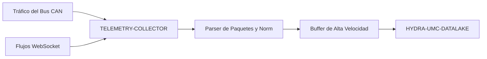

<!-- =============================================================================
HYDRA-UMC-TELEMETRY-COLLECTOR - Ingestion node for CAN, WebSocket and MQTT telemetry
Copyright (C) JuanenRac (Electro Hobby 3D) <electrohobby3d@gmail.com>
GPL-3.0-or-later - see LICENSE
============================================================================= -->

<p align="center">
  
</p>

# 📡 HYDRA-UMC-TELEMETRY-COLLECTOR

<p align="center"><a href="README.md">🇺🇸 English</a> | 🇪🇸 <b>Español</b> | <a href="README_fra.md">🇫🇷 Français</a> | <a href="README_ita.md">🇮🇹 Italiano</a> | <a href="README_deu.md">🇩🇪 Deutsch</a> | <a href="README_zho.md">🇨🇳 简体中文</a> | <a href="README_jpn.md">🇯🇵 日本語</a> | <a href="README_por.md">🇵🇹 Português</a></p>

### 🚀 Nodo de Ingesta de Alto Rendimiento para Logs de CAN y WebSocket

<p align="center">
  
  
  
  
  
  
</p>

---

> **Estado de seguridad física y de ciberseguridad:** este ecosistema no es un sistema de seguridad certificado. Todavía no existe una ruta de E-STOP por hardware, ni límites ni enclavamientos aplicados por el firmware, ni un comando de movimiento verificado; las imágenes de firmware se comprueban con CRC-32 y una firma Ed25519, y una compilación de versión rechaza las claves de desarrollo publicadas (los cabezales de herramienta y las placas de expansión detrás del relé siguen con cargadores de URTC, que usan un HMAC-SHA256 de clave compartida en lugar de una firma); TLS y TLS mutuo son opcionales y están desactivados por defecto; aún no se ha poblado ni probado ninguna placa propia. Lee la [línea base de seguridad](https://github.com/JuanenRac/HYDRA-UMC-DOCS/blob/main/docs/SECURITY_BASELINE.md) y el [modelo de amenazas](https://github.com/JuanenRac/HYDRA-UMC-DOCS/blob/main/docs/THREAT_MODEL.md) antes de fiarte de cualquier afirmación de aquí para la seguridad de una persona.

---

## 📋 De un vistazo

| | |
|---|---|
| Versión | `0.1.8` |
| Madurez | Funcional |
| Tests | 126 (`go test ./...`) |
| Tecnología | Go / CAN/WebSocket parsers / bounded FIFO buffer / HTTP API |
| Destino | La Raspberry Pi CM5 de una celda HYDRA-UMC |
| En hardware real | Todavía no: no consta ninguna ejecución en hardware real para esta versión |

**Ir a:** [Resumen](#-resumen) · [Arquitectura](#-arquitectura) · [Seguridad y protección](#-seguridad-y-protección) · [Configuración](#-configuración) · [Inicio rápido](#-inicio-rápido) · [Pruebas](#-pruebas) · [Resolución de problemas](#-resolución-de-problemas) · [Estructura del repositorio](#-estructura-del-repositorio) · [Proyectos relacionados](#-proyectos-relacionados)

## 🚦 Estado del proyecto

Cada línea es una parte de este repositorio y la luz dice hasta dónde llega hoy. Se escribe con lo que el repositorio puede demostrar (pruebas, compilaciones, ejecuciones), no con lo previsto.

🟢 Hecho y verificado · 🟡 Funciona, con límites conocidos · 🟠 Hecho a medias o sin verificar · 🔴 Sin hacer o sin funcionar

| Área | Estado | Qué significa aquí |
|---|---|---|
| Software | 🟡 | Funciona para su propósito principal; la comprobación de honestidad de arriba lista lo que aún falta |
| Pruebas | 🟢 | 126 pruebas automáticas, ejecutadas en cada cambio |
| Hardware real | 🔴 | Todavía no: no consta ninguna ejecución en hardware real para esta versión |
| Documentación | 🟢 | README en ocho idiomas, comprobado contra el manifiesto en cada cambio |

## 🎯 Resumen

**HYDRA-UMC-TELEMETRY-COLLECTOR** es la pasarela de ingesta que recibe la telemetría que se le envía por HTTP y la escribe en el Datalake. Convierte en muestras normalizadas las tramas CAN y los mensajes JSON de WebSocket que recibe; todavía no escucha ningún bus CAN por sí misma (previsto).

Normaliza y deduplica entradas heterogéneas, de modo que lecturas como un pico de corriente de motor en un bus CAN puedan correlacionarse más adelante con otras series (previsto: correlación con resultados de inferencia de IA de un Vision Node; esa inferencia todavía no existe).

### Características Clave:
* 🚀 **Ingesta Multi-Protocolo:** Maneja telemetría CAN y WebSocket hoy, sobre una API de ingesta HTTP simple. *(la ingesta gRPC está planeada)*
* ⚡ **Rendimiento:** pensado para la telemetría de la fábrica, no para capturar un bus: con los valores por defecto el collector entrega hasta 250 muestras por segundo (un lote de 500 cada 2 s, en una sola petición por lote hacia HYDRA-UMC-DATALAKE, o una petición por muestra si ese datalake no tiene la ruta de lotes o con `-datalake-batch=false`); más allá, el búfer se llena y la ingesta responde `503`.
* 🧬 **Normalización de Datos:** Traduce paquetes binarios brutos a un formato JSON estandarizado. *(la salida Protobuf está planeada, no implementada)*
* 🛡️ **Entrega con búfer:** una muestra que el collector aceptó no se descarta durante una caída de la base de datos o de la red: el lote que se está entregando conserva su sitio, y un búfer lleno rechaza muestras nuevas (`503`) en lugar de tirar las antiguas. El búfer está en memoria, así que reiniciar el collector pierde lo que contiene.
* 🔁 **Deduplicación Segura ante Reconexión:** Un número de secuencia opcional por productor, rastreado en una ventana de reordenamiento acotada, para que un dispositivo que se reconecta y reenvía sus últimos mensajes sin confirmar nunca infle los conteos de ingesta. *(implementado)*
* 🧭 **Entrada plausible:** se rechazan (`400`) una marca de tiempo en segundos en vez de milisegundos, o más de 5 minutos por delante del reloj (`-max-future-skew`), y un `sourceId` demasiado largo o con caracteres invisibles; un productor cuyo contador empieza de nuevo tras un reinicio se reconoce (`producerResets` en `GET /stats`) en vez de rechazar sus muestras nuevas como duplicadas. *(implementado)*
* 🩺 **Diagnóstico Real de Fallos:** Cada fallo de flush se clasifica como un rechazo genuino de los datos por parte del sink frente a un problema de transporte - expuesto en `GET /stats` para una visibilidad operativa real. *(implementado)*
* 🧮 **Validación de Campos Finitos:** Un nombre de campo vacío o un valor numérico `NaN`/`Infinity`/`-Infinity` se rechaza (`400`) antes de llegar al buffer o a un sink - la decodificación CAN pasa por el mismo `Sample.Validate()` que la ingesta JSON. *(implementado)*
* 📊 **Métricas Prometheus:** `GET /metrics` expone los mismos contadores en vivo de ingesta y pérdida que sigue `GET /stats` (ingeridas, descartadas, en cuarentena, fallos de envío de transporte frente a datos inválidos, ocupación del búfer) en el formato real de texto de Prometheus. *(implementado)*
* 🧰 **Caídas, prioridades y métricas protegidas (todo opcional):** `-spool <fichero>` guarda en disco las muestras de una caída larga del datalake (con el límite de `-spool-max-bytes`) y las reenvía primero cuando responde de nuevo; `-priority tipo=nivel,...` permite que un búfer lleno descarte la muestra menos importante por otra más importante (se cuenta en `evicted`); `-datalake-permanent-statuses 401,403,404` descarta en lugar de reintentar para siempre; `-metrics-token` hace que `GET /stats` y `GET /metrics` exijan un token. Informan de la latencia del último y del más lento envío y de la edad de la muestra más antigua del búfer. Todo está desactivado por defecto. *(implementado)*

## 🧩 Papel en HYDRA-UMC

**HYDRA-UMC-TELEMETRY-COLLECTOR** recibe telemetría de tramas CAN, mensajes WebSocket y el estado MQTT de los bridges, descarta los duplicados de un reenvío, mantiene un búfer acotado y entrega lotes a `HYDRA-UMC-DATALAKE`, con un spool opcional en disco para las caídas. Sin datalake imprime lo que habría escrito.

## 🏛️ Arquitectura

<p align="center">
  
</p>

<details>
<summary>Versión en texto del diagrama (Mermaid)</summary>



</details>

### ARQUITECTURA Y DECISIONES DE DISEÑO

* **Por qué `src/` es la raíz del módulo Go, no la raíz del repo.** Mantiene los propios archivos del módulo instalable (`main.go`, `version.go`, `go.mod`) separados de las herramientas de la raíz del repo (`bump_version.py`, `docker-compose.yml`) - `go build ./...` se ejecuta desde dentro de `src/`, no desde la raíz del repo.
* **Por qué la recolección está separada del propio HYDRA-UMC-DATALAKE.** La recolección (sondear HYDRA-UMC-SERVER, hacer buffer, agrupar escrituras) es una preocupación ligada a E/S distinta del almacenamiento/consulta - mantenerla como proceso separado significa que un reinicio del recolector o un pico de contrapresión no toca el propio camino de consulta del data lake.
* **Por qué un fallo de escritura en el sink reencola el lote en vez de descartarlo - excepto la única muestra que nunca va a tener éxito.** `src/collector` es lo que de verdad respalda la promesa de "Entrega con Buffer: cero pérdida de datos": `FlushOnce` solo elimina un lote del buffer una vez que `Sink.Write` lo confirma, y lo devuelve directamente al frente en caso de fallo de transporte - un corte real reintenta las mismas muestras, no las pierde. La única excepción es una muestra que el propio sink rechazó de forma PERMANENTE como inválida (ver `sink.InvalidDataError` más abajo) - reencolarla sin condiciones solía devolverla justo al frente para siempre, bloqueando toda muestra válida detrás de ella; ahora se pone en cuarentena (se descarta, se cuenta en el `quarantined` de `GET /stats`) en vez de eso, mientras el resto del lote se sigue reencolando con normalidad. El buffer (`src/buffer`) sigue siendo acotado, eso sí - un corte que dure más que su capacidad SÍ descarta el excedente más antiguo, un límite real y honesto en vez de prometer memoria infinita.
* **Por qué CAN y WebSocket se parsean ambos al mismo formato `Sample`.** `src/telemetry` normaliza ambas fuentes heterogéneas en una sola estructura antes de que nada toque el buffer o el sink - el mecanismo real detrás de "un pico de corriente de motor en CAN correlacionado correctamente con un resultado de un Vision Node": ninguna etapa posterior necesita saber por qué protocolo llegó una muestra.
* **Por qué el formato de trama CAN es una convención propia v0 de este proyecto, no todavía los IDs CAN reales del ecosistema.** Las tablas reales de IDs CAN viven en la propia documentación de firmware de HYDRA-UMC y URTC - integrarse contra ellas de verdad es trabajo futuro, no algo para adivinar sin esa referencia delante.
* **Por qué `DatalakeSink` escribe una muestra por petición HTTP.** El `POST /ingest` de HYDRA-UMC-DATALAKE recibe una muestra, así que una "escritura por lotes" son en realidad N peticiones, en orden, que se detienen en el primer fallo. `PartialWriteError` dice cuántas se confirmaron (`202`) y solo se reintenta el resto; una muestra que el sink rechaza como inválida (`400` o `413`) es la única que se descarta, y lo que viene después se reintenta. Una fila duplicada solo puede aparecer si DATALAKE aceptó una petición y se perdió la respuesta, y DATALAKE guarda un valor por (fuente, tipo, campo, marca de tiempo), así que un reenvío sobrescribe en vez de duplicar.
* **Cómo encaja en el resto del ecosistema.** Un servicio hermano bajo HYDRA-UMC-DATALAKE: recibe la telemetría que los productores le envían por HTTP y la escribe en el almacén compartido de series temporales. No consulta nada, y nada del ecosistema le envía datos todavía: falta escribir un productor (una suscripción a los deltas de robots del Server, un lector SocketCAN en la CM5).
* **Por qué la deduplicación es un paquete `dedup` separado, indexado por un `Sequence` opcional, no un hash del propio contenido de la muestra.** Una reconexión real reenvía los mismos bytes exactos, así que el hash de contenido funcionaría para ese caso - pero también se tragaría en silencio dos muestras genuinamente distintas que por casualidad comparten todos los campos (p. ej. dos lecturas de `0.0` con un segundo de diferencia). Un número de secuencia por productor es lo que un dispositivo real ya tiene que llevar para rastrear sus propios mensajes sin confirmar, así que reutilizarlo es la señal honesta y real - no una suposición derivada de datos que en realidad no prometen unicidad. `Sequence == 0`/omitido excluye por completo a un productor, así que nada del comportamiento preexistente cambia para un dispositivo que no envía uno.
* **Por qué `sink.InvalidDataError` lleva el `Index` de la muestra rechazada dentro del lote.** Encontrado al auditar el código (P1): `DatalakeSink.Write` envía una muestra por petición HTTP y se detiene en el primer fallo, así que cuando DATALAKE devuelve un HTTP 400 real para una muestra concreta, `Write` marca la posición de esa muestra en el lote sobre el propio error antes de devolverlo. `FlushOnce` usa esto para poner en cuarentena (descartar de forma permanente, nunca reencolar) exactamente esa muestra - reintentar los mismos bytes rechazados nunca puede tener éxito - mientras sigue reencolando el resto del lote con normalidad, en vez de que el lote entero se reintente (y se vuelva a bloquear) para siempre detrás de una muestra envenenada. `quarantined` en `GET /stats` cuenta cada muestra descartada así, por separado de `invalidDataErrors` (intentos de flush, no muestras) y de `dropped` (un límite de capacidad del buffer lleno, no un rechazo permanente) - así que nada de esto es un descarte silencioso, y `invalidDataErrors` frente a `transportErrors` le sigue permitiendo a un operador distinguir "DATALAKE está rechazando nuestros datos" de "la red hacia DATALAKE está caída" sin tener que adivinar a partir de los logs.

## 🔒 Seguridad y protección

| Amenaza | Defensa | Dónde |
|---|---|---|
| Cualquiera de la red alimentando las rutas de ingesta | Con un `-addr` que no es de bucle local y sin token el colector se niega a arrancar salvo que se dé `-allow-anonymous`; el token viene de `HYDRA_UMC_TELEMETRY_COLLECTOR_TOKEN` | `src/guard.go` |
| Muestras con fecha en el futuro lejano, o una avalancha de fuentes | Una muestra más de 5 minutos por delante del reloj se rechaza (`-max-future-skew`), los identificadores de fuente se cortan a 128 caracteres, los cuerpos a 1 MiB y la tabla de deduplicación a 10 000 fuentes | `src/telemetry/sample.go`, `src/api/api.go`, `src/dedup/dedup.go` |
| Credenciales del broker viajando en claro | Un usuario y una contraseña para un broker de otra máquina exigen `tls://` o el explícito `-mqtt-allow-plaintext`; la contraseña viene de un fichero o de `HYDRA_UMC_TELEMETRY_MQTT_PASSWORD`, nunca de una opción | `src/main.go`, `src/mqttin/client.go` |

## ⚙️ Configuración

Todo son opciones; los secretos pueden venir también del entorno.

| Variable | Por defecto | Qué fija |
|---|---|---|
| `-addr` | `127.0.0.1:8092` | dirección de la API HTTP |
| `-buffer` | `10000` | muestras retenidas mientras esperan la entrega |
| `-flush-interval` | `2s` | cada cuánto se vacía el búfer |
| `-batch-size` | `500` | máximo de muestras por vaciado |
| `-datalake-url` | ninguno | datalake donde escribir; vacío imprime por la salida estándar |
| `-token` / `HYDRA_UMC_TELEMETRY_COLLECTOR_TOKEN` | ninguno | token Bearer que exigen las rutas de ingesta |
| `-metrics-token` / `HYDRA_UMC_TELEMETRY_COLLECTOR_METRICS_TOKEN` | ninguno | token que exigen `GET /stats` y `GET /metrics` |
| `-datalake-token` / `HYDRA_UMC_DATALAKE_TOKEN` | ninguno | token enviado al datalake con cada muestra |
| `-spool`, `-spool-max-bytes` | desactivado; 256 MiB | fichero que guarda las muestras de una caída del datalake, y su tope de tamaño |
| `-mqtt-url` | ninguno | broker del que leer el estado de los bridges; vacío deja la entrada MQTT apagada |

## 🚀 Inicio rápido

Requiere Go 1.24 o superior.

```bash
./build.sh  # Linux, macOS (build.bat on Windows)
./run.sh -addr 127.0.0.1:8092
./run.sh -addr 127.0.0.1:8092 -datalake-url http://localhost:8095 -spool spool.jsonl
```

## 🧪 Pruebas

126 pruebas automáticas se ejecutan con `cd src && go test ./...`. No necesitan hardware ni nada fuera de esta máquina.

El CI ejecuta `HYDRA_UMC_CI=1 python tools/ci_validate.py`, que comprueba el manifiesto, los documentos, los ocho README y las imágenes.

## 🏗️ Compilación y publicación

Requiere Go >= 1.21. Un pipeline de ingesta real con API HTTP, no solo un
esqueleto que compila.

```bash
# Linux/macOS
./build.sh
./run.sh -addr 127.0.0.1:8092 -datalake-url http://localhost:8095

# Windows
build.bat
run.bat -addr 127.0.0.1:8092 -datalake-url http://localhost:8095
```

`build` nunca cambia la versión (solo `python tools/hydra_project_tool.py bump` la sube) y compila el módulo Go de
`src/` a `build/telemetry-collector(.exe)`. `run` ejecuta el binario
compilado, reenviando cualquier flag, y empieza a escuchar tráfico real.
`-datalake-url` apunta los lotes descargados a una instancia real y en
ejecución de HYDRA-UMC-DATALAKE (`POST /ingest`, `sink.DatalakeSink`) -
si se omite, imprime las muestras descargadas a stdout en su lugar
(`sink.ConsoleSink`), útil para ejecutar este collector de forma
independiente.

Por defecto el collector escucha solo en loopback y sus rutas de ingesta están abiertas a los llamadores locales. Para escuchar en una dirección de red hay que darle un token Bearer (`-token`, o `HYDRA_UMC_TELEMETRY_COLLECTOR_TOKEN`; al menos 16 caracteres): `POST /ingest/can` y `POST /ingest/ws` pasan a exigir `Authorization: Bearer <token>` (`/stats` y `/metrics` siguen abiertas para que un recolector local no necesite ningún secreto). Un `-addr` que no sea loopback y no tenga token se rechaza al arrancar salvo que se pase `-allow-anonymous`. El cuerpo de una petición está limitado a 1 MiB (`413` si lo supera) y el servidor HTTP aplica tiempos límite de lectura, escritura e inactividad.

**Lectura de los puentes por MQTT.** Con `-mqtt-url tcp://127.0.0.1:1883` (o `tls://broker:8883`, con `-mqtt-ca-file` para una autoridad privada) el colector se suscribe además a `hydra/bridges/+/state` y `hydra/bridges/+/availability` (`-mqtt-topics`) y convierte cada mensaje en una muestra: `bridge_state` con cada número y bandera del estado (un nivel de anidamiento) y una bandera `machine_state.<valor>`, con la marca de tiempo `observed_at` del puente, y `bridge_availability` con `online` 1 o 0. Un estado retenido más antiguo que `-mqtt-max-age` (2 minutos por defecto) es la memoria del broker, no una lectura, y se omite. El usuario sale de `-mqtt-username` o `HYDRA_UMC_TELEMETRY_MQTT_USER` y la contraseña de `-mqtt-password-file` o `HYDRA_UMC_TELEMETRY_MQTT_PASSWORD`; se rechazan las credenciales por una conexión en claro hacia otra máquina salvo que se pase `-mqtt-allow-plaintext`. La entrada está apagada por defecto y `GET /stats` informa de su conexión y sus cuentas en `mqtt`. Aún no probado con el broker real del ecosistema.

```bash
# Ingerir una muestra de telemetría estilo WebSocket
curl -X POST localhost:8092/ingest/ws \
  -d '{"sourceId":"robot-1","kind":"motor_temp","timestamp":1700000000000,"fields":{"value":42.5}}'

# Ingerir una trama CAN (8 bytes, base64 - ver src/telemetry/can.go para el formato)
curl -X POST localhost:8092/ingest/can \
  -d '{"arbitrationId":7,"data":"AQAAUEEAAAA="}'

# Ver qué ha ingerido/vaciado/descartado el collector
curl localhost:8092/stats
```

```bash
cd src && go test ./...   # telemetry (round-trip CAN, validacion WS),
                           # buffer (FIFO acotado, contrapresion, requeue),
                           # collector (el comportamiento real de "no
                           # perder datos ante un corte del sink"), y api
                           # (round-trips HTTP reales via httptest)
```

## 🩺 Resolución de problemas

| Ves | Porque | Haz |
|---|---|---|
| HTTP 503 | El búfer está lleno y ninguna prioridad permite descartar una muestra en cola | Revisa el datalake, añade `-spool`, sube `-buffer` o define `-priority` |
| HTTP 401 | Hay un token configurado y la petición no lo trae o es erróneo | Envía `Authorization: Bearer <token>` |

## 📂 Estructura del repositorio

<p align="center">
  
</p>

<details>
<summary>Versión en texto del árbol</summary>

```text
HYDRA-UMC-TELEMETRY-COLLECTOR/
├── src/                       Módulo Go
│   ├── go.mod                 Definición del módulo
│   ├── version.go             const Version = "X.Y.Z"
│   ├── main.go                Punto de entrada: conecta todo, arranca la API HTTP
│   ├── guard.go               Guarda de arranque: solo loopback salvo que haya un token Bearer
│   ├── guard_test.go          Pruebas de la guardia de arranque solo-loopback
│   ├── mqttin/                Convierte lo que dicen los bridges por MQTT (estado, disponibilidad) en muestras de telemetría
│   ├── telemetry/             Tipo Sample + parsers CAN/WebSocket (normalizacion)
│   ├── buffer/                FIFO acotado con reporte de contrapresion (Ring)
│   ├── dedup/                 Deduplicación real por secuencia por productor (ventana de reordenamiento)
│   ├── collector/             Orquesta ingesta+flush, reintenta si falla el sink, dedup
│   ├── sink/                  Adónde van los lotes enviados (el data lake por HTTP o la consola), clasificación de fallos de transporte y de datos inválidos
│   ├── spool/                 Cola opcional en disco que guarda las muestras de una caída larga del destino
│   └── api/                   Handlers JSON/HTTP planos que envuelven el collector
├── docs/                      documentos del proyecto
├── images/                    Medios y diagramas
├── systemd/                   unidad de servicio
├── tools/                     herramientas del proyecto y comprobaciones del CI
├── .github/                   flujo de CI y plantillas de incidencias
├── bump_version.py            Incremento de versión tipo cuentakilómetros (solo lo ejecuta el comando `bump` explícito)
├── bump_manifest_version.py   Sincroniza la versión de hydra-umc.project.json con la nativa (--sync)
├── build.sh / build.bat       Valida y compila (compilar nunca cambia la versión)
├── run.sh / run.bat           Ejecución real: corre el binario compilado
├── CHANGELOG.md               qué cambió en cada versión
├── build-test.sh              comprobación de compilación sin cambios
├── hydra-umc.project.json     manifiesto: versión, madurez, familia
└── test.sh                    ejecuta las pruebas
```

</details>

## 🗺️ Hoja de ruta y límites conocidos

**Límites conocidos hoy**

* **Fase 1:** Ingesta de alto rendimiento e indexación del Datalake para análisis histórico.
* **Fase 2:** Compresión en el borde del colector de telemetría y protocolos de transmisión seguros.
* **Fase 3:** Detección de anomalías mediante aprendizaje no supervisado y análisis de vibración de motores.
* **Fase 4:** Compresión en tiempo real para ingesta de logs masivos y optimización multi-protocolo.

## 🌍 Idiomas

Este README y los documentos del repositorio existen en ocho idiomas: inglés, español, alemán, francés, italiano, japonés, chino y portugués (Portugal). Se escriben a la vez y el CI comprueba que los ocho ficheros tengan las mismas secciones y los mismos enlaces. Este repositorio no tiene pantalla ni catálogo de mensajes propios, así que no hay cadenas de interfaz que traducir.

## 🔗 Proyectos relacionados

Este proyecto es parte del ecosistema de robótica HYDRA-UMC del mismo autor (JuanenRac / Electro Hobby 3D). Vale la pena conocerlo, ya que una petición podría en realidad ser sobre alguno de estos en vez de sobre este repositorio.

**Proyecto Padre**
- **[HYDRA-UMC-DATALAKE](https://github.com/JuanenRac/HYDRA-UMC-DATALAKE)** — almacén de series temporales real respaldado por sqlite3, con una API HTTP real de ingesta/consulta; el padre del que este repositorio es un servicio de analítica específico, dentro de su propia capa de datos y analítica.

**Proyectos Hermanos** — los demás servicios de analítica de la propia capa de datos y analítica de HYDRA-UMC-DATALAKE
- **[HYDRA-UMC-ANOMALY-DETECTOR](https://github.com/JuanenRac/HYDRA-UMC-ANOMALY-DETECTOR)** — detector de anomalías real basado en FFT + línea base estadística, con monitorización de deriva.
- **[HYDRA-UMC-PRODUCTION-REPORTS](https://github.com/JuanenRac/HYDRA-UMC-PRODUCTION-REPORTS)** — cálculo real de OEE/disponibilidad sobre el histórico de DATALAKE, con exportación CSV reproducible.

**Directamente Relacionados**
- **[HYDRA-UMC-SERVER](https://github.com/JuanenRac/HYDRA-UMC-SERVER)** — el backend headless real (REST/WebSocket) con el que habla de verdad cada cliente de control — la fuente de los registros que ingiere este proyecto.
- **[HYDRA-UMC](https://github.com/JuanenRac/HYDRA-UMC)** — el diseño de la placa madre del brazo robótico: host CM5 + coprocesador STM32H745 de doble núcleo, pensado para coordinar hasta 8 brazos herramienta por CAN-OTA/SPI-OTA (firmware en fase temprana; todavía no hay ninguna placa poblada); hoy usa su propia convención v0, seguida honestamente como trabajo futuro en vez de darse por hecho.
- **[URTC](https://github.com/JuanenRac/URTC)** — firmware para la placa física del Universal Robot Tool Controller, más de 25 perfiles de herramienta por bus CAN — la tabla real de IDs CAN contra la que el propio formato CAN de este proyecto está pensado para integrarse con el tiempo; hoy usa su propia convención v0, seguida honestamente como trabajo futuro en vez de darse por hecho.

**También Forma Parte del Ecosistema**

*Hardware y Plataforma Base*
- **[HYDRA-UMC-OS](https://github.com/JuanenRac/HYDRA-UMC-OS)** — capa de producto reproducible sobre Raspberry Pi OS para el CM5: agente de solo lectura, config/perfiles validados, aprovisionamiento WiFi de primer contacto.
- **[HYDRA-UMC-SDK](https://github.com/JuanenRac/HYDRA-UMC-SDK)** — el contrato JSON-Schema compartido y la barrera de software de puerta de trabajos contra la que cada bridge valida sus comandos (no es una función de seguridad certificada).
- **[HYDRA-UMC-CONNECTOR-HUB](https://github.com/JuanenRac/HYDRA-UMC-CONNECTOR-HUB)** — registro declarativo y validador de manifiestos de adaptador para conectores de máquinas externas; extiende la propia idea de contrato del SDK a máquinas externas sin sustituir a los proyectos de pasarela industrial.

*Backend Central y Clientes*
- **[HYDRA-UMC-STUDIO](https://github.com/JuanenRac/HYDRA-UMC-STUDIO)** — panel de control web con visualización 3D multi-robot en tiempo real.
- **[HYDRA-UMC-SUITE](https://github.com/JuanenRac/HYDRA-UMC-SUITE)** — centro de mando de enjambre de escritorio (PySide6) para varios servidores a la vez, empaquetado como ejecutable independiente.
- **[HYDRA-UMC-ANDROID-CONTROL](https://github.com/JuanenRac/HYDRA-UMC-ANDROID-CONTROL)** — app nativa de control para Android con inicio de sesión biométrico y un compañero Wear OS emparejado.
- **[HYDRA-UMC-IOS-CONTROL](https://github.com/JuanenRac/HYDRA-UMC-IOS-CONTROL)** — app de control para iOS/iPadOS (Flutter) con sincronización en tiempo real por WebSocket.
- **[HYDRA-UMC-DSI](https://github.com/JuanenRac/HYDRA-UMC-DSI)** — interfaz táctil nativa para la pantalla táctil DSI de 7" a bordo, embebida en el propio CM5.
- **[HYDRA-UMC-EDITOR-URDF](https://github.com/JuanenRac/HYDRA-UMC-EDITOR-URDF)** — creador/editor gráfico de URDF de escritorio que envía los modelos terminados al propio catálogo de STUDIO.
- **[HYDRA-UMC-EDITOR-STL](https://github.com/JuanenRac/HYDRA-UMC-EDITOR-STL)** — editor de escritorio de modelos STL, que transforma/reemplaza/quita/añade piezas reales en el mismo catálogo de modelos que también edita HYDRA-UMC-EDITOR-URDF.
- **[HYDRA-UMC-BRIDGE-AMR](https://github.com/JuanenRac/HYDRA-UMC-BRIDGE-AMR)** — barrera de coordinación para flotas AGV/AMR mediante un publicador MQTT VDA 5050 (probado solo contra una flota emulada).
- **[HYDRA-UMC-BRIDGE-CNC](https://github.com/JuanenRac/HYDRA-UMC-BRIDGE-CNC)** — coordinador de alto nivel para celdas CNC con acceso a estado/bytes de control GRBL (probado solo contra un emulador).
- **[HYDRA-UMC-BRIDGE-DROIDS](https://github.com/JuanenRac/HYDRA-UMC-BRIDGE-DROIDS)** — barrera de coordinación para droides con patas/humanoides, con un emisor de comandos para Boston Dynamics Spot (probado solo contra un emulador).
- **[HYDRA-UMC-BRIDGE-LASER](https://github.com/JuanenRac/HYDRA-UMC-BRIDGE-LASER)** — coordinador de celdas láser que lee 3 señales GPIO de llave/carcasa/enclavamiento (probado solo contra un chip simulado; no puede armar ni disparar un láser).
- **[HYDRA-UMC-BRIDGE-OPENPNP](https://github.com/JuanenRac/HYDRA-UMC-BRIDGE-OPENPNP)** — coordinador de alto nivel seguro para el flujo de placas de pick-and-place OpenPnP.
- **[HYDRA-UMC-BRIDGE-PRINTER3D](https://github.com/JuanenRac/HYDRA-UMC-BRIDGE-PRINTER3D)** — barrera de coordinación segura para impresoras 3D Moonraker/Klipper, con comandos de trabajo reales y controlados.
- **[HYDRA-UMC-BRIDGE-ROS2](https://github.com/JuanenRac/HYDRA-UMC-BRIDGE-ROS2)** — coordinador con un transporte ROS 2 rclpy importado de forma perezosa (todavía no ejecutado contra una instalación de ROS 2).
- **[HYDRA-UMC-BRIDGE-UAV](https://github.com/JuanenRac/HYDRA-UMC-BRIDGE-UAV)** — barrera de coordinación para UAV equipados con cámara, con un emisor de comandos MAVLink (probado solo contra un emulador).

*Plataforma de Herramientas URTC*
- **[URTC-FLASHER](https://github.com/JuanenRac/URTC-FLASHER)** — herramienta de escritorio con GUI para flashear placas URTC, CAN-OTA más SWD/JTAG de chip completo.
- **[URTC-TESTER](https://github.com/JuanenRac/URTC-TESTER)** — herramienta de escritorio de diagnóstico CAN-bus en vivo para placas URTC, un panel por perfil de herramienta.
- **[URTC-WEB-STUDIO](https://github.com/JuanenRac/URTC-WEB-STUDIO)** — alternativa basada en navegador a URTC-TESTER mediante la Web Serial API, sin instalación local.
- **[URTC-GATEWAY](https://github.com/JuanenRac/URTC-GATEWAY)** — pasarela delante del bus CAN de URTC: lista de identificadores permitidos, límite de tasa y clave de sesión; software probado en ordenador, aún no en un bus real.

*Nodo IA de Visión (Hailo-8)*
- **[HYDRA-UMC-VISION-NODE](https://github.com/JuanenRac/HYDRA-UMC-VISION-NODE)** — nodo de integración para el pipeline de visión Hailo-8, con una comprobación real de disponibilidad de hardware por etapa.
- **[HYDRA-UMC-DETECTION-HEF](https://github.com/JuanenRac/HYDRA-UMC-DETECTION-HEF)** — registro real de modelos compilados con verificación de carga segura por arquitectura Hailo/checksum.
- **[HYDRA-UMC-VISION-STREAMER](https://github.com/JuanenRac/HYDRA-UMC-VISION-STREAMER)** — generador real de pipeline GStreamer + config MediaMTX, con una frontera de integración HailoRT real.
- **[HYDRA-UMC-VISUAL-SERVOING-API](https://github.com/JuanenRac/HYDRA-UMC-VISUAL-SERVOING-API)** — ley de corrección Position-Based Visual Servoing con autorización condicionada al estado de zona; todavía sin estimación de pose por cámara.
- **[HYDRA-UMC-SAFETY-ZONES](https://github.com/JuanenRac/HYDRA-UMC-SAFETY-ZONES)** — lógica v0 de invasión de zona, vigencia de calibración y solicitud de E-STOP que toma las posiciones de los objetos de un fichero; ningún detector la alimenta y todavía no hay un E-STOP físico conectado.

*Nodo IA Cognitivo (Hailo-10)*
- **[HYDRA-UMC-COGNITIVE-NODE](https://github.com/JuanenRac/HYDRA-UMC-COGNITIVE-NODE)** — nodo de integración para el pipeline cognitivo Hailo-10 (orquestación de LLM/VLA/voz).
- **[HYDRA-UMC-VLA-ENGINE](https://github.com/JuanenRac/HYDRA-UMC-VLA-ENGINE)** — codificación/decodificación real de tokens de acción y generación de trayectoria para un modelo Vision-Language-Action.
- **[HYDRA-UMC-VOICE-UI](https://github.com/JuanenRac/HYDRA-UMC-VOICE-UI)** — front-end de voz real (VAD + analizador de intención) con un relé a Watch acotado y con confirmación.
- **[HYDRA-UMC-SEMANTIC-PLANNER](https://github.com/JuanenRac/HYDRA-UMC-SEMANTIC-PLANNER)** — descomposición real de tareas basada en reglas y recuperación semántica de errores sobre códigos de error del MCU.
- **[HYDRA-UMC-DOCS-QA](https://github.com/JuanenRac/HYDRA-UMC-DOCS-QA)** — búsqueda real de documentos TF-IDF (solo librería estándar) sobre los propios documentos Markdown de este ecosistema.
- **[HYDRA-UMC-LOCAL-TECHNICIAN](https://github.com/JuanenRac/HYDRA-UMC-LOCAL-TECHNICIAN)** — técnico de mantenimiento con IA local y con puertas de política para el propio ecosistema - observa, diagnostica y propone arreglos; los dos niveles de riesgo más altos están deliberadamente sin implementar todavía.

*Orquestación y Enjambre*
- **[HYDRA-UMC-ORCHESTRATOR](https://github.com/JuanenRac/HYDRA-UMC-ORCHESTRATOR)** — nodo de integración con un contrato real de informe de salud gRPC/Protobuf y una máquina de estados de misión.
- **[HYDRA-UMC-JOB-DISPATCHER](https://github.com/JuanenRac/HYDRA-UMC-JOB-DISPATCHER)** — cola de trabajos real basada en prioridad con deduplicación, sobre una API HTTP real.
- **[HYDRA-UMC-NODE-HEALING](https://github.com/JuanenRac/HYDRA-UMC-NODE-HEALING)** — watchdog de salud de flota real basado en gRPC, con reintento/backoff y detección de discrepancia de identidad.
- **[HYDRA-UMC-PATH-PLANNER-3D](https://github.com/JuanenRac/HYDRA-UMC-PATH-PLANNER-3D)** — planificador de rutas 3D real basado en RRT, con validación real de colisión de obstáculos/espacio de trabajo.
- **[HYDRA-UMC-SWARM-SYNC](https://github.com/JuanenRac/HYDRA-UMC-SWARM-SYNC)** — sincronización de estado real mediante CRDT LWW-Element-Map, con pruebas de propiedades para convergencia multi-celda.

*Gemelo Digital y Simulación*
- **[HYDRA-UMC-TWIN](https://github.com/JuanenRac/HYDRA-UMC-TWIN)** — nodo de integración para el motor de gemelo digital, con un contrato real de sincronización por compatibilidad de versión.
- **[HYDRA-UMC-HIL-BRIDGE](https://github.com/JuanenRac/HYDRA-UMC-HIL-BRIDGE)** — enrutador hardware-in-the-loop con un enclavamiento de software por colisión entre simulación y hardware real (probado sin hardware real).
- **[HYDRA-UMC-PHYSICS-REPLICA](https://github.com/JuanenRac/HYDRA-UMC-PHYSICS-REPLICA)** — cinemática directa real y validación de límites articulares sobre un subconjunto real de URDF.
- **[HYDRA-UMC-SYNTHETIC-DATA-GEN](https://github.com/JuanenRac/HYDRA-UMC-SYNTHETIC-DATA-GEN)** — generador real de escenas 2D procedurales con exportación de anotaciones YOLO/COCO.

*Pasarela Industrial*
- **[HYDRA-UMC-GATEWAY-INDUSTRIAL](https://github.com/JuanenRac/HYDRA-UMC-GATEWAY-INDUSTRIAL)** — nodo de integración que retransmite a protocolos industriales, con una capa real de lista blanca de comandos/contrapresión.
- **[HYDRA-UMC-OPCUA-SERVER](https://github.com/JuanenRac/HYDRA-UMC-OPCUA-SERVER)** — espacio de direcciones OPC-UA real, verificado con una sesión de cliente real del protocolo binario.
- **[HYDRA-UMC-MQTT-BROKER](https://github.com/JuanenRac/HYDRA-UMC-MQTT-BROKER)** — broker MQTT real con autenticación por cliente opcional y ACL de tópicos.
- **[HYDRA-UMC-MTCONNECT-ADAPTER](https://github.com/JuanenRac/HYDRA-UMC-MTCONNECT-ADAPTER)** — endpoints XML reales `/probe` y `/current` de MTConnect, con salida en modo degradado.

*Herramientas Complementarias y Operaciones del Ecosistema*
- **[HYDRA-UMC-DASHBOARD-AI](https://github.com/JuanenRac/HYDRA-UMC-DASHBOARD-AI)** — paneles de Resúmenes Inteligentes y Resaltado de Anomalías sobre DATALAKE/ANOMALY-DETECTOR, con un respaldo estadístico honesto.
- **[HYDRA-UMC-TOOL-CLI](https://github.com/JuanenRac/HYDRA-UMC-TOOL-CLI)** — CLI de flota con un contrato real y estable de códigos de salida, cliente real y en vivo de la propia API de HYDRA-UMC-SERVER.
- **[HYDRA-UMC-WATCH](https://github.com/JuanenRac/HYDRA-UMC-WATCH)** — app compañera de WearOS con patrones de alerta háptica y un relé de voz al teléfono emparejado (todavía no ejecutada en un reloj físico).
- **[URTC-SMART-RACK](https://github.com/JuanenRac/URTC-SMART-RACK)** — firmware para un rack de montaje de placas con decodificación real de ID de herramienta y lógica de precalentamiento Smart Idle.
- **[URTC-VISION-TOOL](https://github.com/JuanenRac/URTC-VISION-TOOL)** — firmware más un compañero de visión real en Python para un cabezal de inspección térmica/RGB.
- **[HYDRA-UMC-UPDATER](https://github.com/JuanenRac/HYDRA-UMC-UPDATER)** — herramienta administrativa de escritorio que descubre, clona y actualiza cada repositorio de este ecosistema.
- **[HYDRA-UMC-OS-REBUILDER](https://github.com/JuanenRac/HYDRA-UMC-OS-REBUILDER)** — herramienta de escritorio Windows/Linux que construye una imagen de la CM5 lista para grabar, precargada con las versiones más actuales del ecosistema, con configuración de primer arranque de Wi-Fi/usuario/SSH al estilo de Raspberry Pi Imager.
- **[HYDRA-UMC-OPS-AGENT](https://github.com/JuanenRac/HYDRA-UMC-OPS-AGENT)** — coordinador de incidencias de mantenimiento: un rol edge de bajo privilegio recopila un snapshot de inventario/salud saneado, un rol control-plane lo renderiza de solo lectura y pide a un proveedor de IA que sugiera un diagnóstico - nunca aplica un parche ni despliega nada.
- **[HYDRA-UMC-DEV-SERVER](https://github.com/JuanenRac/HYDRA-UMC-DEV-SERVER)** — host de desarrollo reproducible (Raspberry Pi 5 / CM5) que almacena el código del ecosistema y ejecuta tareas acotadas de compilación/pruebas bajo una cola duradera; un rol de desarrollo dedicado, explícitamente distinto de un CM5 operativo.

## 📚 Documentación

Dónde leer más:

* [Base de seguridad del ecosistema](https://github.com/JuanenRac/HYDRA-UMC-DOCS/blob/main/docs/SECURITY_BASELINE.md)
* [Modelo de amenazas del ecosistema](https://github.com/JuanenRac/HYDRA-UMC-DOCS/blob/main/docs/THREAT_MODEL.md)
* [Historial de cambios de este repositorio](CHANGELOG.md)
* [Licencia de este repositorio](LICENSE.md)

## 🤝 Contribuir y comunidad

* Antes de un pull request ejecuta `HYDRA_UMC_CI=1 py -3 tools/ci_validate.py` (o `HYDRA_UMC_CI=1 python3 tools/ci_validate.py`): debe imprimir `CI_VALIDATION=PASS`. No ejecutes `build.sh` ni `build.bat` para esta comprobación; compilar no es comprobar.
* Los ocho README se escriben desde una sola fuente en HYDRA-UMC-DOCS; no los edites a mano. Cambia la fuente y vuelve a escribirlos con `tools/make_readmes.py`.
* No afirmes en un README lo que no se ha ejecutado: di «simulado» o «sin probar en hardware» cuando esa sea la verdad.
* Mira [CONTRIBUTING.md](CONTRIBUTING.md), el [código de conducta](CODE_OF_CONDUCT.md), [SECURITY.md](SECURITY.md) y [SUPPORT.md](SUPPORT.md).

## 👤 AUTOR

**JuanenRac (Electro Hobby 3D)** · electrohobby3d@gmail.com

## 📜 LICENCIA

GPL-3.0-or-later - [LICENSE](LICENSE).
