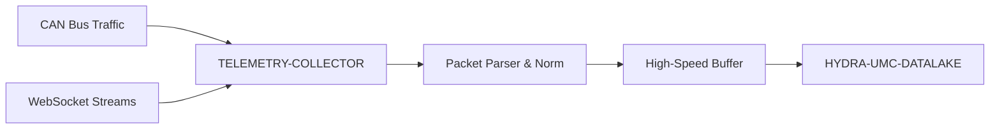

<!-- =============================================================================
HYDRA-UMC-TELEMETRY-COLLECTOR - Ingestion node for CAN, WebSocket and MQTT telemetry
Copyright (C) JuanenRac (Electro Hobby 3D) <electrohobby3d@gmail.com>
GPL-3.0-or-later - see LICENSE
============================================================================= -->

<p align="center">
  
</p>

# 📡 HYDRA-UMC-TELEMETRY-COLLECTOR

<p align="center"><a href="README.md">🇺🇸 English</a> | <a href="README_spa.md">🇪🇸 Español</a> | <a href="README_fra.md">🇫🇷 Français</a> | <a href="README_ita.md">🇮🇹 Italiano</a> | <a href="README_deu.md">🇩🇪 Deutsch</a> | 🇨🇳 <b>简体中文</b> | <a href="README_jpn.md">🇯🇵 日本語</a> | <a href="README_por.md">🇵🇹 Português</a></p>

### 🚀 面向 CAN 和 WebSocket 日志的高吞吐量摄取节点

<p align="center">
  
  
  
  
  
  
</p>

---

> **安全与安防现状:**本生态系统不是经认证的安全系统。目前尚无硬件 E-STOP 通路,没有由固件强制执行的限位或联锁,也没有经过验证的运动指令;固件映像使用 CRC-32 和 Ed25519 签名校验,发布构建会拒绝已公开的开发密钥(中继之后的工具头和扩展板仍运行 URTC 的引导程序,它们使用共享密钥的 HMAC-SHA256 而不是签名);TLS 与双向 TLS 均为可选项,默认关闭;自制电路板尚未组装或测试。在依赖此处任何说法来保障人身安全之前,请先阅读[安全基线](https://github.com/JuanenRac/HYDRA-UMC-DOCS/blob/main/docs/SECURITY_BASELINE.md)和[威胁模型](https://github.com/JuanenRac/HYDRA-UMC-DOCS/blob/main/docs/THREAT_MODEL.md)。

---

## 📋 速览

| | |
|---|---|
| 版本 | `0.1.9` |
| 成熟度 | 可用 |
| 测试 | 138 (`go test ./...`) |
| 技术栈 | Go / CAN/WebSocket parsers / bounded FIFO buffer / HTTP API |
| 目标 | HYDRA-UMC 工作单元的 Raspberry Pi CM5 |
| 真实硬件 | 尚未：此版本没有在真实硬件上运行的记录 |

**跳转：** [概述](#-概述) · [架构](#-架构) · [安全与防护](#-安全与防护) · [配置](#-配置) · [快速开始](#-快速开始) · [测试](#-测试) · [故障排除](#-故障排除) · [仓库结构](#-仓库结构) · [相关项目](#-相关项目)

## 🚦 项目状态

每一行是本仓库的一个部分，灯号表示它今天做到了哪一步。内容依据仓库能够展示的证据（测试、构建、运行），而不是计划。

🟢 已完成并验证 · 🟡 可用，有已知限制 · 🟠 部分完成或尚未验证 · 🔴 未完成或不可用

| 领域 | 状态 | 在这里的含义 |
|---|---|---|
| 软件 | 🟡 | 主要用途可用；上面的诚实性检查列出了仍然缺少的内容 |
| 测试 | 🟢 | 138 项自动测试，每次变更都会运行 |
| 真实硬件 | 🔴 | 尚未：此版本没有在真实硬件上运行的记录 |
| 文档 | 🟢 | 八种语言的 README，每次变更都会与清单核对 |

## 🎯 概述

**HYDRA-UMC-TELEMETRY-COLLECTOR** 是接收通过 HTTP 推送给它的遥测数据并写入 Datalake 的摄取网关。它把收到的 CAN 帧和 WebSocket JSON 消息解析为规范化样本;它自己目前不监听 CAN 总线(计划中)。

它对异构输入进行规范化和去重,使 CAN 总线上的电机电流尖峰等读数日后可以与其他序列关联(计划中:与 Vision Node 的 AI 推理结果关联;目前尚无此类推理)。

### 关键特性：
* 🚀 **多协议摄取：** 目前通过简单的 HTTP 摄取 API 处理 CAN 和 WebSocket 遥测数据。*(gRPC 摄取计划中)*
* ⚡ **吞吐量：** 面向工厂遥测，而不是总线抓包：使用默认值时，采集器每秒最多投递 250 个样本（每 2 秒一批 500 个，通过一次批量请求发送到 HYDRA-UMC-DATALAKE；若该数据湖没有批量路由或使用 `-datalake-batch=false`，则每个样本一次请求）；超过后缓冲区会被填满，写入将返回 `503`。
* 🧬 **数据归一化：** 将原始二进制数据包转换为标准化的 JSON 格式。*(Protobuf 输出仍处于计划阶段，尚未实现)*
* 🛡️ **带缓冲的投递：** 采集器已接收的样本不会在数据库或网络中断期间被丢弃：正在投递的批次保留其位置，缓冲区满时会拒绝新样本（`503`），而不是丢弃旧样本。缓冲区在内存中，因此重启采集器会丢失其中的内容。
* 🔁 **重连安全去重：** 一个可选的按生产者维护的序列号，在有界重排序窗口内跟踪，使得重新连接并重发最后几条未确认消息的设备永远不会使摄取计数虚增。*(已实现)*
* 🧭 **合理的输入：** 以秒而非毫秒表示的时间戳、比时钟提前超过 5 分钟的时间戳（`-max-future-skew`），以及过长或含不可见字符的 `sourceId` 会被拒绝（`400`）；重启后计数器从头开始的生产者会被识别（`GET /stats` 中的 `producerResets`），而不是把它的新样本当作重复项拒绝。*(已实现)*
* 🩺 **真实故障诊断：** 每次刷新失败都会被分类为 sink 真正拒绝了数据，还是传输层出现了问题——通过 `GET /stats` 暴露，提供真实的运维可见性。*（已实现）*
* 🧮 **有限字段验证：** 空字段名或 `NaN`/`Infinity`/`-Infinity` 数值会在到达缓冲区或 sink 之前被拒绝（`400`）——CAN 解码也会经过与 JSON 接入相同的 `Sample.Validate()` 校验。*（已实现）*
* 📊 **Prometheus 指标：** `GET /metrics` 以真正的 Prometheus 文本格式提供与 `GET /stats` 相同的实时摄取与丢失计数器（已摄取、已丢弃、已隔离、传输与无效数据导致的发送失败、缓冲区占用）。 *(已实现)*
* 🧰 **故障、优先级与受保护的指标（均为可选）：** `-spool <文件>` 把数据湖长时间故障期间的样本保存在磁盘上（由 `-spool-max-bytes` 限制），恢复后优先重发；`-priority 类型=级别,...` 让已满的缓冲区丢弃最不重要的样本以容纳更重要的样本（计入 `evicted`）；`-datalake-permanent-statuses 401,403,404` 直接丢弃而不是无限重试；`-metrics-token` 让 `GET /stats` 与 `GET /metrics` 需要令牌。还会报告最近一次与最慢一次发送的延迟，以及缓冲区中最旧样本的存在时间。全部默认关闭。 *(已实现)*
* 📉 **按类型降采样(可选，默认关闭):** `-downsample 类型=间隔毫秒[:函数]` 会在样本进入缓冲区之前，把高频类型的样本按时间桶和来源合并为一条(每个字段取平均、最小、最大、最后一个或求和)。缓冲区满时已关闭的时间桶不会丢失，未关闭的时间桶在关闭时交付，`/stats` 和 `/metrics` 会统计被合并的样本数。

## 🧩 在 HYDRA-UMC 中的角色

**HYDRA-UMC-TELEMETRY-COLLECTOR** 接收来自 CAN 帧、WebSocket 消息和桥接 MQTT 状态的遥测数据，丢弃重发造成的重复，保持有界缓冲，并把批次交给 `HYDRA-UMC-DATALAKE`；可选的磁盘缓存用于应对中断。没有数据湖时，它会打印本该写入的内容。

## 🏛️ 架构

<p align="center">
  
</p>

<details>
<summary>图表的文本版本（Mermaid）</summary>



</details>

### 架构与设计决策

* **为何 `src/` 是 Go 模块根目录，而非仓库根目录。** 使可安装模块自身的文件（`main.go`、`version.go`、`go.mod`）与仓库根目录的工具（`bump_version.py`、`docker-compose.yml`）分离——`go build ./...` 在 `src/` 内部运行，而非仓库根目录。
* **为何数据采集与 HYDRA-UMC-DATALAKE 本身是分离的。** 数据采集（轮询 HYDRA-UMC-SERVER、缓冲、批量写入）是一项与存储/查询截然不同的 I/O 密集型任务——将其保持为独立进程，意味着一次采集器重启或背压峰值不会触及数据湖自身的查询路径。
* **为何 sink 写入失败会将该批次重新入队，而非直接丢弃——但那一条永远不会成功的样本除外。** `src/collector` 才是真正兑现「带缓冲的投递：零数据丢失」这一承诺的地方——`FlushOnce` 只有在 `Sink.Write` 确认后才会把已取出的批次从缓冲区中移除，出现传输层故障时会把它直接放回队首——真实的服务中断会重试同一批样本，而不是丢失它们。唯一的例外是 sink 自身永久拒绝为无效的样本（见下文 `sink.InvalidDataError`）——无条件将它重新入队，过去会让它永远停留在队首，阻塞它后面所有有效的样本；现在它会被隔离（丢弃，计入 `GET /stats` 的 `quarantined`），而批次中的其余部分仍会照常重新入队。不过缓冲区（`src/buffer`）仍然是有界的——如果中断持续时间超过其容量，确实会丢弃最旧的多余部分，这是一个真实、诚实的限制，而不是承诺无限内存。
* **为何 CAN 和 WebSocket 都被解析为同一个 `Sample` 形态。** `src/telemetry` 在任何东西触及缓冲区或 sink 之前，就把这两种异构来源归一化为同一个结构体——这正是「CAN 总线上的电机电流尖峰与 Vision Node 的推理结果正确关联」背后的真实机制：下游任何阶段都无需知道某个样本最初是通过哪种协议到达的。
* **为何 CAN 线路格式是本项目自己的 v0 约定，而非生态系统真正的 CAN ID。** 真正的 CAN ID 表存在于 HYDRA-UMC 和 URTC 各自的固件文档中——真正对接它们是未来的工作，在没有那份参考资料的情况下猜测是不可取的。
* **为何 `DatalakeSink` 每个样本发送一次 HTTP 请求。** HYDRA-UMC-DATALAKE 的 `POST /ingest` 一次接收一个样本，所以"批量写入"实际上是按顺序发出的 N 个请求，遇到第一个失败就停止。`PartialWriteError` 会告知已确认多少个（`202`），只重试其余部分；被 sink 判定为无效（`400` 或 `413`）的样本是唯一被丢弃的，其后的样本会被重试。只有在 DATALAKE 已接受请求但应答丢失时才可能出现重复行，而 DATALAKE 对每个（来源、类型、字段、时间戳）只保留一个值，因此重发是覆盖而不是重复。
* **它如何融入生态系统的其余部分。** HYDRA-UMC-DATALAKE 之下的兄弟服务：接收生产者通过 HTTP 推送给它的遥测数据，并写入共享的时序存储。它不会主动轮询任何东西，目前生态系统中也没有任何组件向它发送数据：生产者（订阅 Server 的机器人增量、CM5 上的 SocketCAN 读取器）仍有待编写。
* **为何去重是一个独立的 `dedup` 包，以可选的 `Sequence` 为键，而非对样本自身内容做哈希。** 真实的重连会重发完全相同的字节，因此内容哈希对这种情况确实有效——但它也会悄悄吞掉两个碰巧所有字段都相同的、真正不同的样本（例如相隔一秒的两次 `0.0` 读数）。按生产者维护的序列号正是真实设备本就需要用来跟踪自身未确认消息的东西，因此复用它才是诚实、真实的信号——而不是从并不真正承诺唯一性的数据中猜测出来的东西。`Sequence == 0`/省略会使某个生产者完全选择退出去重，因此对于不发送该字段的设备，既有行为不会有任何变化。
* **为何 `sink.InvalidDataError` 携带被拒绝样本在批次中的 `Index`。** 在一次生态系统范围的软件改进审计中发现（P1）：`DatalakeSink.Write` 每次 HTTP 请求发送一条样本，遇到第一个失败就停止，因此当 DATALAKE 针对某条具体样本返回真实的 HTTP 400 时，`Write` 会在返回错误之前，把该样本在批次中的位置记录到错误本身上。`FlushOnce` 利用这一点，精确地隔离（永久丢弃，永不重新入队）那一条样本——重试完全相同、已被拒绝的字节永远不可能成功——同时批次中的其余部分仍会照常重新入队，而不是让整个批次永远在一条有毒样本后面被反复重试（并反复被阻塞）。`GET /stats` 中的 `quarantined` 统计的正是这样被丢弃的样本数，与 `invalidDataErrors`（flush 尝试次数，而非样本数）以及 `dropped`（缓冲区已满的容量限制，而非永久拒绝）是分开的——所以这一切都不是静默丢弃，`invalidDataErrors` 与 `transportErrors` 仍然让运维人员无需从日志中猜测，就能分辨出「DATALAKE 正在拒绝我们的数据」还是「到 DATALAKE 的网络中断了」。

## 🔒 安全与防护

| 威胁 | 防御 | 位置 |
|---|---|---|
| 网络上任何人向摄取路由写入数据 | 使用非回环 `-addr` 且没有令牌时，除非给出 `-allow-anonymous`，采集器拒绝启动；令牌来自 `HYDRA_UMC_TELEMETRY_COLLECTOR_TOKEN` | `src/guard.go` |
| 时间戳在遥远未来的样本，或大量的来源 | 比时钟提前超过 5 分钟的样本会被拒绝（`-max-future-skew`），来源 ID 最长 128 个字符，请求体最大 1 MiB，去重表最多 10 000 个来源 | `src/telemetry/sample.go`, `src/api/api.go`, `src/dedup/dedup.go` |
| 代理的凭据以明文传输 | 向另一台机器上的代理发送用户名和密码需要 `tls://`，或显式的 `-mqtt-allow-plaintext`；密码来自文件或 `HYDRA_UMC_TELEMETRY_MQTT_PASSWORD`，从不通过选项传入 | `src/main.go`, `src/mqttin/client.go` |

## ⚙️ 配置

全部通过选项配置；密钥也可以来自环境变量。

| 变量 | 默认值 | 设置内容 |
|---|---|---|
| `-addr` | `127.0.0.1:8092` | HTTP API 的地址 |
| `-buffer` | `10000` | 等待投递时保留的样本数 |
| `-flush-interval` | `2s` | 缓冲区清空的频率 |
| `-batch-size` | `500` | 每次清空的最大样本数 |
| `-datalake-url` | 无 | 要写入的数据湖；为空则打印到标准输出 |
| `-token` / `HYDRA_UMC_TELEMETRY_COLLECTOR_TOKEN` | 无 | 摄取路由所需的 Bearer 令牌 |
| `-metrics-token` / `HYDRA_UMC_TELEMETRY_COLLECTOR_METRICS_TOKEN` | 无 | `GET /stats` 和 `GET /metrics` 所需的令牌 |
| `-datalake-token` / `HYDRA_UMC_DATALAKE_TOKEN` | 无 | 随每个样本发送给数据湖的令牌 |
| `-spool`, `-spool-max-bytes` | 关闭；256 MiB | 保存数据湖中断期间样本的文件及其大小上限 |
| `-mqtt-url` | 无 | 读取桥接状态的代理；为空则关闭 MQTT 输入 |

## 🚀 快速开始

需要 Go 1.24 或更高版本。

```bash
./build.sh  # Linux, macOS (build.bat on Windows)
./run.sh -addr 127.0.0.1:8092
./run.sh -addr 127.0.0.1:8092 -datalake-url http://localhost:8095 -spool spool.jsonl
```

## 🧪 测试

运行 `cd src && go test ./...` 会执行 138 个自动测试。 不需要硬件，也不需要这台机器以外的任何东西。

CI 运行 `HYDRA_UMC_CI=1 python tools/ci_validate.py`，检查清单、文档、八个 README 和图片。

## 🏗️ 构建与发布

需要 Go >= 1.21。一个带有 HTTP API 的真实摄取流水线，而不只是一个能
编译的骨架。

```bash
# Linux/macOS
./build.sh
./run.sh -addr 127.0.0.1:8092 -datalake-url http://localhost:8095

# Windows
build.bat
run.bat -addr 127.0.0.1:8092 -datalake-url http://localhost:8095
```

`build` 不会更改版本号，并将 `src/` 中的 Go 模块编译
为 `build/telemetry-collector(.exe)`。`run` 执行编译后的二进制文件，
转发任何标志，并开始监听真实流量。`-datalake-url` 会将刷新后的批次
指向一个真实的、正在运行的 HYDRA-UMC-DATALAKE 实例（`POST /ingest`，
`sink.DatalakeSink`）——省略该参数则改为将刷新的样本打印到 stdout
（`sink.ConsoleSink`），便于独立运行该 collector：

默认情况下，collector 只在回环地址上监听，其摄取路由对本地调用方开放。若要在网络地址上监听，必须为它提供 Bearer 令牌（`-token`，或 `HYDRA_UMC_TELEMETRY_COLLECTOR_TOKEN`；至少 16 个字符）：此时 `POST /ingest/can` 和 `POST /ingest/ws` 要求 `Authorization: Bearer <token>`（`/stats` 和 `/metrics` 保持开放，本地采集器无需任何密钥）。非回环的 `-addr` 若没有令牌，启动时会被拒绝，除非传入 `-allow-anonymous`。请求体上限为 1 MiB（超出返回 `413`），HTTP 服务器还会应用读取、写入和空闲超时。

**通过 MQTT 读取各个网桥。** 使用 `-mqtt-url tcp://127.0.0.1:1883`(或 `tls://broker:8883`,私有证书颁发机构用 `-mqtt-ca-file`)后,采集器还会订阅 `hydra/bridges/+/state` 和 `hydra/bridges/+/availability`(`-mqtt-topics`),并把每条消息变成一个样本:`bridge_state` 包含状态中的每个数值和标志(嵌套一层)以及 `machine_state.<值>` 标志,时间戳取网桥的 `observed_at`;`bridge_availability` 的 `online` 为 1 或 0。比 `-mqtt-max-age`(默认 2 分钟)更旧的保留状态是代理的记忆而不是读数,会被跳过。用户名来自 `-mqtt-username` 或 `HYDRA_UMC_TELEMETRY_MQTT_USER`,密码来自 `-mqtt-password-file` 或 `HYDRA_UMC_TELEMETRY_MQTT_PASSWORD`;通过明文连接向另一台机器发送凭据会被拒绝,除非加上 `-mqtt-allow-plaintext`。该输入默认关闭,`GET /stats` 在 `mqtt` 下报告其连接和计数。尚未用生态系统的真实代理试过。

```bash
# 摄取一个 WebSocket 风格的遥测样本
curl -X POST localhost:8092/ingest/ws \
  -d '{"sourceId":"robot-1","kind":"motor_temp","timestamp":1700000000000,"fields":{"value":42.5}}'

# 摄取一个 CAN 帧（8 字节，base64——格式见 src/telemetry/can.go）
curl -X POST localhost:8092/ingest/can \
  -d '{"arbitrationId":7,"data":"AQAAUEEAAAA="}'

# 查看 collector 已摄取/已刷新/已丢弃的数据
curl localhost:8092/stats
```

```bash
cd src && go test ./...   # telemetry（CAN 往返、WS 校验）、buffer
                           # （有界 FIFO、背压、requeue）、collector
                           # （"sink 中断时不丢数据"的真实行为），以及
                           # api（通过 httptest 的真实 HTTP 往返测试）
```

## 🩺 故障排除

| 你看到 | 原因 | 处理 |
|---|---|---|
| HTTP 503 | 缓冲区已满，且没有优先级允许丢弃排队中的样本 | 检查数据湖，添加 `-spool`，增大 `-buffer` 或设置 `-priority` |
| HTTP 401 | 已设置令牌，而请求没带或带错了 | 发送 `Authorization: Bearer <token>` |

## 📂 仓库结构

<p align="center">
  
</p>

<details>
<summary>目录树的文本版本</summary>

```text
HYDRA-UMC-TELEMETRY-COLLECTOR/
├── src/                       Go 模块
│   ├── go.mod                 模块定义
│   ├── version.go             const Version = "X.Y.Z"
│   ├── main.go                入口点：连接一切，启动 HTTP API
│   ├── guard.go               启动守卫：除非设置了 Bearer 令牌，否则仅限回环
│   ├── guard_test.go          仅限本机回环的启动保护测试
│   ├── mqttin/                把各 bridge 通过 MQTT 发出的内容 (状态、可用性) 转为遥测样本
│   ├── telemetry/             Sample 类型 + CAN/WebSocket 解析器（归一化）
│   ├── buffer/                带背压报告的有界 FIFO（Ring）
│   ├── dedup/                 真实的按生产者序列号去重（重排序窗口）
│   ├── collector/             编排摄取+刷新，sink 失败时重试，去重
│   ├── sink/                  已刷新批次的去向 (经 HTTP 的数据湖或控制台),传输错误与无效数据的分类
│   ├── spool/                 可选的磁盘队列，保存目标长时间故障期间的样本
│   └── api/                   封装 collector 的简单 JSON/HTTP 处理器
├── docs/                      项目文档
├── images/                    媒体与图表
├── systemd/                   服务单元
├── tools/                     项目工具和 CI 检查
├── .github/                   CI 工作流和 Issue 模板
├── bump_version.py            显式提升版本
├── bump_manifest_version.py   将 hydra-umc.project.json 的版本与原生版本同步(--sync)
├── build.sh / build.bat       验证并构建（构建不会更改版本）
├── run.sh / run.bat           真实运行：执行编译后的二进制文件
├── CHANGELOG.md               每个版本的变更
├── build-test.sh              不修改内容的构建检查
├── hydra-umc.project.json     清单：版本、成熟度、系列
└── test.sh                    运行测试
```

</details>

## 🗺️ 路线图与已知限制

**当前已知限制**

* **第一阶段：** 数据湖的高吞吐量摄取和索引，用于历史分析。
* **第二阶段：** 遥测采集器的边缘压缩和安全传输协议。
* **第三阶段：** 使用无监督学习和电机振动分析进行异常检测。
* **第四阶段：** 用于海量日志摄取的实时压缩以及多协议优化。

## 🌍 语言

本 README 和仓库文档提供八种语言：英语、西班牙语、德语、法语、意大利语、日语、中文和葡萄牙语（葡萄牙）。它们同时编写，并由 CI 检查八个文件拥有相同的章节和相同的链接。 本仓库没有自己的界面或消息目录，因此没有需要翻译的界面文字。

## 🔗 相关项目

本项目是同一作者(JuanenRac / Electro Hobby 3D)打造的 HYDRA-UMC 机器人生态系统的一部分。值得了解,因为某个请求实际上可能是关于这些项目之一,而非本仓库本身。

**父项目**
- **[HYDRA-UMC-DATALAKE](https://github.com/JuanenRac/HYDRA-UMC-DATALAKE)** — 具备真实数据摄入/查询 HTTP API 的真实 sqlite3 时序数据存储;本仓库是其自身数据与分析层中一个具体分析服务所属的父项目。

**兄弟项目** —— HYDRA-UMC-DATALAKE 自身数据与分析层中的其他分析服务
- **[HYDRA-UMC-ANOMALY-DETECTOR](https://github.com/JuanenRac/HYDRA-UMC-ANOMALY-DETECTOR)** — 具备漂移监测能力的真实 FFT + 统计基线异常检测器。
- **[HYDRA-UMC-PRODUCTION-REPORTS](https://github.com/JuanenRac/HYDRA-UMC-PRODUCTION-REPORTS)** — 基于 DATALAKE 历史数据的真实 OEE/可用率计算，支持可复现的 CSV 导出。

**直接相关**
- **[HYDRA-UMC-SERVER](https://github.com/JuanenRac/HYDRA-UMC-SERVER)** — 每个控制客户端真正通信的真实无头后端(REST/WebSocket) —— 本项目摄取日志的来源。
- **[HYDRA-UMC](https://github.com/JuanenRac/HYDRA-UMC)** — 机器人手臂主板设计——CM5 主机 + 双核 STM32H745,目标是通过 CAN-OTA/SPI-OTA 协调最多 8 条工具臂(固件处于早期阶段,尚无已组装的电路板);目前使用自身的 v0 约定,诚实地作为未来工作跟踪,而非宣称已完成。
- **[URTC](https://github.com/JuanenRac/URTC)** — 面向实体 Universal Robot Tool Controller 板卡的固件，通过 CAN 总线支持 25 种以上工具配置 —— 本项目自身 CAN 线路格式最终计划与之集成的真实 CAN ID 表;目前使用自身的 v0 约定,诚实地作为未来工作跟踪,而非宣称已完成。

**生态系统中的其他项目**

*核心硬件与平台*
- **[HYDRA-UMC-OS](https://github.com/JuanenRac/HYDRA-UMC-OS)** — 面向 CM5 的可复现 Raspberry Pi OS 产品层——只读代理、经过验证的配置/配置文件、WiFi 首次配网。
- **[HYDRA-UMC-SDK](https://github.com/JuanenRac/HYDRA-UMC-SDK)** — 每个桥接都据此校验自身指令的共享 JSON-Schema 契约与软件作业门限边界(并非经认证的安全功能)。
- **[HYDRA-UMC-CONNECTOR-HUB](https://github.com/JuanenRac/HYDRA-UMC-CONNECTOR-HUB)** — 面向外部机器连接器的声明式适配器清单注册与校验工具；把 SDK 自身的契约理念扩展到外部机器，而不取代工业网关类项目。

*核心后端与客户端*
- **[HYDRA-UMC-STUDIO](https://github.com/JuanenRac/HYDRA-UMC-STUDIO)** — 具有实时多机器人 3D 可视化的网页控制面板。
- **[HYDRA-UMC-SUITE](https://github.com/JuanenRac/HYDRA-UMC-SUITE)** — 面向多台服务器的桌面(PySide6)集群指挥中心，打包为独立可执行文件。
- **[HYDRA-UMC-ANDROID-CONTROL](https://github.com/JuanenRac/HYDRA-UMC-ANDROID-CONTROL)** — 具有生物识别登录和配对 Wear OS 伴侣应用的原生 Android 控制应用。
- **[HYDRA-UMC-IOS-CONTROL](https://github.com/JuanenRac/HYDRA-UMC-IOS-CONTROL)** — 具有实时 WebSocket 同步的 iOS/iPadOS 控制应用(Flutter)。
- **[HYDRA-UMC-DSI](https://github.com/JuanenRac/HYDRA-UMC-DSI)** — 面向机载 7 英寸 DSI 触摸屏的原生触控界面，直接嵌入 CM5 本体。
- **[HYDRA-UMC-EDITOR-URDF](https://github.com/JuanenRac/HYDRA-UMC-EDITOR-URDF)** — 将完成的模型推送到 STUDIO 自身目录的桌面版图形化 URDF 创建/编辑工具。
- **[HYDRA-UMC-EDITOR-STL](https://github.com/JuanenRac/HYDRA-UMC-EDITOR-STL)** — 桌面 STL 模型编辑器，在 HYDRA-UMC-EDITOR-URDF 编辑的同一模型目录中变换/替换/移除/添加真实部件。
- **[HYDRA-UMC-BRIDGE-AMR](https://github.com/JuanenRac/HYDRA-UMC-BRIDGE-AMR)** — 通过 VDA 5050 MQTT 发布者为 AGV/AMR 车队提供的协调边界(仅针对仿真车队测试)。
- **[HYDRA-UMC-BRIDGE-CNC](https://github.com/JuanenRac/HYDRA-UMC-BRIDGE-CNC)** — 具备 GRBL 状态/控制字节访问能力的高层 CNC 单元协调器(仅针对模拟器测试)。
- **[HYDRA-UMC-BRIDGE-DROIDS](https://github.com/JuanenRac/HYDRA-UMC-BRIDGE-DROIDS)** — 面向足式/人形机器人的协调边界,带有 Boston Dynamics Spot 指令发送器(仅针对模拟器测试)。
- **[HYDRA-UMC-BRIDGE-LASER](https://github.com/JuanenRac/HYDRA-UMC-BRIDGE-LASER)** — 读取 3 路钥匙/外壳/联锁 GPIO 信号的激光单元协调器(仅针对模拟芯片测试;无法使激光器上膛或发射)。
- **[HYDRA-UMC-BRIDGE-OPENPNP](https://github.com/JuanenRac/HYDRA-UMC-BRIDGE-OPENPNP)** — 面向 OpenPnP 贴片机板级流程的安全高层协调器。
- **[HYDRA-UMC-BRIDGE-PRINTER3D](https://github.com/JuanenRac/HYDRA-UMC-BRIDGE-PRINTER3D)** — 面向 Moonraker/Klipper 3D 打印机的安全协调边界，具备真实的受控作业指令。
- **[HYDRA-UMC-BRIDGE-ROS2](https://github.com/JuanenRac/HYDRA-UMC-BRIDGE-ROS2)** — 带有惰性导入 rclpy ROS 2 传输层的协调器(尚未在 ROS 2 环境中运行)。
- **[HYDRA-UMC-BRIDGE-UAV](https://github.com/JuanenRac/HYDRA-UMC-BRIDGE-UAV)** — 面向搭载摄像头的无人机的协调边界,带有 MAVLink 指令发送器(仅针对模拟器测试)。

*URTC 工具平台*
- **[URTC-FLASHER](https://github.com/JuanenRac/URTC-FLASHER)** — 面向 URTC 板卡的桌面图形烧录工具，支持 CAN-OTA 以及全芯片 SWD/JTAG。
- **[URTC-TESTER](https://github.com/JuanenRac/URTC-TESTER)** — 面向 URTC 板卡的桌面实时 CAN 总线诊断工具，每种工具配置对应一个面板。
- **[URTC-WEB-STUDIO](https://github.com/JuanenRac/URTC-WEB-STUDIO)** — 通过 Web Serial API 实现的浏览器版 URTC-TESTER 替代方案，无需本地安装。
- **[URTC-GATEWAY](https://github.com/JuanenRac/URTC-GATEWAY)** — URTC CAN 总线前的网关：允许的标识符列表、速率限制和会话密钥；软件已在计算机上测试，尚未在真实总线上测试。

*视觉 AI 节点(Hailo-8)*
- **[HYDRA-UMC-VISION-NODE](https://github.com/JuanenRac/HYDRA-UMC-VISION-NODE)** — 面向 Hailo-8 视觉流水线的集成中枢，具备逐阶段的真实硬件就绪检测。
- **[HYDRA-UMC-DETECTION-HEF](https://github.com/JuanenRac/HYDRA-UMC-DETECTION-HEF)** — 具备 Hailo 架构/校验和安全加载验证的真实编译模型注册表。
- **[HYDRA-UMC-VISION-STREAMER](https://github.com/JuanenRac/HYDRA-UMC-VISION-STREAMER)** — 具备真实 HailoRT 集成边界的真实 GStreamer 流水线 + MediaMTX 配置生成器。
- **[HYDRA-UMC-VISUAL-SERVOING-API](https://github.com/JuanenRac/HYDRA-UMC-VISUAL-SERVOING-API)** — 以区域状态为授权条件的 Position-Based Visual Servoing 修正律;尚无摄像头位姿估计。
- **[HYDRA-UMC-SAFETY-ZONES](https://github.com/JuanenRac/HYDRA-UMC-SAFETY-ZONES)** — 从文件读取物体位置的 v0 区域入侵、校准新鲜度与 E-STOP 请求逻辑;没有检测器为其供数,也尚未连接任何物理 E-STOP。

*认知 AI 节点(Hailo-10)*
- **[HYDRA-UMC-COGNITIVE-NODE](https://github.com/JuanenRac/HYDRA-UMC-COGNITIVE-NODE)** — 面向 Hailo-10 认知流水线(LLM/VLA/语音编排)的集成中枢。
- **[HYDRA-UMC-VLA-ENGINE](https://github.com/JuanenRac/HYDRA-UMC-VLA-ENGINE)** — 面向 Vision-Language-Action 模型的真实动作 token 编解码与轨迹生成。
- **[HYDRA-UMC-VOICE-UI](https://github.com/JuanenRac/HYDRA-UMC-VOICE-UI)** — 具备受限、需确认的 Watch 中继的真实语音前端(VAD + 意图解析)。
- **[HYDRA-UMC-SEMANTIC-PLANNER](https://github.com/JuanenRac/HYDRA-UMC-SEMANTIC-PLANNER)** — 基于真实规则的任务分解，以及针对 MCU 错误码的语义化错误恢复。
- **[HYDRA-UMC-DOCS-QA](https://github.com/JuanenRac/HYDRA-UMC-DOCS-QA)** — 面向本生态系统自身 Markdown 文档的真实纯标准库 TF-IDF 文档检索。
- **[HYDRA-UMC-LOCAL-TECHNICIAN](https://github.com/JuanenRac/HYDRA-UMC-LOCAL-TECHNICIAN)** — 面向生态系统自身的本地、按策略门控的 AI 维护技师——观察、诊断并提出修复建议;两个最高风险等级目前特意尚未实现。

*编排与集群*
- **[HYDRA-UMC-ORCHESTRATOR](https://github.com/JuanenRac/HYDRA-UMC-ORCHESTRATOR)** — 具备真实 gRPC/Protobuf 健康报告契约与任务状态机的集成中枢。
- **[HYDRA-UMC-JOB-DISPATCHER](https://github.com/JuanenRac/HYDRA-UMC-JOB-DISPATCHER)** — 基于真实 HTTP API 的真实优先级任务队列，支持去重。
- **[HYDRA-UMC-NODE-HEALING](https://github.com/JuanenRac/HYDRA-UMC-NODE-HEALING)** — 具备重试/退避与身份不匹配检测的真实基于 gRPC 的车队健康看门狗。
- **[HYDRA-UMC-PATH-PLANNER-3D](https://github.com/JuanenRac/HYDRA-UMC-PATH-PLANNER-3D)** — 具备真实障碍物/工作空间碰撞校验的真实基于 RRT 的三维路径规划器。
- **[HYDRA-UMC-SWARM-SYNC](https://github.com/JuanenRac/HYDRA-UMC-SWARM-SYNC)** — 经过多单元收敛属性测试的真实 CRDT LWW-Element-Map 状态同步。

*数字孪生与仿真*
- **[HYDRA-UMC-TWIN](https://github.com/JuanenRac/HYDRA-UMC-TWIN)** — 面向数字孪生引擎的集成中枢，具备真实的版本兼容性同步契约。
- **[HYDRA-UMC-HIL-BRIDGE](https://github.com/JuanenRac/HYDRA-UMC-HIL-BRIDGE)** — 在仿真与真实硬件之间带有软件碰撞联锁的硬件在环路由器(未在真实硬件上测试)。
- **[HYDRA-UMC-PHYSICS-REPLICA](https://github.com/JuanenRac/HYDRA-UMC-PHYSICS-REPLICA)** — 面向真实 URDF 子集的真实正向运动学与关节限位校验。
- **[HYDRA-UMC-SYNTHETIC-DATA-GEN](https://github.com/JuanenRac/HYDRA-UMC-SYNTHETIC-DATA-GEN)** — 具备 YOLO/COCO 标注导出功能的真实程序化 2D 场景生成器。

*工业网关*
- **[HYDRA-UMC-GATEWAY-INDUSTRIAL](https://github.com/JuanenRac/HYDRA-UMC-GATEWAY-INDUSTRIAL)** — 中继至工业协议的集成中枢，具备真实的指令白名单/背压控制层。
- **[HYDRA-UMC-OPCUA-SERVER](https://github.com/JuanenRac/HYDRA-UMC-OPCUA-SERVER)** — 经真实二进制协议客户端会话验证的真实 OPC-UA 地址空间。
- **[HYDRA-UMC-MQTT-BROKER](https://github.com/JuanenRac/HYDRA-UMC-MQTT-BROKER)** — 具备可选按客户端认证与主题 ACL 的真实 MQTT 代理。
- **[HYDRA-UMC-MTCONNECT-ADAPTER](https://github.com/JuanenRac/HYDRA-UMC-MTCONNECT-ADAPTER)** — 具备降级模式输出的真实 MTConnect `/probe` 与 `/current` XML 端点。

*辅助工具与生态系统运维*
- **[HYDRA-UMC-DASHBOARD-AI](https://github.com/JuanenRac/HYDRA-UMC-DASHBOARD-AI)** — 基于 DATALAKE/ANOMALY-DETECTOR 的智能摘要与异常高亮面板，具备诚实的统计回退机制。
- **[HYDRA-UMC-TOOL-CLI](https://github.com/JuanenRac/HYDRA-UMC-TOOL-CLI)** — 具备真实、稳定退出码契约的车队 CLI，是 HYDRA-UMC-SERVER 自身 API 的真实在线客户端。
- **[HYDRA-UMC-WATCH](https://github.com/JuanenRac/HYDRA-UMC-WATCH)** — 带有触觉提醒模式与配对手机语音中继的 WearOS 伴侣应用(尚未在实体手表上运行)。
- **[URTC-SMART-RACK](https://github.com/JuanenRac/URTC-SMART-RACK)** — 面向板卡安装机架的固件，具备真实的工具 ID 解码与 Smart Idle 预热逻辑。
- **[URTC-VISION-TOOL](https://github.com/JuanenRac/URTC-VISION-TOOL)** — 面向热成像/RGB 检测工具头的固件及真实 Python 视觉伴侣程序。
- **[HYDRA-UMC-UPDATER](https://github.com/JuanenRac/HYDRA-UMC-UPDATER)** — 发现、克隆并更新本生态系统中每个仓库的管理类桌面工具。
- **[HYDRA-UMC-OS-REBUILDER](https://github.com/JuanenRac/HYDRA-UMC-OS-REBUILDER)** —— 构建即刻可烧录、预装生态系统最新版本的 CM5 镜像的 Windows/Linux 桌面工具,具备类似 Raspberry Pi Imager 风格的首次启动 Wi-Fi/用户/SSH 配置。
- **[HYDRA-UMC-OPS-AGENT](https://github.com/JuanenRac/HYDRA-UMC-OPS-AGENT)** — 维护事件协调器：一个低权限的边缘角色采集经过脱敏的库存/健康快照，一个控制面角色以只读方式渲染它，并请求某个 AI 提供方给出诊断建议——从不应用补丁，也从不部署任何内容。
- **[HYDRA-UMC-DEV-SERVER](https://github.com/JuanenRac/HYDRA-UMC-DEV-SERVER)** — 可复现的开发主机（Raspberry Pi 5 / CM5），保存整个生态系统的源代码，并在持久队列下运行有界的构建/测试任务；这是专用的开发角色，明确区别于运行中的 CM5。

## 📚 文档

更多阅读：

* [生态系统的安全基线](https://github.com/JuanenRac/HYDRA-UMC-DOCS/blob/main/docs/SECURITY_BASELINE.md)
* [生态系统的威胁模型](https://github.com/JuanenRac/HYDRA-UMC-DOCS/blob/main/docs/THREAT_MODEL.md)
* [本仓库的更新日志](CHANGELOG.md)
* [本仓库的许可证](LICENSE.md)

## 🤝 参与贡献与社区

* 提交 pull request 之前，请运行 `HYDRA_UMC_CI=1 py -3 tools/ci_validate.py`（或 `HYDRA_UMC_CI=1 python3 tools/ci_validate.py`）：它必须输出 `CI_VALIDATION=PASS`。此检查不要运行 `build.sh` 或 `build.bat`；构建不是检查。
* 八个 README 由 HYDRA-UMC-DOCS 中的同一个源生成；请勿手工编辑。修改源文件，再用 `tools/make_readmes.py` 重新生成。
* 不要在 README 中声称尚未运行过的内容：属实时请写“仅模拟”或“尚未在硬件上试过”。
* 请参阅 [CONTRIBUTING.md](CONTRIBUTING.md)、[行为准则](CODE_OF_CONDUCT.md)、[SECURITY.md](SECURITY.md) 和 [SUPPORT.md](SUPPORT.md)。

## 👤 作者

**JuanenRac (Electro Hobby 3D)** · electrohobby3d@gmail.com

## 📜 许可证

GPL-3.0-or-later - [LICENSE](LICENSE).
